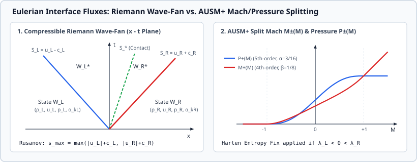
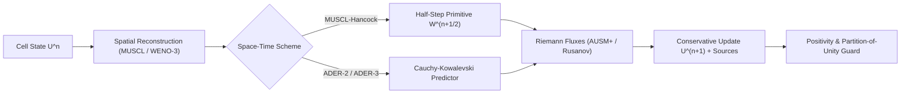
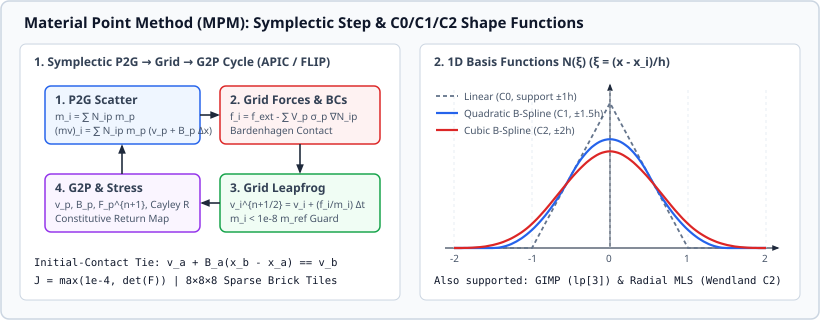
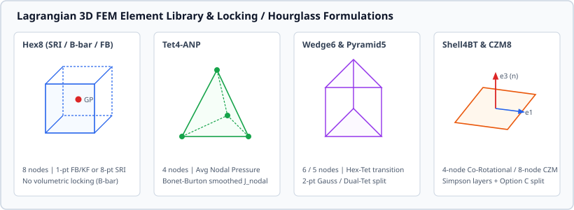
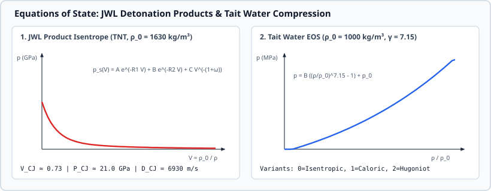
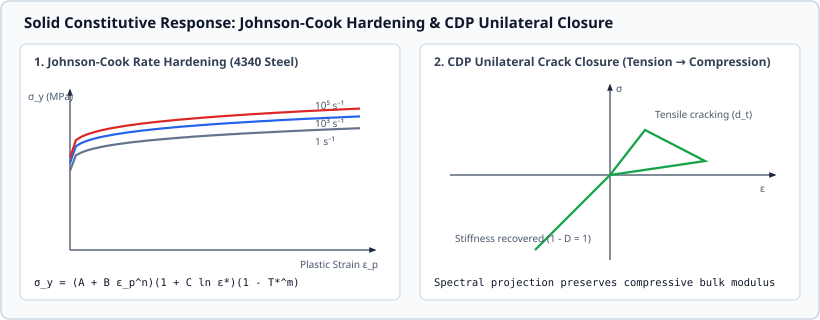
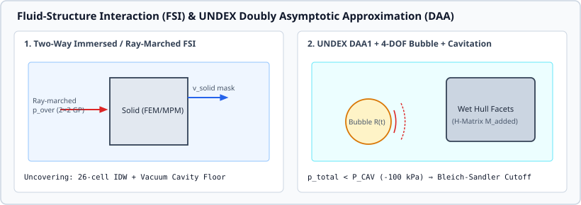
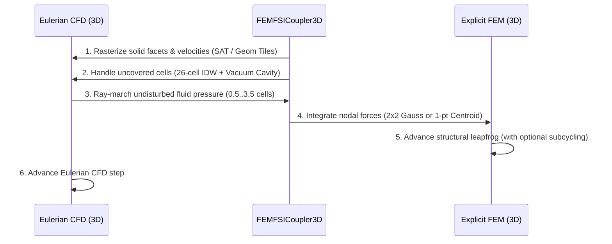

# BlastDaemon Enterprise Multi-Physics Theory Manual

<!-- BEGIN_AUTO_STAMP -->
**Last Verified Against Commit:** `9077463` (2026-11-14)
<!-- END_AUTO_STAMP -->

> **Living Technical Reference:** This manual documents the governing physics, numerical discretizations, constitutive equations, coupling algorithms, realizability safeguards, and user-configurable options implemented in **BlastDaemon**. Every method is cross-referenced to its source implementation in `backend/BlastSolver/` and its quantitative benchmarks in [VERIFICATION_MANUAL.md](VERIFICATION_MANUAL.md).

---

## Table of Contents

- [Part I: Executive Summary](#part-i-executive-summary)
  - [1. Mission & Multi-Physics Scope](#1-mission--multi-physics-scope)
  - [2. Architectural Principles & Accuracy Guarantees](#2-architectural-principles--accuracy-guarantees)
  - [3. Unit System & Sign Conventions](#3-unit-system--sign-conventions)
  - [4. Multi-Physics Capability Matrix](#4-multi-physics-capability-matrix)
  - [5. Live Verification & Validation Status](#5-live-verification--validation-status)
- [Part II: Main Technical Reference](#part-ii-main-technical-reference)
  - [Section 1: Eulerian Compressible CFD Solvers (1D, 2D, 2D AMR, 3D)](#section-1-eulerian-compressible-cfd-solvers-1d-2d-2d-amr-3d)
  - [Section 2: Lagrangian Material Point Method (MPM — 2D & 3D)](#section-2-lagrangian-material-point-method-mpm--2d--3d)
  - [Section 3: Lagrangian Finite Element Method (FEM — 3D)](#section-3-lagrangian-finite-element-method-fem--3d)
  - [Section 4: Equations of State & Constitutive Models](#section-4-equations-of-state--constitutive-models)
  - [Section 5: Fluid-Structure Interaction (FSI) & UNDEX Acoustics (DAA)](#section-5-fluid-structure-interaction-fsi--undex-acoustics-daa)
  - [Section 6: Realizability Safeguards, Diagnostics & I/O](#section-6-realizability-safeguards-diagnostics--io)
- [Part III: References & Appendices](#part-iii-references--appendices)
  - [References](#references)
  - [Appendix A: Exhaustive Node & Parameter Option Reference](#appendix-a-exhaustive-node--parameter-option-reference)

---

# Part I: Executive Summary

## 1. Mission & Multi-Physics Scope

**BlastDaemon** is a zero-dependency C++20/CUDA computational mechanics framework engineered for extreme transient dynamics: high-explosive detonation, supersonic blast wave propagation, underwater explosions (UNDEX), two-way fluid-structure interaction (FSI), hypervelocity/ballistic impact, structural fracture, and secondary debris projection.

The framework unifies four tightly coupled continuum and discrete paradigms:
1. **Eulerian Finite-Volume CFD (`1D`, `2D`, `2D AMR`, `3D`):** Multi-material compressible shock hydrodynamics for air, detonation products, unreacted explosives, and weakly compressible water.
2. **Lagrangian Material Point Method (`2D`, `3D`):** Meshfree continuum and multi-velocity particle mechanics for large-deformation solids, soils, energetic charges, and spall debris.
3. **Lagrangian Explicit Finite Element Method (`3D`):** High-rate nonlinear structural dynamics with 11+ element topologies, anti-locking formulations, cohesive node-splitting, and LS-DYNA keyword ingestion.
4. **Fluid-Structure & Acoustic Coupling (`FSI`, `DAA`):** Two-way immersed boundary FSI (CFD-MPM and CFD-FEM), zonal hybrid water-to-water handoff sleeves, and Doubly Asymptotic Approximation (DAA) for submerged hull acoustics.

---

## 2. Architectural Principles & Accuracy Guarantees

- **Process Isolation & Zero-Dependency Core:** The `Broker` manages WebSocket telemetry and UI orchestration, while the `BlastSolver` worker executes all CPU (OpenMP) and GPU (CUDA) physics kernels. Heavy volumetric I/O uses HDF5 strictly inside `BlastSolver`.
- **Minimum 2nd-Order Temporal Accuracy:** 1st-order time integration is prohibited as a default anywhere in BlastDaemon.
  - Eulerian CFD defaults to **2nd-Order ADER-2** or **MUSCL-Hancock** (`3D`), **Williamson LSRK3** (`2D`/`2D AMR`), and **SSP-RK2/3/4** (`1D`).
  - Lagrangian MPM and FEM default to **2nd-Order Symplectic Central Difference / Staggered Leapfrog** (`O(Δt^2)` trajectory accuracy and Hamiltonian energy preservation).
- **3D Uniform Grid Mandate:** Per architectural Directive 9, all 3D Eulerian CFD simulations execute strictly on single-block uniform Cartesian grids (`DomainMesh3D`) tiled into `8×8×8` blocks; 1D and 2D solvers retain block-structured AMR.
- **Strict Realizability (Directive 19):** Numerical safeguards are strictly scale-isolated, spatially/temporally invariant, and thermodynamically monotonic—with zero coordinate shims or post-step bulk state overwrites.

---

## 3. Unit System & Sign Conventions

| Quantity | Canonical Unit | Sign / Orientation Convention |
| :--- | :--- | :--- |
| **Length / Coordinates** | `m` (meter) | Right-handed Cartesian `(x, y, z)`; in 2D axisymmetric `(r, z)` with `r ≥ 0`; in UNDEX `+z` is vertical upward (`g_z = -9.80665 m/s^2`) |
| **Mass / Density** | `kg` / `kg/m^3` | Strictly positive (`ρ ≥ ρ_floor`) |
| **Time** | `s` (second) | Forward explicit integration (`Δt > 0`) |
| **CFD Pressure (`p`)** | `Pa` (`N/m^2`) | **Positive in compression** (`p > 0`); cavitation cutoff `p ≥ p_cav` |
| **Solid Stress (`σ`)** | `Pa` (`N/m^2`) | **Cauchy stress positive in tension** (`σ_kk > 0` tension, `p_hydro = -1/3 tr(σ) > 0` compression) |
| **Specific Internal Energy (`e`)** | `J/kg` | Internal thermal/elastic energy per unit mass |
| **Temperature (`T`)** | `K` (Kelvin) | Absolute thermodynamic temperature |

---

## 4. Multi-Physics Capability Matrix

| Subsystem | 1D | 2D Uniform | 2D AMR | 3D Uniform | CPU (OpenMP) | GPU (CUDA) | Precision | Primary Source |
| :--- | :---: | :---: | :---: | :---: | :---: | :---: | :---: | :--- |
| **Eulerian CFD** | Yes | Yes | Yes | Yes | Yes | Yes (2D/3D) | `F32` / `F64` | `cfd_solver*.hpp` |
| **MPM Continuum** | — | Yes | — | Yes | Yes | Yes (3D) | `F32` / `F64` | `mpm_solver_*.hpp` |
| **MPM Bardenhagen** | — | — | — | Yes | Yes | Yes (3D) | `F32` / `F64` | `mpm_solver_3d*.hpp` |
| **Explicit FEM** | — | — | — | Yes | Yes | Yes (3D) | `F32` / `F64` | `fem_solver_3d*.hpp` |
| **CFD-MPM FSI** | — | Yes | — | Yes | Yes | Partial | `F32` / `F64` | `fsi_coupler_3d.hpp` |
| **CFD-FEM FSI** | — | — | — | Yes | Yes | Yes (3D) | `F32` / `F64` | `fem_fsi_coupler_3d*.hpp` |
| **DAA / UNDEX** | — | — | — | Standalone | Yes | — | `F64` | `daa/daa_coupler_3d.hpp` |

---

## 5. Live Verification & Validation Status

<!-- BEGIN_AUTO_VV_SUMMARY -->
| Total Benchmarks | Verified & Passed | Pending Integration | Failed | Active Pass Rate |
| :---: | :---: | :---: | :---: | :---: |
| **93** | **69** | **22** | **2** | **97.2%** |
<!-- END_AUTO_VV_SUMMARY -->

---

# Part II: Main Technical Reference

## Section 1: Eulerian Compressible CFD Solvers (1D, 2D, 2D AMR, 3D)

### 1.1 Governing Conservation Laws

BlastDaemon solves the compressible, inviscid multi-material Euler equations in conservation form [Toro2009] across 1D spherical (`cfd_solver.hpp`), 2D axisymmetric/Cartesian (`cfd_solver_2d.hpp`, `cfd_solver_2d_amr.hpp`), and 3D uniform Cartesian (`cfd_solver_3d.hpp`, `cfd_solver_3d_cuda.hpp`) domains.

```text
3D Multi-Material Conservation System:
  ∂U/∂t + ∂F_x/∂x + ∂F_y/∂y + ∂F_z/∂z = S_gravity + S_burn + S_afterburn

Single-Material Conserved Vector:
  U = [ ρ,  ρ*u_x,  ρ*u_y,  ρ*u_z,  E ]^T

Multi-Material Conserved Vector (Products k=1, Unreacted HE k=2, Implicit Air k=0):
  U = [ ρ,  ρ*u_x,  ρ*u_y,  ρ*u_z,  E,  α_1,  α_2,  α_1*ρ_1,  α_2*ρ_2 ]^T
```

where:
- `ρ` (`kg/m^3`): total mixture density, `ρ = α_0*ρ_0 + α_1*ρ_1 + α_2*ρ_2`
- `u = (u_x, u_y, u_z)` (`m/s`): mixture velocity vector
- `E` (`J/m^3`): total energy per unit volume, `E = ρ*e + 0.5*ρ*|u|^2`
- `α_1, α_2 ∈ [0, 1]`: volume fractions of detonation products (`k=1`) and unreacted high explosive (`k=2`), with implicit ambient air `α_0 = 1 - α_1 - α_2` and partial densities `arho_1 = α_1*ρ_1`, `arho_2 = α_2*ρ_2`, `arho_0 = ρ - arho_1 - arho_2`.

#### Coordinate-Specific Formulations
- **1D Spherically Symmetric (`cfd_solver_step.cpp`):** Exact spherical shell volumes `V_i = (4/3)*π*(r_{i+1/2}^3 - r_{i-1/2}^3)` and face areas `A_{i+1/2} = 4*π*r_{i+1/2}^2` are integrated in finite-volume form:
  ```text
  ∂(U_i * V_i)/∂t + A_{i+1/2}*F_{i+1/2} - A_{i-1/2}*F_{i-1/2} = S_geom + S_burn + S_afterburn
  S_geom^{ρu} = p_i * (A_{i+1/2} - A_{i-1/2})
  ```
  This well-balanced discretization preserves exact static equilibrium (`u = 0, p = const`).
- **2D Axisymmetric / Cartesian (`cfd_solver_2d_step.cpp`, `cfd_2d_math_kernels.hpp`):** In cylindrical `(r, z)` mode (`r_center = (i + 0.5)*Δr`), radial fluxes are weighted by `r_{i±1/2}` with radial momentum geometric source `S_geom = p_face_avg / r_center`. Multi-material volume fractions evolve via the non-conservative advection equation [Abgrall1996]:
  ```text
  ∂α_k/∂t + ∇·(α_k * u) = α_k * (∇·u)
  ```
- **3D Uniform Cartesian (`cfd_solver_3d.cpp`, `cfd_solver_3d_cuda_impl.cuh`):** Executes on `8×8×8` Structure-of-Arrays (SoA) cell tiles (`ConservativeTile3D`, `PrimitiveTile3D`). Tracks running peak overpressure `p_peak = max(p_peak, p - p_ambient)`, positive-phase impulse `I(t) = ∫ max(0, p - p_ambient) dt`, and peak impulse `I_peak`.

### 1.2 Spatial Reconstruction & Slope Limiters

| Solver | Order 1 | Order 2 | Order 3 | Slope Limiters & Shock Sensors |
| :--- | :--- | :--- | :--- | :--- |
| **1D CFD** | Piecewise constant | Characteristic MUSCL (`dW = L * dV`, limited, `dV = R * dW`) | Characteristic MUSCL | **Ducros-style shock sensor:** `p_max > 5.0*p_min && ∇·u < 0` forces **Minmod**; smooth regions use **Monotonized Central (MC)** |
| **2D Uniform & AMR** | Piecewise constant | Primitive MUSCL + **Minmod** | **WENO-3** (`weno3_kernel`) | Minmod retained on species `α_k` to guarantee `[0, 1]` monotonicity [Jiang1996] |
| **3D CPU & CUDA** | Piecewise constant | MUSCL-Hancock / ADER-2 | ADER-3 / **WENO-3** (`weno3_gpu`) | **Minmod** (`minmod_gpu`); slopes zeroed adjacent to immersed solid boundaries |

### 1.3 Riemann Solvers & Entropy Fixes



1. **Rusanov (Local Lax-Friedrichs) Flux** (`1D`, `2D`, `2D AMR`, `3D`) [Toro2009]:
   ```text
   F_{i+1/2} = 0.5 * (F(W_L) + F(W_R)) - 0.5 * s_max * (U_R - U_L)
   s_max     = max(|u_L| + c_L, |u_R| + c_R)
   u_int     = 0.5 * (u_L + u_R)   (advects α_k and α_k*ρ_k consistently)
   ```

2. **AUSM+ (Advection Upstream Splitting Method Plus)** (`1D`, `3D`) [Liou1996]:
   Defines interface sound speed `c_{1/2} = min(c_L, c_R)` and Mach numbers `M_L = u_L / c_{1/2}`, `M_R = u_R / c_{1/2}`. Inside the subsonic range `|M| < 1`, split Mach and pressure polynomials are:
   ```text
   M4±(M) = ±0.25*(M ± 1)^2 ± β*(M^2 - 1)^2,               β = 1/8
   P5±(M) = 0.25*(M ± 1)^2 * (2 ∓ M) ± α*M*(M^2 - 1)^2,    α = 3/16
   M_{1/2} = M4+(M_L) + M4-(M_R),   p_{1/2} = P5+(M_L)*p_L + P5-(M_R)*p_R
   ```
   - **Harten Acoustic Entropy Fix:** When a sonic rarefaction crosses zero (`λ_L < 0 < λ_R` for `u - c` or `u + c`), dissipative wave scaling prevents unphysical expansion shocks and carbuncle instabilities.
   - **Hydrostatic Pressure Reconstruction (3D):** In stratified gravity fields (`init_mode = Hydrostatic_Stratified_3D`), face pressures are offset by `±0.5*ρ*g_z*Δz` before flux evaluation to maintain exact hydrostatic equilibrium (`u = 0`).

> [!NOTE]
> **Implementation Status (`2D` AUSM+ & `MGFM`):** In `cfd_solver_2d_step.cpp` and `cfd_solver_2d_amr.cpp`, `FluxScheme::AUSM_PLUS` is parsed in the header/UI, but `computeTileRHS` currently dispatches to `calcFluxRusanov_kernel` (`STATUS: PENDING INTEGRATION`). Similarly, `TwoPhaseMGFM::solve_interface_state` (`cfd_two_phase_riemann.hpp`) is compiled and unit-tested standalone but not yet wired into the 3D step loop.

### 1.4 Time Integration & 2D Block-Structured AMR



- **1D CFD:** Forward Euler (Order 1), SSP-RK2 (Order 2/5), optimal SSP-RK3 (Order 3/6), and 5-stage low-storage SSP-RK4 (Order 4) [Gottlieb2001]. Timestep obeys `Δt = CFL * order_factor * Δr / max(|u| + c, D_det)` (`order_factor = 0.8` for Order 2, `0.4` for Order ≥ 3).
- **2D Uniform & 2D AMR:** 3-stage Williamson Low-Storage Runge-Kutta (`LSRK3`) [Williamson1980] with Butcher coefficients `A = [0, -5/9, -153/128]` and `B = [1/3, 15/16, 8/15]`, requiring only two state vectors per cell (`U` and `dU_pool`).
- **2D Quadtree AMR (`cfd_solver_2d_amr.cpp`, `cfd_solver_2d_amr_cuda.cu`):** Leaf tiles of `16×16` cells (`20×20` with 2-cell ghost halos, `AMR_TILE_DIM = 20`) refine dynamically via Löhner's 2nd-derivative error indicator (`amr_threshold`, `amr_max_levels`, `amr_coarsen_ratio`). **Berger-Colella flux registers** (`applyFluxCorrection`) synchronize coarse-fine interface fluxes at every RK stage [Berger1989].
- **3D Uniform (`8×8×8` SoA Tiles):**
  - `MUSCL_HANCOCK` (0, **UI default for `CFDSolver3D`**): Half-step primitive predictor `W^{n+1/2} = W^n - 0.5*Δt*∇·F(W^n)` followed by Riemann corrector.
  - `ADER_2` (1, **UI default for `CFDSolver` and `CFDSolver2D`**): Single-stage 2nd-order Cauchy-Kowalevski space-time predictor (`∂W/∂t = -A ∂W/∂x - B ∂W/∂y - C ∂W/∂z + S`) [Titarev2002].
  - `ADER_3` (2): 3rd-order space-time expansion using 1st and 2nd Cauchy-Kowalevski time derivatives.

#### Per-Node CFD Solver Defaults (`frontend/src/state-manager.ts`)

| Parameter Key | `CFDSolver` (1D) | `CFDSolver2D` (2D) | `CFDSolver3D` (3D) | Physical Role |
| :--- | :--- | :--- | :--- | :--- |
| `init_mode` | `'Multi-Material JWL'` | `'Multi-Material JWL'` | `'Multi-Material JWL'` | Equation of state / initialization mode (`From1D`, `From2D`, `From3D`, `Hydrostatic_Stratified_3D`) |
| `device` / `precision` | `'cpu'` / `'double'` | `'cpu'` / `'double'` | `'cpu'` / `'double'` | Execution target (`cpu`, `cuda`) and floating-point precision (`single`, `double`) |
| `cfl` / `endtime` | `0.4` / `0.0002 s` | `0.4` / `0.0005 s` | `0.4` / `0.0005 s` | Acoustic/detonation Courant number and physical termination time |
| `flux_scheme` | `'AUSM+'` | `'AUSM+'` *(dispatches Rusanov)* | `'AUSM+'` | Approximate Riemann solver (`AUSM+`, `Rusanov`) |
| `space_time_scheme` | `'ADER-2 (2nd-Order Space/Time)'` | `'ADER-2 (2nd-Order Space/Time)'` | `'MUSCL-Hancock (2nd-Order Space/Time)'` | Space-time predictor-corrector (`MUSCL-Hancock`, `ADER-2`, `ADER-3`) |
| `spatial_order` / `temporal_order` | `2` / `2` | `2` / `2` | `2` / `2` | Reconstruction order (`1, 2, 3, 5`) and RK stage order (`1, 2, 3, 4`) |

### 1.5 Boundary Conditions, Immersed Boundaries, Remapping & Phase Tracking

| Boundary Option | Dimension | Physical Formulation |
| :--- | :--- | :--- |
| `Reflecting` | `1D`, `2D`, `3D` | Slip wall: inverts normal velocity (`u_n = -u_n`), zeros mass/energy flux, sets normal momentum flux to `p_wall` |
| `Transmitting` | `1D`, `2D`, `3D` | Zero-gradient extrapolation into ghost cells |
| `Outflow_Riemann` | `2D`, `3D` | Characteristic Riemann invariant far-field check; clamps subsonic inflow to ambient state |
| `Terminate` | `1D`, `2D`, `3D` | Active shock-arrival sensor halts simulation cleanly when blast front reaches boundary |
| `Sticky` / `FreeSlip` / `Lysmer` | `2D`, `3D` (UI Mesh) | Domain boundary options exposed on `DomainMesh2D`/`3D` for coupled solid/seabed absorbing boundaries |

- **Immersed Boundary (`ImmersedBoundary.cpp`):** Uses Akenine-Möller 3D SAT triangle-box overlap (`tri_box_overlap`) [AkenineMoller2001], quantized into a 32-bit `GeometryPayload` (`bits 0..7`: signed `nx`, `bits 8..15`: signed `ny`, `bits 16..23`: signed `nz ∈ [-127, 127]`, `bits 24..30`: unsigned `solid_fraction ∈ [0, 127]`, `bit 31`: `is_boundary`) via `watertight_floodfill`, `watertight_raycast` (Möller-Trumbore parity), or `winding_number`.
- **Cross-Dimensional Remapping (`remapper_3d.cpp`):** `remap_1d_to_3d`, `remap_2d_to_3d`, and `remap_3d_to_3d` evaluate **27-point (`3×3×3`) subgrid volume quadrature** per target cell to eliminate center-cell spherical distortion.
- **Phase-Tracking Particles (`PhaseTrackingParticles3D`):** 2nd-order RK2 advection with analytical trilinear velocity divergence `V *= exp(clamp(Δt * ∇·u, -5, 5))`, adaptive particle splitting when `V > 2*V_0`, and Abgrall-consistent partition-of-unity projection across 8 surrounding cells.

#### Section 1 Source Map

| Subsystem / Algorithm | Source Implementation |
| :--- | :--- |
| Conserved & Primitive State Vectors | [cfd_states.hpp](file:///home/chris/antigrav/blastdemon/backend/BlastSolver/cfd_states.hpp#L1-L120), [cfd_tile.hpp](file:///home/chris/antigrav/blastdemon/backend/BlastSolver/cfd_tile.hpp#L1-L140) |
| 1D Spherical CFD (Init, Fluxes, Step) | [cfd_solver_init.cpp](file:///home/chris/antigrav/blastdemon/backend/BlastSolver/cfd_solver_init.cpp#L1-L180), [cfd_solver_fluxes.cpp](file:///home/chris/antigrav/blastdemon/backend/BlastSolver/cfd_solver_fluxes.cpp#L1-L260), [cfd_solver_step.cpp](file:///home/chris/antigrav/blastdemon/backend/BlastSolver/cfd_solver_step.cpp#L1-L320) |
| 2D Uniform & Quadtree AMR CFD | [cfd_solver_2d_step.cpp](file:///home/chris/antigrav/blastdemon/backend/BlastSolver/cfd_solver_2d_step.cpp#L1-L350), [cfd_solver_2d_amr.cpp](file:///home/chris/antigrav/blastdemon/backend/BlastSolver/cfd_solver_2d_amr.cpp#L1-L400), [cfd_solver_2d_amr_cuda.cu](file:///home/chris/antigrav/blastdemon/backend/BlastSolver/cfd_solver_2d_amr_cuda.cu#L1-L350) |
| 3D Uniform Tiled CFD (CPU & CUDA) | [cfd_solver_3d.cpp](file:///home/chris/antigrav/blastdemon/backend/BlastSolver/cfd_solver_3d.cpp#L1-L500), [cfd_solver_3d_cuda_impl.cuh](file:///home/chris/antigrav/blastdemon/backend/BlastSolver/cfd_solver_3d_cuda_impl.cuh#L1-L500) |
| Immersed Boundary, Remap & Phase Particles | [ImmersedBoundary.cpp](file:///home/chris/antigrav/blastdemon/backend/BlastSolver/ImmersedBoundary.cpp#L1-L300), [remapper_3d.cpp](file:///home/chris/antigrav/blastdemon/backend/BlastSolver/remapper_3d.cpp#L1-L250), [PhaseTrackingParticles3D.cpp](file:///home/chris/antigrav/blastdemon/backend/BlastSolver/PhaseTrackingParticles3D.cpp#L1-L250) |

**CFD Verification Benchmarks:** `VV-L2-08` (Sod Shock Tube, PASS), `VV-L2-09` (Hydrostatic Water, PASS), `VV-L2-14` (Afterburn, PASS), `VV-L2-15` (Transmitting BC, PASS), `VV-L3-13` / `VV-L3-14` (Bubble & Bjerknes Jetting, PASS), `VV-L2-10` / `VV-L3-05` / `VV-L3-06` (`PENDING INTEGRATION`).

---

## Section 2: Lagrangian Material Point Method (MPM — 2D & 3D)

### 2.1 Weak Form, Time Integration Schemes & Symplectic P2G / G2P Cycle



BlastDaemon implements 2D CPU (`MPMSolver2D`), 3D CPU (`MPMSolver3D`), and 3D CUDA GPU (`MPMSolver3DCUDA` using `8×8×8` block-sparse bricks) Material Point Method solvers [Sulsky1994]. Four `space_time_scheme` options are supported on `MPMDomain2D` and `MPMDomain3D`:
- **`Leapfrog` (UI Default):** 2nd-order staggered symplectic integration (`v^{n+1/2}`, `x^{n+1}`) with MUSL-style post-grid velocity gradient update.
- **`RK2`:** 2-stage midpoint Runge-Kutta trajectory & stress update.
- **`USL` (Update Stress Last):** Stress updated after grid momentum integration using updated nodal velocities `v_i^{n+1}`.
- **`USF` (Update Stress First):** Reconstructs nodal velocities first to update particle stress prior to internal force assembly.

```text
Symplectic MPM Step (Per Time Increment Δt):
  1. P2G Scatter:   m_i       = ∑_p N_ip * m_p
                    (m*v)_i   = ∑_p N_ip * m_p * (v_p + B_p * (x_i - x_p))
  2. Grid Forces:   f_i       = f_ext,i - ∑_p V_p * σ_p · ∇N_ip + f_contact,i
  3. Grid Leapfrog: v_i^{n+1/2} = v_i^{n-1/2} + (f_i / m_i) * Δt   (if m_i ≥ 1e-8 * m_ref)
  4. G2P Gather:    v_p^{n+1} = ∑_i N_ip * v_i^{n+1/2}             (APIC / PIC / FLIP blend)
                    L_p       = ∑_i v_i^{n+1/2} ⊗ ∇N_ip
                    F_p^{n+1} = (I + L_p * Δt) * F_p^n,   J = max(1e-4, det(F_p^{n+1}))
                    x_p^{n+1} = x_p^n + v_p^{n+1} * Δt
```

### 2.2 Shape Functions, Velocity Transfers & Cayley Corotation

- **Five Basis Functions (`transfer_scheme`, UI default `'BSpline'`):** Let `ξ = (x_p - x_i) / h` and `r = |ξ|`:
  1. **Standard Linear (`±1h`, `C^0`):** `N(ξ) = max(0, 1 - r)`, `dN/dx = -sign(ξ)/h`. Fast, susceptible to cell-crossing noise.
  2. **GIMP (`lp[3]`, `C^1`):** Generalized Interpolation Material Point integrating over particle domain half-lengths `lp` [Bardenhagen2004], eliminating cell-crossing oscillations.
  3. **Quadratic B-Spline (`±1.5h`, `C^1`, UI Default `BSpline`):** `N(ξ) = 0.75 - r^2` (`r < 0.5`); `0.5*(1.5 - r)^2` (`0.5 ≤ r < 1.5`).
  4. **Cubic B-Spline (`±2h`, `C^2`):** `N(ξ) = 2/3 - r^2 + 0.5*r^3` (`r < 1`); `(2 - r)^3 / 6` (`1 ≤ r < 2`).
  5. **Radial MLS (`Wendland C2`):** Compact radial kernel `w(r) = (1 - r/R)^4 * (4*r/R + 1)` (`R = 2.0*h`) with polynomial basis correction for free surfaces.
- **Velocity Transfer (`velocity_scheme`, UI default `'APIC'`):**
  - **APIC (Default):** Gathers `C_p = ∑_i N_ip * v_i ⊗ (x_i - x_p)` and updates `B_p = C_p * D_p^{-1}` (`D_p^{-1} = (4/h^2)*I` for Quadratic B-Spline, `(3/h^2)*I` for Cubic B-Spline), preserving exact linear and angular momentum [Jiang2015].
  - **PIC:** Pure nodal interpolation `v_p = ∑ N_ip * v_i` (dissipative fallback).
  - **FLIP:** Velocity-increment blend `v_p^{n+1} = β*(v_p^n + ∑ N_ip*(v_i^{n+1} - v_i^n)) + (1-β)*∑ N_ip*v_i^{n+1}` with `β = m_flip_blend = 0.95`.
- **Closed-Form 2nd-Order Cayley Stress Corotation ([ConstitutiveDispatcher.hpp](file:///home/chris/antigrav/blastdemon/backend/BlastSolver/materials/ConstitutiveDispatcher.hpp#L31-L51)):** From spin tensor `W = 0.5*(L_p - L_p^T)` and `dW = Δt * W` with `θ^2 = dW_{01}^2 + dW_{02}^2 + dW_{12}^2`:
  ```text
  c = 1 / (1 + 0.25 * θ^2),   R = I + c * dW + 0.5 * c * dW^2,   σ_rot = R * σ * R^T
  ```
  Guarantees exact orthogonality (`det(R) = 1`, `R * R^T = I`) in closed form without matrix inversion or 1st-order Jaumann stress inflation.

### 2.3 Multi-Velocity Bardenhagen Contact, Initial Tie & DEM

- **Multi-Velocity Bardenhagen (`contact_method = Multi-Velocity (Bardenhagen)`):** Separate momentum fields `m_mat_fields[m]` (configured via `bardenhagen_grouping_policy`: `Per-Object Independent` or `By Material Node`) evaluate center-of-mass velocity `v_cm = (∑_m m_i^m*v_i^m) / (∑_m m_i^m)` and outward mass-gradient normal `n_i^m = ∇m_i^m / |∇m_i^m|`. When `(v_i^m - v_cm) · n_i^m > 0` (approaching), normal relative velocity is projected out and tangential slip is bounded by Coulomb friction `|f_t| ≤ μ*|f_n|` [Bardenhagen2001]. On CUDA, compact 4-byte per-node tags (`d_mat_tag`) dynamically allocate multi-material slots (`d_mat_grid_buffer`) only where ≥ 2 materials overlap.
- **Initial Contact Tie ([initial_contact_tie.hpp](file:///home/chris/antigrav/blastdemon/backend/BlastSolver/include/initial_contact_tie.hpp#L1-L180)):** Detects initially touching, co-moving bodies (`v_a + B_a*(x_b - x_a) == v_b` within `1.25*h`) and binds them via `m_tie_mask` until tensile separation criteria are met.
- **Sub-Grid DEM Contact (`evaluateDEMContact`):** Fixed-size spatial hash (`DEM_HASH_TABLE_SIZE = 131072` buckets, zero dynamic allocations) evaluates Hertzian repulsion, restitution (`m_dem_restitution`), and Coulomb friction (`m_dem_friction`) in modes `GasSolidOnly` (0), `BallisticAndGas` (1), or `AllDynamic` (2).
- **Thermo-Mechanical Coupling & Low-Density Gas Erosion:** Optional `enable_impact_welding`, `enable_frictional_heating` (`q_fric`), and `enable_thermal_conduction` (`applyGridThermalConduction()`). Expanding JWL gas particles below density threshold erode conservatively (`VV-L2-MPM-ERO-DEN`).

> [!WARNING]
> **Active Research Note (`Lee-Tarver Pop-Plot`):** While inert target Hugoniot parity (`VV-L2-LT-INERT`) passes, 1D slab run-to-detonation (`VV-L2-LT-POP`, `VV-L2-LT-POP-CONV`) in `MPMSolver3D` currently fails tolerance (`e_L2 = 0.513` vs `0.150`) and is under active investigation.

#### Section 2 Source Map

| Subsystem / Algorithm | Source Implementation |
| :--- | :--- |
| 2D MPM Solver (GIMP, B-Spline, Radial MLS) | [mpm_solver_2d.hpp](file:///home/chris/antigrav/blastdemon/backend/BlastSolver/mpm_solver_2d.hpp#L1-L320), [mpm_solver_2d.cpp](file:///home/chris/antigrav/blastdemon/backend/BlastSolver/mpm_solver_2d.cpp#L1-L600) |
| 3D MPM Solver (CPU OpenMP, Bardenhagen, DEM) | [mpm_solver_3d.hpp](file:///home/chris/antigrav/blastdemon/backend/BlastSolver/mpm_solver_3d.hpp#L1-L450), [mpm_solver_3d.cpp](file:///home/chris/antigrav/blastdemon/backend/BlastSolver/mpm_solver_3d.cpp#L1-L900) |
| 3D MPM CUDA Solver (8×8×8 Sparse Bricks, Compact Slots) | [mpm_solver_3d_cuda.hpp](file:///home/chris/antigrav/blastdemon/backend/BlastSolver/mpm_solver_3d_cuda.hpp#L1-L260), [mpm_solver_3d_cuda.cu](file:///home/chris/antigrav/blastdemon/backend/BlastSolver/mpm_solver_3d_cuda.cu#L1-L900) |
| Initial-Contact Co-Moving Tie Detection | [initial_contact_tie.hpp](file:///home/chris/antigrav/blastdemon/backend/BlastSolver/include/initial_contact_tie.hpp#L1-L180) |

**MPM Verification Benchmarks:** `VV-L2-CMP-00` through `VV-L2-CMP-10` (PASS), `VV-L2-MPM-SPR-2D` / `3D-CPU` / `3D-GPU` (PASS), `VV-L2-MPM-ERO-DEN` (PASS).

---

## Section 3: Lagrangian Finite Element Method (FEM — 3D)

### 3.1 Element Library, Bulk Viscosity & Anti-Locking Formulations



`FEMSolver3D<T>` (CPU OpenMP) and `FEMSolver3DCUDA<T>` (GPU) advance nodal equations of motion using **2nd-Order Symplectic Central Difference** (`v^{n+1/2} = v^{n-1/2} + (f_ext - f_int)/m * Δt`, `x^{n+1} = x^n + v^{n+1/2} * Δt`) with `F32` and `F64` precision parity. Shock compression (`∇·v < 0`) includes linear and quadratic artificial bulk viscosity (`bulk_viscosity_b1 = 0.06`, `bulk_viscosity_b2 = 1.2`):
```text
q_bv = ρ * L_c * (b_2 * L_c * (∇·v)^2 - b_1 * c_s * (∇·v))    if ∇·v < 0, else 0
```

| Element | Nodes / DOFs | Quadrature & Formulation | Locking / Hourglass Control | Source |
| :--- | :--- | :--- | :--- | :--- |
| **Hex8** | 8 / 3 trans | `OnePointFB` (default), `OnePointKF`, `FullGauss8`, `SelectiveReduced` (SRI / B-bar) | Flanagan-Belytschko Stiffness/Viscous, Kosloff-Frazier [Flanagan1981], B-bar [Hughes1980] | [fem_solver_3d.hpp](file:///home/chris/antigrav/blastdemon/backend/BlastSolver/fem_solver_3d.hpp#L1-L400) |
| **Tet4-ANP** | 4 / 3 trans | Average Nodal Pressure (Bonet-Burton / Puso-Solberg) [Bonet1998] | Nodal volume averaging `J_nodal = V_cur / V_0` eliminates volumetric locking | [FEMTet4ANP.hpp](file:///home/chris/antigrav/blastdemon/backend/BlastSolver/elements/FEMTet4ANP.hpp#L1-L120) |
| **Tet10** | 10 / 3 trans | 4-point symmetric Keast quadrature (`α = 0.58541020`, `β = 0.13819660`) | Quadratic displacement field | [FEMTet10.hpp](file:///home/chris/antigrav/blastdemon/backend/BlastSolver/elements/FEMTet10.hpp#L1-L120) |
| **Wedge6** | 6 / 3 trans | 2-point Gauss (`t = ±1/√3`) | Hex-to-Tet transition prism | [FEMWedge6.hpp](file:///home/chris/antigrav/blastdemon/backend/BlastSolver/elements/FEMWedge6.hpp#L1-L120) |
| **Pyramid5** | 5 / 3 trans | Dual-Tet decomposition (`0-1-2-4` + `0-2-3-4`) | Hex-to-Tet transition pyramid | [FEMPyramid5.hpp](file:///home/chris/antigrav/blastdemon/backend/BlastSolver/elements/FEMPyramid5.hpp#L1-L100) |
| **Shell4BT** | 4 / 6 DOF | Co-rotational triad `(e1, e2, e3)` + Simpson thickness layers (3–5 pts) [Belytschko1984] | Out-of-plane warping FB hourglass stiffness | [FEMShell4BT.hpp](file:///home/chris/antigrav/blastdemon/backend/BlastSolver/elements/FEMShell4BT.hpp#L1-L180) |
| **Membrane4** | 4 / 3 trans | Principal-plane spectral wrinkling relaxation (`σ_2 < 0 ⇒ 0`) | Zero compressive fabric stiffness | [FEMMembrane4.hpp](file:///home/chris/antigrav/blastdemon/backend/BlastSolver/elements/FEMMembrane4.hpp#L1-L120) |
| **CZM8** | 8 / 3 trans | Bilinear mixed-mode traction-separation (`G_Ic`, `G_IIc`) | Normal compression penalty | [FEMCohesiveCZM.hpp](file:///home/chris/antigrav/blastdemon/backend/BlastSolver/elements/FEMCohesiveCZM.hpp#L1-L140) |
| **Truss1D / Beam3D** | 2 / 3 or 6 DOF | Axial rebar elastoplasticity / Timoshenko 3D beam (`N, V2, V3, M2, M3, T`) | — | [fem_solver_3d.cpp](file:///home/chris/antigrav/blastdemon/backend/BlastSolver/fem_solver_3d.cpp#L1-L500) |
| **Discrete / Rigid** | 1–2 / up to 6 DOF | `FEMSpringDamper1D`, `FEMBushing3D`, `Spotweld3D` (`(Fn/Sn)^a + (Fs/Ss)^b ≥ 1`), `RigidBody3D` (quaternions), `RigidWall3D`, `KinematicJoint3D` | — | [RigidBody3D.hpp](file:///home/chris/antigrav/blastdemon/backend/BlastSolver/elements/RigidBody3D.hpp#L1-L160), [Spotweld3D.hpp](file:///home/chris/antigrav/blastdemon/backend/BlastSolver/elements/Spotweld3D.hpp#L1-L100) |

#### Hourglass Stabilization & Anti-Locking Details
- **Flanagan-Belytschko (FB) Hourglass Control (`hourglass_coeff = 0.1` default):** Uses the 4 orthogonal base vectors `Γ_α` (`α = 1..4`) orthogonalized against current nodal coordinates:
  ```text
  γ_α = Γ_α - (Γ_α · x) * ∇N,    q_α = γ_α · v_elem
  f_hg,i = -c_hg * q_α * γ_α,i   (Viscous)  or  -k_hg * ∫(q_α dt) * γ_α,i (Stiffness with polar rotation R_elem)
  ```
  Guarantees zero spurious forces under rigid-body translation, rotation, and uniform strain modes [Flanagan1981]. `KosloffFrazier` scales hourglass stiffness by material Lamé parameters (`nu → 0.49` safe).
- **Hex8 Selective Reduced Integration (`SelectiveReduced` / B-bar):** Evaluates deviatoric stress at 8 Gauss points (`2×2×2`) while integrating volumetric dilatational strain `tr(D)/3` at the single centroidal point [Hughes1980].
- **Tet4-ANP (`FEMTet4ANPElement`):** Two-pass nodal pressure smoothing: Pass 1 scatters `0.25*V_cur` and `0.25*V_0` to nodes; Pass 2 gathers `J_nodal = V_cur,node / V_0,node` to evaluate locking-free pressure `p_anp`, while preserving signed elemental volume checks (`detJ ≤ 0`) for inversion detection [Bonet1998].

### 3.2 Contact Mechanics, Option C Splitting & Erosion

- **Contact Search ([fem_contact_3d.hpp](file:///home/chris/antigrav/blastdemon/backend/BlastSolver/fem_contact_3d.hpp#L1-L220), [fem_solver_3d_cuda.cu](file:///home/chris/antigrav/blastdemon/backend/BlastSolver/fem_solver_3d_cuda.cu#L1-L600)):**
  - *CPU (`Hierarchical Octave Hash Grid`):* Dynamic cell size `h_cell = max(2*h_avg, 1e-4)`.
  - *GPU (`Linear BVH (Morton Code)`):* Linear Bounding Volume Hierarchy (**LBVH**) constructed over 30-bit Morton codes with parallel prefix scans.
  - *Surface Normals:* Feature-angle smoothing (`≤ 60°`) filters sharp corners to prevent edge snagging.
- **Penalty & Coulomb Friction:** Harmonic interface bulk modulus `K_int = 2*K_m*K_s / (K_m + K_s)` bounds contact stiffness:
  ```text
  k_stiff = penalty_scale * min(0.10 * K_int * h_elem,  0.50 * m_pair / Δt^2)
  μ(v_t)  = μ_kinetic + (μ_static - μ_kinetic) * exp(-10 * v_t),   |f_t| ≤ min(μ * f_n, m_pair * v_t / Δt)
  ```
  Penetration is capped at `0.35*h_elem` and contact force is bounded by `max(1.5*σ_y, p_elem) * A_facet`.
- **Multi-Scale FEM-MPM Contact:** `solveMPMRebarContact` (analytical line-segment-to-sphere for 1D rebar) and `solveMPMFacetContact` (facet-to-debris penalty).
- **Option C Cohesive Node-Splitting (`splitFracturedElementNodes`):** When `damage ≥ 1.0` (`decay_step ≥ 5`) and `enable_cohesive_splitting = true`, shared nodes are duplicated with proportional mass `m = ρ*V_0/N_nodes`, deviatoric stresses soften (`s_dev *= 0.15`), face neighbor connectivity is severed (`-1`), and split faces become active contact facets (CPU full; CUDA kernel stubs).
- **Six Erosion Criteria (`evaluateErosionCriteria`):**
  1. *Acoustic Timestep Collapse:* `Δt_e ≤ timestep_erosion_factor * Δt_e,0` (default factor `0.10`)
  2. *Equivalent Plastic Strain:* `ε_p ≥ failure_strain`
  3. *Tensile Hydrostatic Cutoff:* `p_hydro < -erosion_stress`
  4. *Volume Distortion Limits:* `V/V_0 ≤ 0.02` or `V/V_0 ≥ 5.0`
  5. *Cumulative Damage:* `damage ≥ max_damage` (`1.0`)
  6. *Jacobian Inversion:* `detJ ≤ 0.0`
  Eroded elements can spawn 1, 8, or 27 MPM debris particles (`processErodedElementsToMPM`) with Mott-Grady clumping, Bažant crack-band fracture energy regularization (`G_f / h_c`) [Bazant1983], and non-local spatial damage averaging.
- **LS-DYNA Keyword Ingestion ([ls_dyna_reader_3d.cpp](file:///home/chris/antigrav/blastdemon/backend/BlastSolver/ls_dyna_reader_3d.cpp#L1-L450)):** Parses `*NODE`, `*ELEMENT_SOLID`, `*ELEMENT_BEAM`, `*ELEMENT_SHELL`, `*PART`, `*SECTION_SOLID/BEAM/SHELL`, `*MAT_001` (Elastic), `*MAT_003` (Plastic Kinematic), `*MAT_011` (Steinberg-Guinan), `*MAT_015` (Johnson-Cook), `*MAT_024` (Piecewise Linear Plasticity), `*MAT_025` (Geological Cap), `*MAT_027` (Mooney-Rivlin), `*MAT_063` (Crushable Foam), `*MAT_072R3` (K&C Concrete), `*MAT_110` (JH-2 Ceramic), `*MAT_173` (Mohr-Coulomb), `*MAT_181` (Simplified Rubber/Yeoh), `*EOS_004` (Grüneisen), `*MAT_ADD_EROSION`, `*BOUNDARY_SPC_SET/NODE`, `*SET_NODE_LIST`, and `*INCLUDE`.

**FEM Verification Benchmarks:** `VV-L1-01`, `VV-L1-02`, `VV-L1-10`, `VV-L2-07`, `VV-L3-03` (Taylor Anvil), `VV-L3-10` (LS-DYNA), `VV-FEM-CPL-03` through `VV-FEM-CPL-09` (PASS). Shell/crack-box benchmarks `VV-L2-01..06`, `VV-L3-01..02`, `VV-L3-07`, `VV-L4-03` are `PENDING INTEGRATION`.

---

## Section 4: Equations of State & Constitutive Models



### 4.1 Gases, Liquids & Energetic Equations of State

1. **Ideal Gas ([cfd_states.hpp](file:///home/chris/antigrav/blastdemon/backend/BlastSolver/cfd_states.hpp#L1-L80), [ConstitutiveSolids.hpp](file:///home/chris/antigrav/blastdemon/backend/BlastSolver/materials/ConstitutiveSolids.hpp#L1-L150)):**
   ```text
   p = (γ - 1) * ρ * e,   c = √(γ * p / ρ),   γ = 1.4,   R = 287.05 J/(kg·K)
   ```
2. **Tait Water EOS ([cfd_eos_water.hpp](file:///home/chris/antigrav/blastdemon/backend/BlastSolver/cfd_eos_water.hpp#L1-L180)):** Supports three thermodynamic variants (`ρ_0 = 1000 kg/m^3`, `γ = 7.15`, `B = 3.039e8 Pa` in C++ backend / `3.07e8 Pa` in UI default, `c_0 = 1482 m/s` in C++ / `1480 m/s` in UI, `Γ_0 = 0.28` in C++ / `0.10` in UI, `s = 1.75`) with tensile cavitation cutoff `p = max(p_cav, p)`:
   - *Variant 0 (`Isentropic` Cole 1948):* `p = B * ((ρ / ρ_0)^γ - 1) + p_0`
   - *Variant 1 (`CaloricGruneisen`):* `p = p_isen(ρ) + Γ_0 * ρ * (e - e_isen(ρ))`
   - *Variant 2 (`ShockHugoniot`):* `p = p_H(ρ) + Γ_0 * ρ_0 * (e - e_H(ρ))` with `U_s = c_0 + s*u_p`
3. **Stiffened Gas ([cfd_eos_water.hpp](file:///home/chris/antigrav/blastdemon/backend/BlastSolver/cfd_eos_water.hpp#L140-L180)):** `p = (γ - 1)*ρ*e - γ*p_∞`, `c = √(γ*(p + p_∞)/ρ)`.
4. **Jones-Wilkins-Lee (JWL) ([materials.hpp](file:///home/chris/antigrav/blastdemon/backend/BlastSolver/materials.hpp#L14-L263), [constitutive_jwl.hpp](file:///home/chris/antigrav/blastdemon/backend/BlastSolver/constitutive_jwl.hpp#L1-L200)) [Lee1968]:**
   ```text
   p(V, e) = A * (1 - ω/(R1*V)) * exp(-R1*V) + B * (1 - ω/(R2*V)) * exp(-R2*V) + ω * ρ_0 * e / V
   where V = ρ_0 / ρ,   c^2 = (∂p/∂ρ)_e + (p / ρ^2) * (∂p/∂e)_ρ
   ```

#### Calibrated High-Explosive Presets ([materials.hpp](file:///home/chris/antigrav/blastdemon/backend/BlastSolver/materials.hpp#L87-L222))

| Explosive Preset | `ρ_0` (`kg/m^3`) | `D_det` (`m/s`) | `E_det` (`MJ/kg`) | Product `A` (`GPa`) | Product `B` (`GPa`) | `R1` | `R2` | `ω` | Afterburn `Q_ab` (`MJ/kg`) | `f_fuel` | `s_ratio` |
| :--- | :---: | :---: | :---: | :---: | :---: | :---: | :---: | :---: | :---: | :---: | :---: |
| **`TNT`** | `1630` | `6930` | `4.29` | `373.77` | `3.747` | `4.15` | `0.90` | `0.35` | `10.71` (`T_ign=600 K`) | `0.35` | `2.67` |
| **`PETN`** | `1770` | `8300` | `5.80` | `613.40` | `15.070` | `4.40` | `1.20` | `0.28` | `2.00` (`T_ign=600 K`) | `0.08` | `1.50` |
| **`RDX`** | `1806` | `8750` | `5.30` | `524.20` | `7.678` | `4.20` | `1.10` | `0.34` | `5.60` (`T_ign=600 K`) | `0.18` | `2.10` |
| **`Nitromethane`** | `1128` | `6280` | `4.48` | `209.20` | `5.689` | `4.40` | `1.20` | `0.30` | `0.00` (Disabled) | `0.00` | `0.00` |
| **`C4`** | `1601` | `8193` | `5.60` | `596.22` | `13.750` | `4.50` | `1.50` | `0.32` | `8.58` (`T_ign=600 K`) | `0.28` | `2.50` |
| **`CompB`** | `1717` | `7980` | `5.19` | `524.23` | `7.678` | `4.20` | `1.10` | `0.34` | `8.31` (`T_ign=600 K`) | `0.26` | `2.40` |
| **`Tritonal`** | `1720` | `6700` | `5.10` | `390.00` | `5.000` | `4.20` | `0.95` | `0.33` | `18.00` (`T_ign=600 K`) | `0.45` | `2.80` |
| **`HMX`** | `1890` | `9110` | `6.20` | `778.30` | `7.071` | `4.20` | `1.00` | `0.30` | `0.00` (Disabled) | `0.00` | `0.00` |
| **`PBX9501`** | `1830` | `8800` | `5.50` | `852.40` | `18.020` | `4.55` | `1.30` | `0.38` | `0.00` (Disabled) | `0.00` | `0.00` |
| **`PBX9502`** | `1895` | `7700` | `4.30` | `732.00` | `7.500` | `4.20` | `1.10` | `0.30` | `0.00` (Disabled) | `0.00` | `0.00` |
| **`ANFO`** | `850` | `4200` | `3.90` | `100.00` | `2.000` | `4.00` | `0.80` | `0.30` | `0.00` (OB ≈ 0%) | `0.00` | `0.00` |

5. **Reactive Burn & Afterburn Models:**
   - *Programmed Burn (`computeProgrammedBurn`):* Huygens arrival `t_arr = t_det + |x - x_det|/D` smeared over `N_BURN_CELLS = 4` cells (`burn_zone_cells = 3` UI default): `λ = clamp((t + Δt - t_arr)/τ_burn, 0, 1)`.
   - *Lee-Tarver Ignition & Growth ([constitutive_lee_tarver.hpp](file:///home/chris/antigrav/blastdemon/backend/BlastSolver/constitutive_lee_tarver.hpp#L1-L220)) [Lee1980]:*
     ```text
     dλ/dt = I*(1-λ)^b*(ρ/ρ_0 - 1 - a)^x + G_1*(1-λ)^c*λ^d*p^y + G_2*(1-λ)^e*λ^g*p^z
     ```
     Integrated via adaptive Heun explicit trapezoid with regime caps `F_ig_max`, `F_G1_max`, `F_G2_min`.
   - *CREST-Davis ([constitutive_crest_davis.hpp](file:///home/chris/antigrav/blastdemon/backend/BlastSolver/constitutive_crest_davis.hpp#L1-L260)) [Handley2006]:* Shock-entropy-driven burn rate from peak shock entropy `s_shock` coupled to Davis solid reactant and product EOS, integrated via 4-stage sub-cycled exponential steps.
   - *EDC Aerobic Afterburn ([materials.hpp](file:///home/chris/antigrav/blastdemon/backend/BlastSolver/materials.hpp#L35-L47)):* Eddy Dissipation Concept mixing rate `k_mix = max(1/τ_exp, C_edc * f_turb)` (`C_edc = 0.15` in C++ presets / `2.0` UI default; `T_ign = 600 K` in C++ presets / `800 K` UI default) with Taylor-Sedov fireball scale invariance (`1 g` to `1 MT`). *(Note: Standalone header `cfd_afterburn.hpp` defines an Arrhenius model but is not wired into the production solvers; standalone headers `constitutive_jwl.hpp`, `constitutive_lee_tarver.hpp`, `constitutive_crest_davis.hpp`, and `constitutive_mixture.hpp` are wired into `MPMSolver3D` and V&V, whereas Eulerian CFD uses `materials.hpp` Dalton/Amagat closures.)*
6. **Multi-Material Mixture Closures ([constitutive_mixture.hpp](file:///home/chris/antigrav/blastdemon/backend/BlastSolver/constitutive_mixture.hpp#L1-L220), `materials.hpp`):**
   - *Isochoric Dalton/Amagat (CFD):* `p = (E_int + ∑(α_k*f_k/ω_k)) / ∑(α_k/ω_k)`.
   - *Pressure Equilibrium:* Solves `V = (1-λ)*V_s + λ*V_p` and `p_s(V_s) = p_p(V_p)` via Illinois modified regula falsi (`kMaxIter = 24`).
   - *Pressure-Temperature Equilibrium (`thermalMixture`):* Nested Illinois root-finders (`kMaxOuter = 40`) solving `V`, `p_s = p_p`, and `ρ_0*e_th = (1-λ)*E_s + λ*E_p`.

### 4.2 Solid, Metal, Concrete & Geomaterial Constitutive Models



`Blast::Materials::ConstitutiveDispatcher3D<T>` ([ConstitutiveDispatcher.hpp](file:///home/chris/antigrav/blastdemon/backend/BlastSolver/materials/ConstitutiveDispatcher.hpp#L11-L320)) dispatches **22 `MPMMaterialModel` enum IDs (`0..21`)** across 2D MPM, 3D MPM (CPU/GPU), and 3D FEM (CPU/GPU) with `__host__ __device__` parity (alongside 2 Eulerian CFD charge modes `'JWL Detonation Gas'` and `'Ideal Gas Charge'` for 24 total UI `material_model` options):

| Enum ID | `MPMMaterialModel` Enum | UI `material_model` String | LS-DYNA Keyword | Primary Governing Equations & Features |
| :---: | :--- | :--- | :---: | :--- |
| `0` | `LinearElastic` | `'Linear Elastic'` | `*MAT_001` | Hooke's law: `p = -K*(J - 1)`, `s = 2*G*dev(ε)` |
| `1` | `Hypoelastic` / `HypoelasticSteel` | `'Hypoelastic'` | `*MAT_003` / `*024` | J2 radial return + linear hardening + Cowper-Symonds `1 + (ε̇/C)^(1/P)` |
| `2` | `JohnsonCookMieGruneisen` | `'Johnson-Cook + Mie-Grüneisen'` | `*MAT_015` + `*EOS_004` | `σ_y = (A + B*ε_p^n)(1 + C*ln ε̇*)(1 - T*^m)`; JC fracture `D1..D5`; MG shock EOS [Johnson1983] |
| `3` | `RHTConcrete` | `'RHT Concrete'` | `*MAT_272` | `P-α` porous crush (`p_crush`, `p_lock`), Rubin `R_3(θ)` Lode factor, DIF, shear/spall damage [Riedel1999] |
| `4` | `KCConcrete` | `'Karagozian & Case (K&C)'` | `*MAT_072R3` | 3-surface (`σ_y`, `σ_m`, `σ_r`) auto-generated from `f_c`, damage `λ` |
| `5` | `CSCMConcrete` | `'CSCM Concrete'` | `*MAT_159` | Smooth multiplicative shear surface + elliptical compaction cap `(W, D_1, D_2)` |
| `6` | `CRESTReactiveBurn` | `'CREST Reactive Burn'` | — | Shock-entropy `s_shock` reactive kinetics + Davis solid/product EOS [Handley2006] |
| `7` | `JWLProgrammedBurn` | `'JWL Programmed Burn'` | — | Huygens programmed arrival `t_arr` + JWL product gas expansion [Lee1968] |
| `8` | `LeeTarverIgnitionGrowth` | `'Lee-Tarver Ignition & Growth'` | — | 3-term ignition/growth ODE + unreacted/product JWL pressure equilibrium [Lee1980] |
| `9` | `HyperelasticYeoh` | `'Hyperelastic (Yeoh)'` | `*MAT_181` | `W = C_10*(I_1-3) + C_20*(I_1-3)^2 + C_30*(I_1-3)^3 + 0.5*K*(J-1)^2` |
| `10` | `HyperelasticMooneyRivlin` | `'Hyperelastic (Mooney-Rivlin)'` | `*MAT_027` | `W = C_10*(I_1-3) + C_01*(I_2-3) + 0.5*K*(J-1)^2` |
| `11` | `ConcreteDamagePlasticity` | `'Concrete Damage Plasticity (CDP)'` | — | Lubliner/Lee-Fenves yield + spectral unilateral crack closure (`(1-D)=1` in compression) [Lee1998] |
| `12` | `Hill48Orthotropic` | `'Hill48 Orthotropic'` | — | Quadratic orthotropic yield (`F, G, H, L, M, N`) in co-rotational triad `Q` [Hill1948] |
| `13` | `TaitWater` | `'Tait Water'` | — | Weakly compressible water (`γ = 7.15`, variants `0, 1, 2`) + viscosity + cavitation floor |
| `14` | `DruckerPragerSoil` | `'Drucker-Prager'` | — | Conical yield `q = c_dp + M_dp*p` with non-associated dilatancy `ψ` |
| `15` | `MohrCoulomb` | `'Mohr-Coulomb'` | `*MAT_173` | Hexagonal pyramid yield with Rankine tension cutoff |
| `16` | `GeologicalCap` | `'Geological Cap (MAT_025)'` | `*MAT_025` | Shear failure envelope + elliptical pore-collapse cap (`X_0, W, D_1, D_2, R`) |
| `17` | `JohnsonHolmquistJH2` | `'Johnson-Holmquist JH-2'` | `*MAT_110` | Intact `σ_i*` & fractured `σ_f*` pressure-dependent ceramic curves + bulking `ΔP` [Johnson1994] |
| `18` | `HoekBrownRock` | `'Hoek-Brown Rock'` | — | Parabolic rock mass envelope (`σ_ci, m_i, GSI, D`) [Hoek2002] |
| `19` | `CrushableFoam` | `'Crushable Foam'` | `*MAT_063` | Deshpande-Fleck elliptical `(p, q)` yield (`α_foam`) + exponential densification [Deshpande2000] |
| `20` | `SteinbergGuinan` | `'Steinberg-Guinan'` | `*MAT_011` | `G(p,T) = G_0*(1 + b'*p*η^{-1/3} - h*(T-300))`, `Y ≤ Y_max` [Steinberg1980] |
| `21` | `IdealGas` | `'Ideal Gas'` | — | Continuum particle gas `p = (γ-1)*ρ*e` + artificial bulk viscosity |

#### Instantaneous Sound Speed & Post-Failure Debris Realizability ([ConstitutiveDispatcher.hpp](file:///home/chris/antigrav/blastdemon/backend/BlastSolver/materials/ConstitutiveDispatcher.hpp#L117-L291))
- **Effective Bulk Modulus & Sound Speed (`getEffectiveBulkModulus`, `computeInstantaneousSoundSpeed`):**
  ```text
  K_eff = γ*B*(1/J)^γ                              (TaitWater)
        = K_1 + 2*K_2*μ + 3*K_3*μ^2                (JH-2 in compression μ = 1/J - 1 > 0)
        = ρ_0 * c_0^2 * (1 + 2*s*μ)                (Johnson-Cook / Steinberg-Guinan with Mie-Grüneisen)
        = E / (3 * (1 - 2*ν))                      (Standard solids)
  c_eff = √(max(1.0, (K_eff + (4/3)*G_eff) / ρ))
  ```
- **Post-Failure Residual Debris Envelope (`computeFailedDebrisEnvelope`):** Failed particles/elements (`damage ≥ 1.0`, `has_failed = true`) lose tensile cohesion (`p_comp ≥ 0` for metals, or small rubble cohesion `c_res = c_0*exp(-(ε_p - 0.01)/0.08)` for concrete) while retaining compressive hydrostatic stiffness and granular Mohr-Coulomb frictional shear strength `q_max = c_res + 0.60*max(0, p_comp)`, preventing non-physical volume collapse.

**Constitutive Verification Benchmarks:** 28/29 PASS (`VV-L1-03..09`, `VV-L1-11..12`, `VV-MAT-01..12`, `VV-L1-LT-01..06`, `VV-L4-04`); `VV-L2-LT-HUG` is `PENDING INTEGRATION`.

---

## Section 5: Fluid-Structure Interaction (FSI) & UNDEX Acoustics (DAA)



### 5.1 Two-Way Eulerian-Lagrangian FSI Couplers



- **CFD-FEM ([fem_fsi_coupler_3d.cpp](file:///home/chris/antigrav/blastdemon/backend/BlastSolver/fem_fsi_coupler_3d.cpp#L1-L400) CPU & [fem_fsi_coupler_3d_cuda.cu](file:///home/chris/antigrav/blastdemon/backend/BlastSolver/fem_fsi_coupler_3d_cuda.cu#L1-L400) GPU):**
  - *Rasterization:* Moving Quad4/Tri3 boundary facets and Hex8/Tet4 interior elements are rasterized into CFD geometry tiles via 3D SAT triangle-box overlap (`tri_box_overlap`) and oriented half-space checks. `primeInitialGeometry()` executes at `t = 0` so virtual gauges snap to genuine fluid cells.
  - *Uncovering (`ConservativeIDW_VacuumCavity` vs `StandardGhostFluid`):* When a solid cell uncovers (`m_prev_solid_mask == 1 && m_solid_mask == 0`), conserved variables `(ρ, ρu, E, α_1, α_2, α_1*ρ_1, α_2*ρ_2)` are reconstructed via **26-neighbor Inverse Distance Weighting (IDW)**; isolated cavities initialize to vacuum floor `ρ_vac = 1.0e-6 kg/m^3` (`0.01 kg/m^3` UI default), `p_vac = 1.0e-2 Pa` (`100.0 Pa` UI default).
  - *Ray-Marched Pressure Integration:* Samples undisturbed fluid overpressure `p_over = p_fluid - p_ambient` by ray-marching `0.5..3.5` cells along the outward facet normal, integrating either via **2×2 Gauss Quadrature** (`dF = -p_over * (t_ξ × t_η)` distributed by bilinear shape functions `N_k`) or **1-Point Centroid**, and tracking boundary work `W_fsi += ∑(v_node · f_ext)*Δt`.
  - *Timestepping (`FSIMethod3D`):* `TwoWayStaggered` or `SubCycling` (preserving `f_ext` across structural substeps).
- **CFD-MPM ([fsi_coupler_3d.cpp](file:///home/chris/antigrav/blastdemon/backend/BlastSolver/fsi_coupler_3d.cpp#L1-L140)):** Computes coupled timestep `Δt = min(Δt_mpm, Δt_cfd)`, evaluates finite-difference fluid pressure gradients at boundary nodes (`m_node ≤ 1.0e-8 kg`), and applies supersonic aerodynamic drag (`F_drag = 0.5*C_d*ρ_g*A_p*|u_g - v_p|*(u_g - v_p)`, `C_d = 1.2`) to failed debris. *(Note: `enforceSolidVelocityOnFluid()` at `fsi_coupler_3d.cpp:108` is currently an empty stub.)*
- **Zonal Hybrid, Tied Contact & Universal Couplers:**
  - `DynamicHybridCoupler3D` ([DynamicHybridCoupler3D.cpp](file:///home/chris/antigrav/blastdemon/backend/BlastSolver/coupling/DynamicHybridCoupler3D.cpp#L1-L220)): Establishes a C1 cubic Hermite overlap sleeve (`s = (r - R_in)/ΔR`, `w = s^2*(3 - 2s)`) for water-to-water handoff using barotropic Tait impedance matching, Gurney cylinder expansion (`V_G = √(2*E_0) / √(M/C + 0.5)`), and Mott fragmentation distributions. *(Note: `synchronize_feedback_fv_to_mpm()` at line 75 is currently a stub.)*
  - `MPMFEMTiedContact3D` ([MPM_FEM_TiedContact.hpp](file:///home/chris/antigrav/blastdemon/backend/BlastSolver/coupling/MPM_FEM_TiedContact.hpp#L1-L160)): Projects MPM particle mass onto FEM interface nodes (`M_fem += ∑ w_a*m_p`) to eliminate added-mass instability and transfers Cauchy traction `t_i = ∑_j σ_{ij}*n_j`.
  - `UniversalFSICoupler3D` ([universal_fsi_coupler_3d.hpp](file:///home/chris/antigrav/blastdemon/backend/BlastSolver/universal_fsi_coupler_3d.hpp#L1-L150)): Standalone two-sided thin-shell pressure jump (`p_net = p_top - p_bot`, vented to `0` at `ε_p ≥ 0.35`), hybrid Ergun (`α_void < 0.80`) / Wen-Yu (`α_void ≥ 0.80`) interphase drag, and symplectic multi-rate subcycling (not yet wired into `main.cpp` worker loops).
  - `MarineHarbourDomain` Zonal Options: Configures stratified water (`water_surface_z = 5.0 m`), seabed (`seabed_surface_z = 0.0 m`, `k0_earth_pressure = 0.5`), `water_discretization_mode` (`Pure_FV`, `Spherical_MPM_Sleeve`, `Full_Column_MPM_Cylinder`, `LPTP_Phase_Tracking_Sleeve`, `Full_Column_LPTP_Cylinder`), `seabed_mesh_type` (`Hybrid_MPM_Crater_FEM_FarField`, `Pure_FV`, `Full_Domain_MPM`, `Local_Crater_MPM`, `Pure_Hex8_FEM`, `Pure_MPM`, `Rigid Acoustic Boundary`), and `undex_coupling_method` (`ZonalHybrid MPM FV FEM`, `Eulerian Multimaterial FSI`, `One-Way Acoustic Impedance`, `LocalCurvedDAA`, `HighFidelityCFD`).

### 5.2 UNDEX Doubly Asymptotic Approximation (DAA) & Bubble Dynamics

- **DAA1 Boundary Equation ([daa_coupler_3d.hpp](file:///home/chris/antigrav/blastdemon/backend/BlastSolver/daa/daa_coupler_3d.hpp#L1-L140)) [Geers1978]:**
  ```text
  dp_s/dt + (ρ * c * M_added^-1) * p_s = ρ * c * a_n,    p_total = p_incident + p_scattered
  Early-Time Acoustic Limit:   p_early = ρ * c * u_dot_n
  Late-Time Added-Mass Limit:  p_late  = ρ * a_dot_n * √(Area)
  Discrete Step (step_daa):    dp_s    = (p_early - p_scattered) * (Δt * 500.0) + p_late * Δt
  Bleich-Sandler Cavitation:   if (p_total < -100 kPa) ⇒ p_total = -100 kPa, facet detaches [Bleich1970]
  ```
- **H-Matrix ACA Added Mass ([HMatrixACA.hpp](file:///home/chris/antigrav/blastdemon/backend/BlastSolver/daa/HMatrixACA.hpp#L1-L140), [HMatrixACA.cpp](file:///home/chris/antigrav/blastdemon/backend/BlastSolver/daa/HMatrixACA.cpp#L1-L200)):** Discretizes the 3D Laplace single-layer potential `G(x_i, x_j) = 1/(4π|x_i - x_j|)` with analytical self-facet regularization `∫_S (1/r) dS = 2*√(π*Area)` on near-field diagonal blocks (`64×64`) and Adaptive Cross Approximation (`max_rank = 32`, `ε_ACA = 1.0e-4`) on far-field blocks for `O(N*k*log N)` matvecs.
- **4-DOF Geers-Hunter Bubble ([analytical_bubble_3d.hpp](file:///home/chris/antigrav/blastdemon/backend/BlastSolver/daa/analytical_bubble_3d.hpp#L1-L160)) [Geers2002]:** Advances `[R, Ṙ, z, u_z]` via 4th-order RK4 using the modified Keller-Miksis equation, Rayleigh/Willis scaling (`R_max = 3.50*W^{1/3}/(d+10.33)^{1/3}`, `T = 2.11*W^{1/3}/(d+10.33)^{5/6}`), buoyant migration, and Bjerknes hull attraction (`a_bjerknes = 3*R*Ṙ*u_z / d_hull^2`). *(Note: Standalone-verified; full-scale BEM-DAA2 cluster integration is `PENDING INTEGRATION`.)*

**FSI/DAA Verification Benchmarks:** `VV-L3-MPM-FV-ERO`, `VV-L3-04`, `VV-L3-15`, `VV-FEM-CPL-01`, `VV-FEM-CPL-02`, `VV-L4-05` (PASS); `VV-L2-11..13`, `VV-L3-08..09`, `VV-L3-11`, `VV-L4-01..02` (`PENDING INTEGRATION`).

---

## Section 6: Realizability Safeguards, Diagnostics & I/O

### 6.1 The Three Ironclad Realizability Tests (Directive 19)

Every numerical limiter in BlastDaemon must pass all three tests:
1. **Scale Isolation (Asymptotic Cutoff Only):** Activates only at asymptotic physical boundaries (`ρ < 1e-8 kg/m^3`, `m_node < 1e-8*m_ref` / `1e-20 kg`, `J < 1e-4`, `p < p_cav`).
2. **Spatial & Temporal Invariance:** Strictly coordinate-free and time-invariant across all cells, particles, and Gauss points.
3. **Conservative & Thermodynamic Monotonicity:** Preserves total energy (internal energy floor reduces kinetic energy conservatively: `|u| = √(2*(E - e_floor)/ρ)`), partition of unity (`∑ α_k = 1`), and non-decreasing damage (`ΔD ≥ 0`).

### 6.2 AST Event Engine, Virtual Gauges & Asynchronous I/O

- **AST Event Engine ([event_engine.hpp](file:///home/chris/antigrav/blastdemon/backend/BlastSolver/event_engine.hpp#L1-L360)):** Evaluates `TIME_GE`, `STEP_GE`, `PRESSURE_MAX_GE`, `ENERGY_DRIFT_GE`, and `DynamicCFLSchedule` (`linear`, `exponential`, `step`) to trigger `SET_PARAM`, `DUMP_VTK`, `DUMP_HDF5`, or `TERMINATE_WITH_STATUS`, backed by a pre-allocated 5-slot `DeepCheckpointPool`. *(Note: `TRIGGER_SNAPSHOT`, `ROLLBACK_BRANCH`, `LOG_MESSAGE`, `TEMPERATURE_MAX_GE`, and `CUSTOM_EXPR` are defined in enums but not yet wired in `execute_action()` / `parse_json_rules()`.)*
- **Virtual Sensor Gauges (`VirtualGauges`):** Records time-series `Pressure`, `Overpressure`, `Impulse`, `Density`, `Velocity`, `InternalEnergy`, and species fractions (`Reacted_Explosive`, `Unreacted_Explosive`, `Air`) with export to CSV, Binary Float32, or HDF5.
- **VTK / ParaView Family ([VTKWriter.hpp](file:///home/chris/antigrav/blastdemon/backend/BlastSolver/VTKWriter.hpp#L1-L260), [VTKWriter.cpp](file:///home/chris/antigrav/blastdemon/backend/BlastSolver/VTKWriter.cpp#L1-L600)):** Exports `.vtu`, `.vtp`, `.vts`, `.vtm` (MultiBlock), and `.pvd` temporal collections in `Ascii`, `Binary` (base64), or `Raw` encoding, with optional **12-bit (`0xFFFFF000`) or 16-bit (`0xFFFFFF00`) mantissa bit-grooming** (`apply_mpm_bit_grooming`) for 2×–4× zlib compression.
- **HDF5 + XDMF ([HDF5Writer.cpp](file:///home/chris/antigrav/blastdemon/backend/BlastSolver/HDF5Writer.cpp#L1-L350), [XDMFWriter.cpp](file:///home/chris/antigrav/blastdemon/backend/BlastSolver/XDMFWriter.cpp#L1-L250)):** Chunked (`65536`), byte-shuffled (`H5Pset_shuffle`), zlib-deflated (`1..9`) volumetric and particle datasets paired with `.xmf` XML descriptors.
- **Asynchronous Queues & Memory Guard:** [AsyncVTKWriter.hpp](file:///home/chris/antigrav/blastdemon/backend/BlastSolver/AsyncVTKWriter.hpp#L1-L160) (bounded depth 4, calls `malloc_trim(0)` after flush), [AsyncMultiBlockWriter.hpp](file:///home/chris/antigrav/blastdemon/backend/BlastSolver/AsyncMultiBlockWriter.hpp#L1-L160) (depth 16), and [system_memory_guard.hpp](file:///home/chris/antigrav/blastdemon/backend/BlastSolver/system_memory_guard.hpp#L1-L80) prevent I/O stalls and OOM conditions on compute threads.

---

# Part III: References & Appendices

## References

- **[Toro2009]** E. F. Toro, *Riemann Solvers and Numerical Methods for Fluid Dynamics: A Practical Introduction*, 3rd ed., Springer, 2009, DOI: `10.1007/b79761`.
- **[Liou1996]** M.-S. Liou, "A Sequel to AUSM: AUSM+," *Journal of Computational Physics*, vol. 129, no. 2, pp. 364–382, 1996, DOI: `10.1006/jcph.1996.0256`.
- **[Titarev2002]** V. A. Titarev and E. F. Toro, "ADER: Arbitrary High Order Godunov Approach," *Journal of Scientific Computing*, vol. 17, pp. 609–618, 2002.
- **[Gottlieb2001]** S. Gottlieb, C.-W. Shu, and E. Tadmor, "Strong Stability-Preserving High-Order Time Discretization Methods," *SIAM Review*, vol. 43, no. 1, pp. 89–112, 2001.
- **[Williamson1980]** J. H. Williamson, "Low-Storage Runge-Kutta Schemes," *Journal of Computational Physics*, vol. 35, no. 1, pp. 48–56, 1980.
- **[Jiang1996]** G.-S. Jiang and C.-W. Shu, "Efficient Implementation of Weighted ENO Schemes," *Journal of Computational Physics*, vol. 126, no. 1, pp. 202–228, 1996.
- **[Berger1989]** M. J. Berger and P. Colella, "Local Adaptive Mesh Refinement for Shock Hydrodynamics," *Journal of Computational Physics*, vol. 82, no. 1, pp. 64–84, 1989.
- **[Abgrall1996]** R. Abgrall, "How to Prevent Pressure Oscillations in Multicomponent Flow Calculations: A Quasi Conservative Approach," *Journal of Computational Physics*, vol. 125, no. 1, pp. 150–160, 1996.
- **[AkenineMoller2001]** T. Akenine-Möller, "Fast 3D Triangle-Box Overlap Testing," *Journal of Graphics Tools*, vol. 6, no. 1, pp. 29–33, 2001.
- **[Sulsky1994]** D. Sulsky, Z. Chen, and H. L. Schreyer, "A Particle Method for History-Dependent Materials," *Computer Methods in Applied Mechanics and Engineering*, vol. 118, pp. 179–196, 1994.
- **[Bardenhagen2001]** S. G. Bardenhagen, J. E. Guilkey, K. M. Roessig, J. U. Brackbill, W. M. Wirth, and J. C. Foster, "An Improved Contact Algorithm for the Material Point Method and Application to Stress Propagation in Granular Material," *CMES*, vol. 2, no. 4, pp. 509–522, 2001.
- **[Bardenhagen2004]** S. G. Bardenhagen and E. M. Kober, "The Generalized Interpolation Material Point Method," *CMES*, vol. 5, no. 6, pp. 477–495, 2004.
- **[Jiang2015]** C. Jiang, C. Schroeder, A. Selle, J. Teran, and A. Stomakhin, "The Affine Particle-in-Cell Method," *ACM Transactions on Graphics (TOG)*, vol. 34, no. 4, Art. 51, 2015.
- **[Flanagan1981]** D. P. Flanagan and T. Belytschko, "A Uniform Strain Hexahedron and Quadrilateral with Orthogonal Hourglass Control," *Int. J. Numer. Meth. Eng.*, vol. 17, no. 5, pp. 679–706, 1981.
- **[Hughes1980]** T. J. R. Hughes, "Generalization of Selective Integration Procedures to Anisotropic and Nonlinear Media," *Int. J. Numer. Meth. Eng.*, vol. 15, no. 9, pp. 1413–1418, 1980.
- **[Bonet1998]** J. Bonet and A. J. Burton, "A Simple Average Nodal Pressure Tetrahedral Element for Incompressible and Nearly Incompressible Dynamic Explicit Applications," *Comm. Numer. Meth. Eng.*, vol. 14, pp. 437–449, 1998.
- **[Belytschko1984]** T. Belytschko, J. I. Lin, and C.-S. Tsay, "Explicit Algorithms for the Nonlinear Dynamics of Shells," *Comput. Meth. Appl. Mech. Eng.*, vol. 42, no. 2, pp. 225–251, 1984.
- **[Bazant1983]** Z. P. Bažant and B. H. Oh, "Crack Band Theory for Fracture of Concrete," *Materials and Structures*, vol. 16, pp. 155–177, 1983.
- **[Lee1968]** E. L. Lee, H. C. Hornig, and J. W. Kury, "Adiabatic Expansion of High Explosive Detonation Products," Lawrence Radiation Laboratory Report UCRL-50422, 1968.
- **[Lee1980]** E. L. Lee and C. M. Tarver, "Phenomenological Model of Shock Initiation in Heterogeneous Explosives," *Physics of Fluids*, vol. 23, no. 12, pp. 2362–2372, 1980.
- **[Handley2006]** C. A. Handley, "The CREST Reactive Burn Model," *13th International Detonation Symposium*, Norfolk, VA, 2006.
- **[Johnson1983]** G. R. Johnson and W. H. Cook, "A Constitutive Model and Data for Metals Subjected to Large Strains, High Strain Rates and High Temperatures," *7th Int. Symp. Ballistics*, pp. 541–547, 1983.
- **[Steinberg1980]** D. J. Steinberg, S. G. Cochran, and M. W. Guinan, "A Constitutive Model for Metals Applicable at High-Strain Rate," *Journal of Applied Physics*, vol. 51, no. 3, pp. 1498–1504, 1980.
- **[Hill1948]** R. Hill, "A Theory of the Yielding and Plastic Flow of Anisotropic Metals," *Proc. Royal Society of London A*, vol. 193, pp. 281–297, 1948.
- **[Riedel1999]** W. Riedel, K. Thoma, S. Hiermaier, and E. Schmolinske, "Penetration of Reinforced Concrete by BETA-B-500: Numerical Analysis Using a New Macroscopic Concrete Model for Hydrocodes," *9th Int. Symp. Interaction of the Effects of Munitions with Structures*, pp. 315–322, 1999.
- **[Lee1998]** J. Lee and G. L. Fenves, "Plastic-Damage Model for Cyclic Loading of Concrete Structures," *Journal of Engineering Mechanics*, vol. 124, no. 8, pp. 892–900, 1998.
- **[Hoek2002]** E. Hoek, C. Carranza-Torres, and B. Corkum, "Hoek-Brown Failure Criterion — 2002 Edition," *NARMS-TAC Conference*, Toronto, pp. 267–273, 2002.
- **[Johnson1994]** G. R. Johnson and T. J. Holmquist, "An Improved Computational Constitutive Model for Brittle Materials," *AIP Conf. Proc.*, vol. 309, pp. 981–984, 1994.
- **[Deshpande2000]** V. S. Deshpande and N. A. Fleck, "Isotropic Constitutive Models for Metallic Foams," *J. Mech. Phys. Solids*, vol. 48, pp. 1253–1283, 2000.
- **[Geers1978]** T. L. Geers, "Doubly Asymptotic Approximations for Transient Motions of Submerged Structures," *Journal of the Acoustical Society of America*, vol. 64, no. 5, pp. 1500–1508, 1978.
- **[Bleich1970]** H. H. Bleich and I. S. Sandler, "Interaction Between Structures and Bilinear Fluids," *Int. J. Solids and Structures*, vol. 6, pp. 617–639, 1970.
- **[Geers2002]** T. L. Geers and K. S. Hunter, "An Integrated Wave-Effects Model for an Underwater Explosion Bubble," *Journal of the Acoustical Society of America*, vol. 111, no. 4, pp. 1584–1601, 2002.

---

## Appendix A: Exhaustive Node & Parameter Option Reference

<!-- BEGIN_AUTO_NODE_REFERENCE -->
_Auto-synchronized from `frontend/src/parameter-definitions.ts` and `frontend/src/state-manager.ts` (45 node types, 595 documented parameters, 41 default node schemas)._

### A.1 Registered UI Node Types

| Node Type | Display Title | Functional Category | Summary |
| :--- | :--- | :--- | :--- |
| `DomainMesh` | 1D Spherical Radial Domain Mesh | 1D CFD Gas Dynamics | Structured 1D spherical radial finite-volume grid defining outer radius, cell size dr, and boundary conditions. |
| `Material` | Universal Material & Constitutive Model | Material & Thermodynamic Equations of State | Universal constitutive and EOS specification node covering all 24 solid, geomaterial, ceramic, foam, fluid, and energetic formulations across CFD, MPM (2D/3D), and FEM. |
| `Charge1D` | 1D Spherical Explosive Charge | 1D CFD Gas Dynamics | 1D spherical high-explosive charge coupling mass, radius, and energetic JWL/Ideal-Gas EOS. |
| `Charge2D` | 2D Axisymmetric Charge | 2D Axisymmetric CFD | 2D Spherical or cylindrical charge geometry with spatial centroid positioning. |
| `Charge3D` | 3D High-Explosive Charge | 3D Multi-Material CFD | 3D Cartesian spherical, cylindrical, or rectangular block charge with 3-axis Euler orientation. |
| `ThePainter` | Initial Conditions Painter | 1D CFD Gas Dynamics | Maps spatial cells to physical material thermodynamic states for simulation initialization. |
| `CFDSolver` | 1D Spherical Compressible CFD Solver | 1D CFD Gas Dynamics | High-order 1D spherical multi-material Euler solver with JWL programmed burn and lossless 9-channel remap export. |
| `TelemetryText` | Live Terminal Text Telemetry | Telemetry & Diagnostics | Live monospaced columnar text stream with phase timing breakdowns, memory diagnostics, and font controls. |
| `TelemetryGraph` | 1D Line Chart Telemetry | Telemetry & Diagnostics | Real-time 1D spatial profile viewer plotting pressure, density, velocity, and energy profiles. |
| `DomainMesh2D` | 2D Axisymmetric / Planar Mesh | 2D Axisymmetric CFD | 2D Cylindrical r-z or Cartesian x-y grid domain with structured uniform cell discretization. |
| `SparseDomainMesh2D` | 2D Sparse Tile Block Mesh | 2D Axisymmetric CFD & MPM | 2D Sparse 8×8 tile-block background grid sharing 100% of DomainMesh2D capabilities while allocating memory only for active particle tiles. |
| `DetonatorLocation` | 2D Detonation Point Location | 2D Axisymmetric CFD | Specifies the spatial point source coordinates and hotspot radius for 2D detonation initiation. |
| `DetonatorLocation3D` | 3D Detonation Point Location | Point Detonator & Ignition | Specifies 3D Cartesian coordinates (x,y,z) and hotspot radius for explosive initiation in CFD and MPM solvers. |
| `RemapNode` | Solution Remapper (1D → 2D) | Remap & State Interpolation | Maps converged 1D spherical blast profiles onto a 2D axisymmetric (r-z) computational mesh. |
| `Remap1DTo2DNode` | Remapper (1D → 2D) | Remap & State Interpolation | Maps converged 1D spherical blast solution onto 2D axisymmetric (r-z) mesh at specified burst origin. |
| `Remap1DTo3DNode` | Remapper (1D → 3D) | Remap & State Interpolation | 27-point subgrid quadrature spherical mapping of 1D blast solution onto 3D Cartesian CFD/FSI domains. |
| `Remap2DTo3DNode` | Remapper (2D → 3D) | Remap & State Interpolation | Cylindrical revolution mapping of 2D axisymmetric blast fields into 3D Cartesian CFD/FSI domains. |
| `Remap3DTo3DNode` | Remapper (3D → 3D) | Remap & State Interpolation | Conservative 3D-to-3D state transfer onto a new 3D mesh resolution, domain extent, or FSI configuration. |
| `HardwareConfig` | Hardware & Compute Execution Config | Hardware & Architecture | Selects execution hardware (CPU OpenMP / CUDA GPU) and numeric floating-point precision. |
| `CFDSolver2D` | 2D Axisymmetric CFD Solver | 2D Axisymmetric CFD | High-order 2D axisymmetric / planar compressible Euler CFD solver. |
| `TelemetryContour` | 2D Real-Time Heatmap Telemetry | Telemetry & Diagnostics | Real-time 2D color contour heatmap renderer for pressure, density, and velocity fields. |
| `VTKOutput` | VTK XML Snapshot Exporter | VTK & Disk I/O | Exports simulation state snapshots in standard VTK XML format (.vtu / .pvd) for ParaView. |
| `VirtualGauges` | Virtual Sensor Gauge Array | Telemetry & Diagnostics | Records pressure, overpressure, and impulse time-history at discrete spatial probe coordinates or massive external datasets. |
| `DomainMesh3D` | 3D Cartesian Domain Mesh | 3D Multi-Material CFD | 3D Uniform structured Cartesian mesh defining 6-face boundary conditions and cell resolution. |
| `SparseDomainMesh3D` | 3D Sparse Tile Block Mesh | 3D Multi-Material CFD & MPM | 3D Sparse 8×8×8 tile-block background grid sharing 100% of DomainMesh3D capabilities while reducing MPM grid RAM/VRAM by 85%–95%. |
| `CFDSolver3D` | 3D Multi-Material CFD Solver | 3D Multi-Material CFD | 3D High-order compressible Euler solver with multi-material JWL and shock-capturing schemes. |
| `Telemetry3DViewport` | 3D Interactive Viewport & Visualizer | Telemetry & Diagnostics | Real-time WebGPU/Canvas 3D interactive volumetric viewport for fluid slices, FEM meshes, and MPM particles. |
| `STLGeometry` | STL CAD Surface Boundary | Boundary & CAD Geometry | Loads 3D STL surface meshes for solid obstacle Immersed Boundary Method (IBM) rasterization. |
| `PrimitiveGeometry3D` | 3D Analytic Primitive Solid Geometry | Boundary & CAD Geometry | Defines analytic CSG solid primitives (boxes, cylinders, spheres, wedges) for IBM obstacles. |
| `MPMDomain2D` | 2D Material Point Method Domain | Lagrangian MPM Solid Mechanics | 2D MPM particle dynamics solver settings, transfer schemes (GIMP/BSpline), and velocity schemes. |
| `MPMDomain3D` | 3D Material Point Method Domain | Lagrangian MPM Solid Mechanics | 3D MPM particle dynamics solver settings, transfer schemes (GIMP/BSpline), and 2nd-order Leapfrog integration. |
| `MPMObject2D` | 2D MPM Solid Object | Lagrangian MPM Solid Mechanics | 2D MPM Primitive Object defining geometry shape, position, per-object PPC discretization, initial velocities, and material binding. |
| `MPMObject3D` | 3D MPM Solid Object | Lagrangian MPM Solid Mechanics | 3D MPM Continuum Solid Object defining geometry, per-object PPC discretization, initial velocities, and material bindings. |
| `FSICoupler2D` | 2D Fluid-Structure Interaction Coupler | Fluid-Structure Interaction | Two-way dynamic coupling between 2D Eulerian CFD gas dynamics and 2D Lagrangian MPM solid particles. |
| `FSICoupler3D` | 3D MPM Fluid-Structure Coupler | Fluid-Structure Interaction | Two-way dynamic coupling between 3D Eulerian CFD blast dynamics and 3D Lagrangian MPM particles. |
| `MPMContactCoupler3D` | 3D MPM Bardenhagen Contact Coupler | Lagrangian MPM Particle Dynamics | Couples a group of 3D MPM parts into a shared Single-Velocity continuum assembly while preserving Bardenhagen Multi-Velocity contact against all other parts. |
| `FEMDomain3D` | 3D Explicit FEM Solver Domain | Lagrangian FEM Structural Dynamics | 3D Explicit Lagrangian FEM structural dynamics solver supporting Hex8 and Tet4-ANP solid elements, cohesive node-splitting fragmentation, energetic reactive burn, contact, and erosion. |
| `FEMObject3D` | 3D FEM Structural Body | Lagrangian FEM Structural Dynamics | 3D FEM Hexahedral (Hex8) or Tetrahedral (Tet4-ANP) solid/energetic body defining geometry generator, STL meshing, boundary constraints, and material bindings. |
| `FEMBeam3D` | 3D FEM Structural Beam Framework | Lagrangian FEM Structural Dynamics | 3D structural beam elements supporting axial tension/compression, bending moments, and plastic hinge yield. |
| `FEMRebar3D` | 3D Embedded Rebar Reinforcement | Lagrangian FEM Structural Dynamics | Embedded 1D tension-compression reinforcement steel strands kinematic-coupled to host concrete solid elements. |
| `Obstacle` | Rigid Obstacle Geometry | CFD Geometry & Boundary Obstacles | Immersed boundary geometric obstacle blocking fluid flow and reflecting shock waves. |
| `Obstacle3D` | 3D CSG Obstacle Geometry | CFD Geometry & Boundary Obstacles | 3D immersed constructive solid geometry obstacle reflecting Eulerian blast waves and sampling surface pressure. |
| `LSDynaImporter3D` | LS-DYNA Keyword File Importer (*.k) | Structural Mechanics | Imports hexahedral/shell mesh topologies, section properties, and material definitions into 3D FEM. |
| `FEMFSICoupler3D` | 3D FEM Fluid-Structure Coupler | Fluid-Structure Interaction | Two-way conservative coupling between 3D Eulerian CFD fluid grids and 3D Lagrangian FEM structural elements. |
| `MarineHarbourDomain` | Marine Harbour & UNDEX Domain | Fluid-Structure Interaction | Multi-scale underwater explosion domain coupling Eulerian CFD water/air, Lagrangian MPM water sleeve & casing, and Hex8 FEM seabed. |

### A.2 Master Parameter Registry

| Parameter Key | Label | Category | Unit | Default | Summary |
| :--- | :--- | :--- | :---: | :---: | :--- |
| `name` | Custom Entity Name | Identification & Hierarchy | `—` | `—` | User-defined custom identifier for the pipeline entity |
| `visible` | Active in Viewport | Identification & Hierarchy | `—` | `true` | Controls whether this individual entity is rendered in 3D/2D viewports |
| `hidden` | Hidden in Viewport | Identification & Hierarchy | `—` | `false` | Inverse visibility flag maintained for backward compatibility |
| `dimension` | Spatial Dimension | Domain & Discretization | `—` | `—` | Dimensionality of spatial domain |
| `domain_radius` | Domain Radius (R_max) | Domain & Discretization | `m` | `—` | Radial extent of 1D domain |
| `cell_size` | Cell Size (Δx / Δr / Δz) | Domain & Discretization | `m` | `—` | Spatial grid cell resolution |
| `nx` | Mesh Discretization X (Nx) | Domain & Discretization | `dim` | `—` | Structural finite element subdivisions along X-axis / radial direction |
| `ny` | Mesh Discretization Y (Ny) | Domain & Discretization | `dim` | `—` | Structural finite element subdivisions along Y-axis / circumferential direction |
| `nz` | Mesh Discretization Z (Nz) | Domain & Discretization | `dim` | `—` | Structural finite element subdivisions along Z-axis / axial direction |
| `domain_mesh` | Target 1D Domain Mesh | Domain & Discretization | `—` | `—` | Connected 1D spherical radial computational grid |
| `left_bc` | Inner Origin Boundary (r = 0) | Domain & Discretization | `—` | `'Reflecting'` | Spherical symmetry condition at radial origin r = 0 |
| `right_bc` | Outer Radial Boundary (r = R) | Domain & Discretization | `—` | `'Transmitting'` | Boundary behavior at outer domain radius r = domain_radius |
| `x_min_bc` | X-Min Boundary Condition | Domain & Discretization | `—` | `—` | Left-hand X-axis boundary condition |
| `x_max_bc` | X-Max Boundary Condition | Domain & Discretization | `—` | `—` | Right-hand X-axis boundary condition |
| `y_min_bc` | Y-Min Boundary Condition | Domain & Discretization | `—` | `—` | Bottom Y-axis boundary condition |
| `y_max_bc` | Y-Max Boundary Condition | Domain & Discretization | `—` | `—` | Top Y-axis boundary condition |
| `z_min_bc` | Z-Min Boundary Condition | Domain & Discretization | `—` | `—` | Axial minimum Z-axis boundary condition |
| `z_max_bc` | Z-Max Boundary Condition | Domain & Discretization | `—` | `—` | Axial maximum Z-axis boundary condition |
| `bc_x_min` | X-Min Face Boundary | Domain & Discretization | `—` | `—` | 3D Domain X-Min boundary condition |
| `bc_x_max` | X-Max Face Boundary | Domain & Discretization | `—` | `—` | 3D Domain X-Max boundary condition |
| `bc_y_min` | Y-Min Face Boundary | Domain & Discretization | `—` | `—` | 3D Domain Y-Min boundary condition |
| `bc_y_max` | Y-Max Face Boundary | Domain & Discretization | `—` | `—` | 3D Domain Y-Max boundary condition |
| `bc_z_min` | Z-Min Face Boundary | Domain & Discretization | `—` | `—` | 3D Domain Z-Min (Bottom) boundary condition |
| `bc_z_max` | Z-Max Face Boundary | Domain & Discretization | `—` | `—` | 3D Domain Z-Max (Top) boundary condition |
| `lysmer_rho` | Lysmer Boundary Density | Boundary Mechanics | `kg/m³` | `—` | Continuum medium mass density for Lysmer-Kuhlemeyer viscous absorbing boundary dashpots |
| `lysmer_cp` | Lysmer P-Wave Velocity | Boundary Mechanics | `m/s` | `—` | Primary compressional (P) acoustic wave propagation speed for normal absorbing dashpots |
| `lysmer_cs` | Lysmer S-Wave Velocity | Boundary Mechanics | `m/s` | `—` | Secondary shear (S) acoustic wave propagation speed for tangential absorbing dashpots |
| `lysmer_normal_relaxation` | Lysmer Normal Relaxation Factor | Boundary Mechanics | `ratio` | `—` | Dimensionless scaling multiplier on normal viscous impedance dashpots |
| `lysmer_shear_relaxation` | Lysmer Shear Relaxation Factor | Boundary Mechanics | `ratio` | `—` | Dimensionless scaling multiplier on tangential shear viscous impedance dashpots |
| `lysmer_x_min` | Lysmer Filter Box X-Min | Boundary Mechanics | `m` | `—` | Minimum X-coordinate for spatial filtering of Lysmer dashpot nodes and faces |
| `lysmer_x_max` | Lysmer Filter Box X-Max | Boundary Mechanics | `m` | `—` | Maximum X-coordinate for spatial filtering of Lysmer dashpot nodes and faces |
| `lysmer_y_min` | Lysmer Filter Box Y-Min | Boundary Mechanics | `m` | `—` | Minimum Y-coordinate for spatial filtering of Lysmer dashpot nodes and faces |
| `lysmer_y_max` | Lysmer Filter Box Y-Max | Boundary Mechanics | `m` | `—` | Maximum Y-coordinate for spatial filtering of Lysmer dashpot nodes and faces |
| `lysmer_z_min` | Lysmer Filter Box Z-Min | Boundary Mechanics | `m` | `—` | Minimum Z-coordinate for spatial filtering of Lysmer dashpot nodes and faces |
| `lysmer_z_max` | Lysmer Filter Box Z-Max | Boundary Mechanics | `m` | `—` | Maximum Z-coordinate for spatial filtering of Lysmer dashpot nodes and faces |
| `lysmer_tol` | Lysmer Spatial Filter Tolerance | Boundary Mechanics | `m` | `—` | Geometric tolerance distance for identifying boundary-adjacent nodes and facets |
| `hybrid_sleeve_radius` | Zonal Sleeve Radius | Zonal Coupling | `m` | `—` | Outer interface radius of the near-field Lagrangian MPM water sleeve |
| `hybrid_overlap_thickness` | Zonal Overlap Thickness | Zonal Coupling | `m` | `—` | Radial thickness of the two-way boundary overlap handoff band |
| `hybrid_subcycles` | Zonal Subcycle Count | Zonal Coupling | `steps` | `—` | Number of MPM micro-steps executed per Eulerian CFD macro-step |
| `hybrid_macro_dt` | Zonal Macro Timestep | Zonal Coupling | `s` | `—` | Target macro integration timestep for Eulerian CFD far-field domain |
| `bc_r_min` | R-Min Boundary (Axis) | Domain & Discretization | `—` | `—` | 2D Axisymmetric symmetry axis (r=0) |
| `bc_r_max` | R-Max Boundary | Domain & Discretization | `—` | `—` | 2D Radial outer boundary condition |
| `max_r` | Max Radius (R_max) | Domain & Discretization | `m` | `—` | 2D Axisymmetric domain radial extent |
| `max_z` | Max Length (Z_max) | Domain & Discretization | `m` | `—` | 2D Axisymmetric domain axial height |
| `xmin` | X-Min Coordinate | Domain & Discretization | `m` | `—` | 3D Domain lower X bound |
| `xmax` | X-Max Coordinate | Domain & Discretization | `m` | `—` | 3D Domain upper X bound |
| `ymin` | Y-Min Coordinate | Domain & Discretization | `m` | `—` | 3D Domain lower Y bound |
| `ymax` | Y-Max Coordinate | Domain & Discretization | `m` | `—` | 3D Domain upper Y bound |
| `zmin` | Z-Min Coordinate | Domain & Discretization | `m` | `—` | 3D Domain lower Z bound |
| `zmax` | Z-Max Coordinate | Domain & Discretization | `m` | `—` | 3D Domain upper Z bound |
| `coordinate_system` | Coordinate System | Domain & Discretization | `—` | `—` | 2D Coordinate formulation |
| `cfl` | CFL Number (Courant Safety) | Solver Numerics | `dim` | `—` | Courant-Friedrichs-Lewy stability factor (0.40–0.60 typical) |
| `endtime` | Simulation End Time (t_end) | Solver Numerics | `s` | `—` | Target physical termination time (or Stage 1 remap handoff time) |
| `init_mode` | Initialization Mode | Solver Numerics | `—` | `'Multi-Material JWL'` | Simulation starting condition source |
| `flux_scheme` | Riemann Flux Splitting | Solver Numerics | `—` | `'AUSM+'` | Numerical flux solver across cell interfaces |
| `spatial_order` | Spatial Reconstruction Order | Solver Numerics | `—` | `2` | Order of spatial polynomial reconstruction |
| `temporal_order` | Time Integration Order | Solver Numerics | `—` | `2` | Order of temporal integration accuracy |
| `space_time_scheme` | Space-Time Scheme | Solver Numerics | `—` | `'ADER-2 (2nd-Order Space/Time)'` | Coupled spatial-temporal accuracy formulation |
| `device` | Compute Target Device | Hardware & Execution | `—` | `'cuda'` | Hardware architecture for solver execution |
| `precision` | Floating-Point Precision | Hardware & Execution | `—` | `'single'` | IEEE 754 floating-point format |
| `telemetry_mode` | Telemetry Stream Mode | Telemetry & Diagnostics | `—` | `'Enabled'` | Websocket telemetry broadcast rate |
| `telemetry_interval_ms` | Telemetry Interval | Telemetry & Diagnostics | `ms` | `—` | Milliseconds between telemetry broadcasts |
| `enable_gauges` | Virtual Sensor Gauges | Telemetry & Diagnostics | `—` | `'Enabled'` | Enable point history sensor recording |
| `enable_vtk` | VTK Disk Snapshot Export | Telemetry & Diagnostics | `—` | `—` | Enable saving VTK XML files to disk |
| `material` | Material Source | Material EOS | `—` | `—` | Linked Material node defining thermodynamic and constitutive equation of state |
| `material_type` | Material Formulation | Material EOS | `—` | `—` | Equation of state model type |
| `composition` | Explosive Composition | Material EOS | `—` | `—` | High-explosive chemical formulation |
| `atm_pressure` | Atmospheric Pressure (p_atm) | Material EOS | `Pa` | `—` | Ambient initial pressure |
| `atm_temperature` | Atmospheric Temperature (T_atm) | Material EOS | `K` | `—` | Ambient initial temperature |
| `initial_temperature` | Initial Temperature (T₀) | Material EOS | `K` | `—` | Initial thermodynamic temperature of the material |
| `gamma` | Adiabatic Ratio of Specific Heats (γ) | Material EOS | `dim` | `—` | Specific heat ratio Cp / Cv |
| `rho` | Unreacted Solid Density (ρ₀) | Material EOS | `kg/m³` | `—` | Initial high-explosive mass density |
| `detonation_energy` | Detonation Energy (E₀) | Material EOS | `J/kg` | `—` | Specific Chapman-Jouguet heat of detonation |
| `det_vel` | Detonation Velocity (D_CJ) | Material EOS | `m/s` | `—` | Chapman-Jouguet detonation wave speed |
| `jwl_A` | JWL Coefficient A | Material EOS | `Pa` | `—` | Leading high-pressure JWL exponent coefficient |
| `jwl_B` | JWL Coefficient B | Material EOS | `Pa` | `—` | Intermediate expansion JWL coefficient |
| `jwl_R1` | JWL Exponent R₁ | Material EOS | `dim` | `—` | Primary dimensionless JWL decay rate |
| `jwl_R2` | JWL Exponent R₂ | Material EOS | `dim` | `—` | Secondary dimensionless JWL decay rate |
| `jwl_omega` | JWL Fractional Grüneisen (ω) | Material EOS | `dim` | `—` | Low-pressure asymptotic ideal gas term |
| `afterburn_enabled` | Enable Afterburn | Material EOS | `—` | `—` | Secondary aerobic combustion of detonation products |
| `afterburn_energy` | Afterburn Energy (Q_ab) | Material EOS | `J/kg` | `—` | Specific chemical heat of secondary combustion |
| `afterburn_fuel_fraction` | Combustible Fuel Fraction (f_fuel) | Material EOS | `dim` | `—` | Mass fraction of combustible fuel in JWL products |
| `afterburn_stoich_ratio` | Stoichiometric Air Ratio (s_ratio) | Material EOS | `dim` | `—` | Stoichiometric mass ratio of air to unburned fuel |
| `afterburn_ignition_temp` | Ignition Temperature (T_ign) | Material EOS | `K` | `—` | Autoignition temperature threshold for secondary burn |
| `afterburn_tau_chem` | Chemical Timescale (τ_chem) | Material EOS | `s` | `—` | High-temperature chemical kinetics reaction timescale |
| `afterburn_c_edc` | EDC Mixing Coefficient (C_edc) | Material EOS | `dim` | `—` | Turbulent Eddy Dissipation Concept mixing intensity coefficient |
| `afterburn_tau_expansion` | Fireball Expansion Timescale (τ_expansion) | Material EOS | `s` | `—` | Physical timescale of fireball expansion (0 = Auto Taylor-Sedov scaling across 1g to 1MT) |
| `afterburn_ambient_o2_fraction` | Ambient O₂ Mass Fraction (f_O2) | Material EOS | `dim` | `—` | Oxygen mass fraction in the surrounding ambient medium |
| `ideal_gamma` | Ideal Gas Gamma (γ) | Material EOS | `dim` | `—` | Adiabatic index for ideal explosive model |
| `ideal_rho_0` | Ideal Charge Density (ρ₀) | Material EOS | `kg/m³` | `—` | Initial density for ideal explosive gas |
| `ideal_e_0` | Ideal Charge Specific Energy (e₀) | Material EOS | `J/kg` | `—` | Initial specific internal energy |
| `charge_mass` | Charge Mass (M) | Charge Geometry | `kg` | `—` | Total mass of high-explosive |
| `charge_shape` | Charge Shape | Charge Geometry | `—` | `—` | Geometric morphology of charge |
| `charge_radius` | Charge Radius (R) | Charge Geometry | `m` | `—` | Radius of sphere or cylinder |
| `charge_height` | Charge Length / Height (H) | Charge Geometry | `m` | `—` | Axial length of cylindrical charge |
| `charge_aspect_ratio` | Aspect Ratio (L/D) | Charge Geometry | `dim` | `—` | Length-to-diameter ratio |
| `charge_r` | Charge Center R | Charge Geometry | `m` | `—` | Radial position of charge centroid |
| `charge_z` | Charge Center Z | Charge Geometry | `m` | `—` | Axial position of charge centroid |
| `charge_x` | Charge Center X | Charge Geometry | `m` | `—` | X-coordinate of charge centroid |
| `charge_y` | Charge Center Y | Charge Geometry | `m` | `—` | Y-coordinate of charge centroid |
| `charge_lx` | Charge Dimension X (L_x) | Charge Geometry | `m` | `—` | Block charge length along X |
| `charge_ly` | Charge Dimension Y (L_y) | Charge Geometry | `m` | `—` | Block charge length along Y |
| `charge_lz` | Charge Dimension Z (L_z) | Charge Geometry | `m` | `—` | Block charge length along Z |
| `charge_rot_x` | Charge Rotation X | Charge Geometry | `deg` | `—` | Euler roll angle around X-axis |
| `charge_rot_y` | Charge Rotation Y | Charge Geometry | `deg` | `—` | Euler pitch angle around Y-axis |
| `charge_rot_z` | Charge Rotation Z | Charge Geometry | `deg` | `—` | Euler yaw angle around Z-axis |
| `detonator_r` | Detonator R Position | Detonator | `m` | `—` | Radial coordinate of detonation initiation |
| `detonator_z` | Detonator Z Position | Detonator | `m` | `—` | Axial coordinate of detonation initiation |
| `detonator_radius` | Detonator Kernel Radius | Detonator | `m` | `—` | Radius of initial detonation hotspot |
| `detonator_x` | Detonator X Position | Detonator | `m` | `—` | Cartesian X coordinate of detonation point |
| `detonator_y` | Detonator Y Position | Detonator | `m` | `—` | Cartesian Y coordinate of detonation point |
| `detonator_time` | Detonation Delay Time | Detonator | `s` | `—` | Physical time delay prior to detonation initiation |
| `time_delay` | Detonation Time Delay | Detonator | `s` | `—` | Physical time delay prior to detonation initiation |
| `track_mpm_velocity` | Track MPM Velocity | Detonator | `—` | `—` | Move detonator with underlying MPM grid velocity |
| `target_domain` | Target Domain / Solver | Wiring & Connectivity | `—` | `—` | Physics solver domain connected to this entity in the model DAG |
| `connected_detonators` | Connected Detonator | Point Detonator & Ignition | `—` | `—` | Point source detonator locations wired to this physics domain |
| `ambient_air_material` | Ambient Air Material | Atmospheric State & Air | `—` | `—` | Ambient atmospheric air material wired to this Eulerian CFD solver domain |
| `explosive_charge` | High-Explosive Charge | Energetic Source & Charge | `—` | `—` | High-explosive charge node wired into this Eulerian CFD solver domain |
| `ambient_air_target` | Ambient Air Target Domain | Wiring & Connectivity | `—` | `—` | Eulerian CFD solver domain utilizing this material as background ambient air |
| `explosive_r` | Remap Origin R | Remapping Pipeline | `m` | `—` | Radial location of remapped blast origin |
| `explosive_z` | Remap Origin Z | Remapping Pipeline | `m` | `—` | Axial location of remapped blast origin |
| `explosive_x` | Remap Origin X | Remapping Pipeline | `m` | `—` | X coordinate of remapped blast origin |
| `explosive_y` | Remap Origin Y | Remapping Pipeline | `m` | `—` | Y coordinate of remapped blast origin |
| `source_model_id` | Upstream Source Simulation Model | Remapping Pipeline | `—` | `—` | Specifies the upstream 1D (or 2D) CFD simulation model in the active workspace providing the shock wave profile |
| `target_solver` | Target Receiving CFD Solver | Remapping Pipeline | `—` | `—` | Downstream CFD solver within this model that receives the interpolated shock state |
| `remap_radius` | Remap Radial Cutoff (R_remap) | Remapping Pipeline | `m` | `—` | Maximum spherical/radial cutoff distance to interpolate (0 = Full Upstream Domain) |
| `trigger_type` | VTK Snapshot Trigger Mode | VTK Output | `—` | `'Step Interval'` | Snapshot cadence mode: Step Interval or Time Interval |
| `stl_file` | STL Mesh Filepath | Boundary Geometry | `—` | `—` | Path to 3D triangular surface mesh (.stl) |
| `k_file` | LS-DYNA Keyword Filepath | Structural Mechanics | `—` | `—` | Path to LS-DYNA Keyword file (*.k / *.key) |
| `fem_setup` | FEM Assembly Preprocessor Configuration | Structural Mechanics | `—` | `—` | Assembly configuration for components, sets, materials, and boundary conditions |
| `geometry_hash` | Geometry Signature Hash | Boundary Geometry | `—` | `—` | Unique cache key for rasterized mask |
| `voxelization_method` | Voxelization Algorithm | Boundary Geometry | `—` | `—` | Algorithm for rasterizing 3D solid triangles into grid or MPM particles |
| `origin_mode` | Transform Origin Reference | Boundary Geometry | `—` | `—` | Coordinate origin anchor point for scaling, rotation, and assembly alignment |
| `scale_x` | Scale Factor X (S_x) | Boundary Geometry | `×` | `—` | Geometric scaling factor along X-axis |
| `scale_y` | Scale Factor Y (S_y) | Boundary Geometry | `×` | `—` | Geometric scaling factor along Y-axis |
| `scale_z` | Scale Factor Z (S_z) | Boundary Geometry | `×` | `—` | Geometric scaling factor along Z-axis |
| `rot_x` | Rotation X (Euler Roll) | Boundary Geometry | `deg` | `—` | Euler rotation angle around X-axis |
| `rot_y` | Rotation Y (Euler Pitch) | Boundary Geometry | `deg` | `—` | Euler rotation angle around Y-axis |
| `rot_z` | Rotation Z (Euler Yaw) | Boundary Geometry | `deg` | `—` | Euler rotation angle around Z-axis |
| `clip_z_min` | Z-Axis Clipping Floor | Boundary Geometry | `m` | `—` | Minimum vertical coordinate for particle generation |
| `clip_z_max` | Z-Axis Clipping Ceiling | Boundary Geometry | `m` | `—` | Maximum vertical coordinate for particle generation |
| `transfer_scheme` | MPM Transfer Kernel | MPM Particle Mechanics | `—` | `—` | Particle-grid interpolation shape function |
| `particle_distribution` | Particle Seeding Lattice Pattern | MPM Particle Discretization | `—` | `—` | Geometric arrangement of initial particle centroids |
| `boundary_filling` | Curved Boundary Discretization Mode | MPM Particle Discretization | `—` | `—` | Volume fractioning and centroid alignment on curved boundaries |
| `velocity_scheme` | MPM Velocity Scheme | MPM Particle Mechanics | `—` | `—` | Particle velocity update algorithm |
| `flip_blend` | FLIP / APIC Blending Ratio | MPM Particle Mechanics | `%` | `—` | Fraction of FLIP velocity vs APIC velocity |
| `smooth_plastic_strain` | Plastic Strain Spatial Smoothing | MPM Particle Mechanics | `—` | `—` | Filter plastic strain across background grid |
| `enable_sdf_barrier` | Grid Solid SDF Barrier | MPM Particle Mechanics | `—` | `—` | Prevents sparse gaseous and debris particles from tunneling through solid structures |
| `sdf_barrier_restitution` | Barrier Restitution Coefficient | MPM Particle Mechanics | `ratio [0, 1]` | `—` | Kinematic normal velocity reflection coefficient upon solid boundary contact |
| `sdf_barrier_friction` | Barrier Coulomb Friction (μ) | MPM Particle Mechanics | `ratio [0, 1]` | `—` | Coulomb wall friction coefficient for tangential slip along solid boundaries |
| `sdf_barrier_skin` | Barrier Interface Skin Fraction | MPM Particle Mechanics | `ratio [0, 1]` | `—` | Solid volume fraction threshold (S_solid) defining the contact boundary skin |
| `contact_method` | Contact Formulation & Method | MPM Particle Mechanics | `—` | `—` | Selects the multi-body contact algorithm for inter-material and inter-body interactions |
| `bardenhagen_grouping_policy` | Uncoupled Part Grouping Policy | MPM Particle Mechanics | `—` | `'Per-Object Independent'` | Determines how uncoupled MPM parts are assigned to Bardenhagen velocity fields by default |
| `bardenhagen_initial_tie` | Initial-Contact Tie (Contact Initialisation) | MPM Particle Mechanics | `—` | `'Enabled'` | Ties velocity fields of bodies that are touching and rigid-body co-moving at t = 0 so Bardenhagen contact does not act on their initial interface |
| `velocity_group` | Velocity Field / Bonded Group | MPM Particle Mechanics | `—` | `'Independent (Auto)'` | Assigns this MPM part to an independent Bardenhagen velocity field or a bonded Single-Velocity group |
| `coupler_mode` | Coupler Kinematics Mode | MPM Particle Mechanics | `—` | `'Bonded (Single-Velocity)'` | Selects whether coupled MPM parts share a bonded Single-Velocity field or remain Independent |
| `coupler_group_tag` | Bonded Group Identifier | MPM Particle Mechanics | `—` | `'Bonded Group A'` | Group tag shared by parts wired to this Bardenhagen contact coupler |
| `enable_impact_welding` | Thermo-Mechanical Impact Welding | MPM Particle Mechanics | `—` | `—` | Enables metallurgical fusion bonding and thermal sintering across high-velocity multi-material interfaces |
| `enable_frictional_heating` | Interfacial Frictional Heating | MPM Particle Mechanics | `—` | `—` | Converts Bardenhagen contact and Coulomb sliding kinetic energy dissipation into interfacial thermal energy |
| `enable_thermal_conduction` | Grid Thermal Conduction & Quenching | MPM Particle Mechanics | `—` | `—` | Enables background grid thermal diffusion so molten/heated interfaces cool and re-solidify into bulk metal |
| `enable_dem_contact` | Particle DEM Contact & Barrier | MPM Particle Mechanics | `—` | `—` | Enables Discrete Element Method (DEM) pairwise contact barrier between MPM particles |
| `dem_friction` | Contact Coulomb Friction (μ) | MPM Particle Mechanics | `ratio [0, 1]` | `—` | Coulomb friction coefficient for multi-material grid contact and particle DEM collisions |
| `dem_restitution` | Contact Restitution Coefficient | MPM Particle Mechanics | `ratio [0, 1]` | `—` | Normal coefficient of restitution for multi-material interface separation and particle collisions |
| `dem_contact_scale` | DEM Contact Radius Multiplier | MPM Particle Mechanics | `multiplier` | `—` | Geometric multiplier on particle contact sphere radius |
| `dem_contact_mode` | DEM Contact Interaction Mode | MPM Particle Mechanics | `discrete mode` | `—` | Selective pairwise filtering mode governing which material categories participate in DEM contact |
| `dem_velocity_threshold` | DEM Approach Velocity Gate | MPM Particle Mechanics | `m/s` | `—` | Minimum relative normal closing velocity required to activate kinematic contact impulse |
| `ppc` | Particles Per Cell (PPC) | Discretization & Seeding | `particles` | `—` | Lagrangian particle sampling density per Eulerian grid cell |
| `shape_type` | Structural Shape Type | Structural Mechanics | `—` | `—` | Geometry primitive for solid body |
| `pos_x` | Centroid X Position | Structural Mechanics | `m` | `—` | Initial X-coordinate of solid object centroid |
| `pos_y` | Centroid Y Position | Structural Mechanics | `m` | `—` | Initial Y-coordinate of solid object centroid |
| `pos_z` | Centroid Z Position | Structural Mechanics | `m` | `—` | Initial Z-coordinate of solid object centroid |
| `size_x` | Dimension X (Size_X) | Structural Mechanics | `m` | `—` | Solid box length along X |
| `size_y` | Dimension Y (Size_Y) | Structural Mechanics | `m` | `—` | Solid box length along Y |
| `size_z` | Dimension Z (Size_Z) | Structural Mechanics | `m` | `—` | Solid box length along Z |
| `radius` | Outer Radius (R_out) | Structural Mechanics | `m` | `—` | Outer radius of cylinder or sphere |
| `inner_radius` | Inner Radius (R_in) | Structural Mechanics | `m` | `—` | Inner bore radius for hollow tubes/cylinders |
| `height` | Height / Length (H) | Structural Mechanics | `m` | `—` | Total height of structural cylinder |
| `vel_x` | Initial Velocity X (V_x) | Structural Mechanics | `m/s` | `—` | Initial translational velocity along X |
| `vel_y` | Initial Velocity Y (V_y) | Structural Mechanics | `m/s` | `—` | Initial translational velocity along Y |
| `vel_z` | Initial Velocity Z (V_z) | Structural Mechanics | `m/s` | `—` | Initial translational velocity along Z |
| `angular_vel` | Angular Velocity (ω) | Structural Mechanics | `rad/s` | `—` | Initial rotational angular speed |
| `angular_vel_x` | Angular Velocity X (ω_x) | Structural Mechanics | `rad/s` | `—` | Initial angular spin around X-axis |
| `angular_vel_y` | Angular Velocity Y (ω_y) | Structural Mechanics | `rad/s` | `—` | Initial angular spin around Y-axis |
| `angular_vel_z` | Angular Velocity Z (ω_z) | Structural Mechanics | `rad/s` | `—` | Initial angular spin around Z-axis |
| `material_model` | Constitutive Model & Formulation | Material Constitutive | `—` | `—` | Universal constitutive formulation or thermodynamic EOS model |
| `preset` | Material Property Preset | Material Constitutive | `—` | `—` | Pre-calibrated empirical parameters from literature for the selected model |
| `solid_model` | Pillar 1: Solid Reactant EOS | Energetic Material Architecture | `model` | `'Mie-Grüneisen Shock Reactant'` | Unreacted solid reactant equation of state formulation |
| `burn_model` | Pillar 2: Reaction Kinetics | Energetic Material Architecture | `model` | `'Programmed Wavefront Burn'` | Detonation reaction progress rate law and kinetics formulation |
| `product_model` | Pillar 3: Detonation Products EOS | Energetic Material Architecture | `model` | `'JWL Product Gas'` | Reacted explosive detonation product gas equation of state |
| `density` | Mass Density (ρ₀) | Material Constitutive | `kg/m³` | `—` | Reference mass density |
| `ambient_rho` | Ambient Gas Density (ρ_amb) | Atmospheric & Ambient EOS | `kg/m³` | `—` | Ambient atmospheric gas density |
| `ambient_p` | Ambient Gas Pressure (p_amb) | Atmospheric & Ambient EOS | `Pa` | `—` | Ambient atmospheric static pressure |
| `ambient_o2_fraction` | Ambient O₂ Mass Fraction | Atmospheric & Ambient EOS | `dim` | `—` | Oxygen mass fraction of the ambient Eulerian background fluid |
| `enable_heterogeneity` | Material Heterogeneity | Material Constitutive | `—` | `—` | Enable stochastic spatial strength variation |
| `enable_anisotropy` | Transverse Anisotropy | Material Constitutive | `—` | `—` | Enable directional strength / stiffness anisotropy |
| `anisotropy_ratio` | Anisotropy Ratio | Material Constitutive | `dim` | `—` | Ratio of longitudinal to transverse directional strength |
| `anisotropy_axis` | Anisotropy Axis | Material Constitutive | `—` | `—` | Principal alignment axis for material anisotropy |
| `anisotropy_dir_x` | Anisotropy Dir X | Material Constitutive | `dim` | `—` | X-component of custom anisotropy orientation vector |
| `anisotropy_dir_y` | Anisotropy Dir Y | Material Constitutive | `dim` | `—` | Y-component of custom anisotropy orientation vector |
| `anisotropy_dir_z` | Anisotropy Dir Z | Material Constitutive | `dim` | `—` | Z-component of custom anisotropy orientation vector |
| `youngs_modulus` | Young\ | Material Constitutive | `Pa` | `—` | Linear elastic tensile stiffness |
| `poissons_ratio` | Poisson\ | Material Constitutive | `dim` | `—` | Transverse contraction to axial strain ratio |
| `yield_stress` | Static Yield Strength (σ_y0) | Material Constitutive | `Pa` | `—` | Initial von Mises yield stress limit |
| `hardening_modulus` | Hardening Modulus (H) | Material Constitutive | `Pa` | `—` | Linear plastic tangent hardening slope |
| `failure_strain` | Failure Strain (JC fracture strain at σ*=1/3 / concrete ε_c0) | Material Failure | `dim` | `—` | Metals (Johnson-Cook): fracture strain at triaxiality 1/3. Concrete: peak compressive strain (~0.0035). |
| `tensile_failure_stress` | Spall Tensile Cutoff (σ_cut / P_min) | Material Failure | `Pa` | `—` | Maximum hydrostatic tensile stress limit |
| `erosion_source` | Erosion Policy Source | Material Failure | `—` | `—` | Select Material inheritance or per-object erosion override |
| `enable_strain_erosion` | Enable Strain-Based Erosion | Material Failure | `—` | `—` | Erode elements exceeding critical erosion strain cutoff |
| `erosion_strain` | Erosion Strain Cutoff (ε_er) | Material Failure | `dim` | `—` | Element erosion/deletion strain cutoff (typically 0.08–0.15) |
| `enable_stress_erosion` | Tensile Stress Erosion | Material Failure | `—` | `—` | Erode elements exceeding tensile limit |
| `erosion_stress` | Erosion Stress Limit | Material Failure | `Pa` | `—` | Critical tensile stress for element deletion |
| `enable_timestep_erosion` | Timestep Degradation Erosion | Material Failure | `—` | `—` | Erode highly compressed elements causing timestep collapse |
| `timestep_erosion_factor` | Timestep Erosion Fraction | Material Failure | `dim` | `—` | Timestep reduction threshold factor (e.g. 0.10) |
| `min_volume_ratio` | Minimum Element Volume Ratio (J_min) | Material Failure | `dim` | `—` | Lower Jacobian threshold for extreme compression / inversion protection |
| `max_volume_ratio` | Maximum Element Volume Ratio (J_max) | Material Failure | `dim` | `—` | Upper Jacobian threshold for extreme element expansion / stretch erosion |
| `enable_damage_erosion` | Enable Damage-Based Erosion | Material Failure | `—` | `—` | Erode elements once scalar continuum damage exceeds max_damage |
| `max_damage` | Maximum Damage Threshold (D_max) | Material Failure | `dim` | `—` | Critical scalar damage D in [0, 1] triggering damage erosion |
| `enable_density_erosion` | Low-Density Particle Erosion | Material Failure | `—` | `—` | Erode MPM particles expanding below critical density |
| `erosion_min_density` | Min Density Cutoff (ρ_min) | Material Failure | `kg/m³` | `—` | Absolute minimum physical density before particle erosion |
| `erosion_min_density_ratio` | Min Density Ratio (ρ / ρ₀) | Material Failure | `dim` | `—` | Relative density ratio cutoff (e.g. 0.05 = 5% of ρ₀, V/V₀ > 20) |
| `erode_to_fv_grid` | Inject Eroded Mass into FV Grid | Material Failure | `—` | `—` | Conservatively transfer eroded fluid/explosive particles into Eulerian FV cells |
| `jc_A` | Johnson-Cook Static Yield (A) | Johnson-Cook Viscoplasticity | `Pa` | `—` | Initial static yield strength parameter |
| `jc_B` | Johnson-Cook Strain Hardening (B) | Johnson-Cook Viscoplasticity | `Pa` | `—` | Strain hardening coefficient |
| `jc_n` | Johnson-Cook Hardening Exponent (n) | Johnson-Cook Viscoplasticity | `dim` | `—` | Nonlinear strain hardening exponent |
| `jc_C` | Johnson-Cook Strain Rate Sensitivity (C) | Johnson-Cook Viscoplasticity | `dim` | `—` | Logarithmic strain rate sensitivity parameter |
| `jc_m` | Johnson-Cook Thermal Softening (m) | Johnson-Cook Viscoplasticity | `dim` | `—` | Thermal softening exponent |
| `jc_d1` | Johnson-Cook Fracture D1 | Johnson-Cook Damage & Fracture | `dim` | `—` | Initial damage strain D1 (Recommended: -0.1 to +0.5, Default: 0.0) |
| `jc_d2` | Johnson-Cook Fracture D2 | Johnson-Cook Damage & Fracture | `dim` | `—` | Triaxiality damage multiplier D2 (Recommended: 0.2 to 5.0) |
| `jc_d3` | Johnson-Cook Fracture D3 | Johnson-Cook Damage & Fracture | `dim` | `—` | Triaxiality exponent D3 (Recommended: -3.5 to -0.5) |
| `jc_d4` | Johnson-Cook Fracture D4 | Johnson-Cook Damage & Fracture | `dim` | `—` | Strain rate damage coefficient D4 (Recommended: 0.001 to 0.02) |
| `jc_d5` | Johnson-Cook Fracture D5 | Johnson-Cook Damage & Fracture | `dim` | `—` | Thermal damage coefficient D5 (Recommended: 0.5 to 4.0) |
| `weibull_modulus` | Weibull Modulus (m_w) | Material Heterogeneity & Fragmentation | `dim` | `—` | Flaw shape m_w (Recommended: 3.0-15.0, Default: 0.0 disabled) |
| `weibull_scale` | Weibull Scale (eta_w) | Material Heterogeneity & Fragmentation | `dim` | `—` | Flaw scale eta_w (Recommended: 0.8-1.2, Default: 1.0) |
| `weibull_ref_volume` | Weibull Reference Volume (V_ref) | Material Heterogeneity & Fragmentation | `m³` | `—` | Reference sample volume V_ref (Recommended: 1.0e-6 m³) |
| `T_melt` | Melting Temperature (T_melt) | Johnson-Cook Viscoplasticity | `K` | `—` | Solidus melting temperature |
| `T_room` | Reference Room Temperature (T_room) | Johnson-Cook Viscoplasticity | `K` | `—` | Ambient reference temperature |
| `Cp` | Specific Heat Capacity (C_p) | Johnson-Cook Viscoplasticity | `J/(kg·K)` | `—` | Specific heat capacity at constant pressure |
| `mg_gamma0` | Mie-Grüneisen Parameter (Γ₀) | Mie-Grüneisen Shock EOS | `dim` | `—` | Dimensionless Grüneisen shock parameter |
| `mg_c0` | Bulk Sound Speed (c₀) | Mie-Grüneisen Shock EOS | `m/s` | `—` | Linear shock Hugoniot intercept sound speed |
| `mg_s` | Hugoniot Slope (S) | Mie-Grüneisen Shock EOS | `dim` | `—` | Slope of Us-Up shock velocity relationship |
| `yeoh_c10` | Yeoh C10: Initial Shear Modulus | Hyperelastic Constitutive Models | `Pa` | `—` | Initial shear stiffness coefficient C10 (Pa) |
| `yeoh_c20` | Yeoh C20: Moderate Strain Softening | Hyperelastic Constitutive Models | `Pa` | `—` | Secondary curvature coefficient C20 (Pa) |
| `yeoh_c30` | Yeoh C30: Large Strain Stiffening | Hyperelastic Constitutive Models | `Pa` | `—` | Upturn hardening coefficient C30 (Pa) |
| `mr_c10` | Mooney-Rivlin C10 | Hyperelastic Constitutive Models | `Pa` | `—` | 1st deviatoric invariant coefficient C10 (Pa) |
| `mr_c01` | Mooney-Rivlin C01 | Hyperelastic Constitutive Models | `Pa` | `—` | 2nd deviatoric invariant coefficient C01 (Pa) |
| `k_bulk` | Bulk Modulus (K) | Hyperelastic Constitutive Models | `Pa` | `—` | Volumetric compressibility bulk modulus (Pa) |
| `cdp_f_t0` | CDP Initial Tensile Strength (f_t0) | Concrete Damage Plasticity | `Pa` | `—` | Elastic peak tensile strength (Pa) |
| `cdp_f_c0` | CDP Initial Compressive Yield (f_c0) | Concrete Damage Plasticity | `Pa` | `—` | Initial linear compressive limit (Pa) |
| `cdp_g_f` | CDP Tensile Fracture Energy (G_f) | Concrete Damage Plasticity | `N/m` | `—` | Mode I specific fracture energy (N/m = J/m²) |
| `cdp_l_ch` | CDP Characteristic Length (l_ch) | Concrete Damage Plasticity | `m` | `—` | Crack band regularization length (m) |
| `hill_F` | Hill48 Parameter F | Hill48 Orthotropic Plasticity | `dim` | `—` | Hill48 anisotropic yield coefficient F |
| `hill_G` | Hill48 Parameter G | Hill48 Orthotropic Plasticity | `dim` | `—` | Hill48 anisotropic yield coefficient G |
| `hill_H` | Hill48 Parameter H | Hill48 Orthotropic Plasticity | `dim` | `—` | Hill48 anisotropic yield coefficient H |
| `hill_L` | Hill48 Parameter L | Hill48 Orthotropic Plasticity | `dim` | `—` | Hill48 anisotropic shear yield coefficient L |
| `hill_M` | Hill48 Parameter M | Hill48 Orthotropic Plasticity | `dim` | `—` | Hill48 anisotropic shear yield coefficient M |
| `hill_N` | Hill48 Parameter N | Hill48 Orthotropic Plasticity | `dim` | `—` | Hill48 anisotropic shear yield coefficient N |
| `hill_sigma_y0` | Hill48 Reference Yield (σ_y0) | Hill48 Orthotropic Plasticity | `Pa` | `—` | Reference isotropic baseline yield (Pa) |
| `tait_gamma` | Tait Adiabatic Exponent (γ) | Tait Water & Hydrodynamic Fluids | `dim` | `7.15` | Adiabatic compressibility index γ in the modified Tait EOS |
| `tait_B` | Tait Bulk Pressure Constant (B) | Tait Water & Hydrodynamic Fluids | `Pa` | `3.039e8` | Reference pressure scale parameter B in the Tait EOS |
| `tait_rho0` | Reference Water Density (ρ₀) | Tait Water & Hydrodynamic Fluids | `kg/m³` | `1000.0` | Uncompressed liquid reference mass density at 1 atm and 20 °C |
| `tait_c0` | Acoustic Sound Speed (c₀) | Tait Water & Hydrodynamic Fluids | `m/s` | `1482.0` | Reference speed of sound in uncompressed water |
| `tait_p_cav` | Cavitation Pressure Limit (p_cav) | Tait Water & Hydrodynamic Fluids | `Pa` | `0.0` | Minimum allowable tensile fluid pressure threshold |
| `tait_p0` | Ambient Reference Pressure (p₀) | Tait Water & Hydrodynamic Fluids | `Pa` | `101325.0` | Atmospheric or reference pressure added to Tait EOS |
| `tait_viscosity` | Dynamic Shear Viscosity (μ) | Tait Water & Hydrodynamic Fluids | `Pa·s` | `1.002e-3` | Newtonian dynamic shear viscosity for physical fluid shear |
| `tait_gruneisen` | Water Grüneisen Parameter (Γ₀) | Tait Water & Hydrodynamic Fluids | `dim` | `0.28` | Thermal shock coupling Grüneisen coefficient |
| `tait_variant` | Tait Formulation Variant | Tait Water & Hydrodynamic Fluids | `enum` | `0` | Thermodynamic coupling variant: 0=Isentropic, 1=Caloric, 2=Hugoniot |
| `tait_variant_str` | Tait Formulation Variant Name | Tait Water & Hydrodynamic Fluids | `dim` | `'Isentropic'` | String name of Tait variant (Isentropic, CaloricGruneisen, ShockHugoniot) |
| `davis_c0` | Davis Reactant Sound Speed (c₀) | Davis Solid Reactant EOS | `m/s` | `—` | Unshocked acoustic bulk sound speed of solid explosive reactant |
| `davis_s1` | Davis Reactant Hugoniot Slope (s₁) | Davis Solid Reactant EOS | `dim` | `—` | First-order Hugoniot slope coefficient for unreacted solid |
| `davis_gamma0` | Davis Reactant Grüneisen (Γ₀) | Davis Solid Reactant EOS | `dim` | `—` | Grüneisen coefficient of unreacted solid explosive |
| `davis_cv` | Davis Reactant Specific Heat (C_v) | Davis Solid Reactant EOS | `J/(kg·K)` | `—` | Isochoric specific heat capacity of unreacted solid |
| `davis_t0` | Davis Reactant Reference Temp (T₀) | Davis Solid Reactant EOS | `K` | `—` | Reference initial temperature for unreacted explosive |
| `davis_rho0` | Davis Reactant Density (ρ₀) | Davis Solid Reactant EOS | `kg/m³` | `—` | Uncompressed density of solid explosive reactant |
| `davis_a` | Davis Product Parameter (a) | Davis Product Gas EOS | `dim` | `—` | High-density asymptotic Grüneisen exponent |
| `davis_b` | Davis Product Parameter (b) | Davis Product Gas EOS | `dim` | `—` | Low-density asymptotic Grüneisen parameter |
| `davis_k` | Davis Product Ratio of Specific Heats (k) | Davis Product Gas EOS | `dim` | `—` | Asymptotic product gas gamma parameter (k = Cp / Cv) |
| `davis_vc` | Davis Product Characteristic Vol (v_c) | Davis Product Gas EOS | `dim` | `—` | Characteristic relative volume scaling factor |
| `davis_pc` | Davis Product Characteristic Pressure (p_c) | Davis Product Gas EOS | `Pa` | `—` | Characteristic pressure scaling parameter |
| `davis_q_det` | Davis Heat of Detonation (Q_det) | Davis Product Gas EOS | `J/kg` | `—` | Chemical energy release per unit mass |
| `crest_b1` | CREST Ignition Rate (b₁) | CREST Reactive Burn Kinetics | `1/s` | `—` | Hot-spot ignition rate multiplier |
| `crest_c1` | CREST Ignition Compression Exponent (c₁) | CREST Reactive Burn Kinetics | `dim` | `—` | Volumetric compression sensitivity exponent for hot-spot ignition |
| `crest_m1` | CREST Ignition Entropy Exponent (m₁) | CREST Reactive Burn Kinetics | `dim` | `—` | Entropy sensitivity exponent for hot-spot ignition |
| `crest_b2` | CREST Reaction Growth Rate (b₂) | CREST Reactive Burn Kinetics | `1/s` | `—` | Reaction growth rate multiplier |
| `crest_c2` | CREST Progress Exponent (c₂) | CREST Reactive Burn Kinetics | `dim` | `—` | Reaction progress surface area exponent |
| `crest_c3` | CREST Growth Compression Exponent (c₃) | CREST Reactive Burn Kinetics | `dim` | `—` | Volumetric compression sensitivity exponent for reaction growth |
| `crest_m2` | CREST Growth Entropy Exponent (m₂) | CREST Reactive Burn Kinetics | `dim` | `—` | Shock entropy sensitivity exponent for reaction growth |
| `crest_s0` | CREST Reference Entropy (s₀) | CREST Reactive Burn Kinetics | `J/(kg·K)` | `—` | Reference specific shock entropy scale |
| `crest_s_threshold` | CREST Entropy Threshold (s_th) | CREST Reactive Burn Kinetics | `J/(kg·K)` | `—` | Critical shock entropy threshold for ignition onset |
| `crest_awe_K0s` | AWE CREST K₀s: Solid Bulk Modulus | CREST Reactive Burn Kinetics | `Pa` | `—` | Reactant bulk modulus at TMD |
| `crest_awe_A1` | AWE CREST A₁: Isentrope Coefficient 1 | CREST Reactive Burn Kinetics | `dim` | `—` | Low-strain polynomial coefficient |
| `crest_awe_A2` | AWE CREST A₂: Isentrope Coefficient 2 | CREST Reactive Burn Kinetics | `dim` | `—` | Quadratic polynomial coefficient |
| `crest_awe_A3` | AWE CREST A₃: Isentrope Coefficient 3 | CREST Reactive Burn Kinetics | `dim` | `—` | Cubic polynomial coefficient |
| `crest_awe_B1` | AWE CREST B₁: High-Strain Coefficient 1 | CREST Reactive Burn Kinetics | `dim` | `—` | High-strain branch linear term |
| `crest_awe_B2` | AWE CREST B₂: High-Strain Coefficient 2 | CREST Reactive Burn Kinetics | `dim` | `—` | High-strain branch quadratic term |
| `crest_awe_B3` | AWE CREST B₃: High-Strain Coefficient 3 | CREST Reactive Burn Kinetics | `dim` | `—` | High-strain branch cubic term |
| `crest_awe_fc` | AWE CREST fc: Branch Strain | CREST Reactive Burn Kinetics | `dim` | `—` | Strain where high-strain branch switches on |
| `crest_awe_delta` | AWE CREST δ: Branch Smoothing Width | CREST Reactive Burn Kinetics | `dim` | `—` | Arctan switch width |
| `crest_awe_Gamma1` | AWE CREST Γ₁: Grüneisen Amplitude | CREST Reactive Burn Kinetics | `dim` | `—` | Strain-dependent Grüneisen coefficient |
| `crest_awe_Gamma2` | AWE CREST Γ₂: Grüneisen Decay | CREST Reactive Burn Kinetics | `dim` | `—` | Grüneisen exponential decay rate |
| `crest_awe_gamma00` | AWE CREST γ00: Grüneisen Floor | CREST Reactive Burn Kinetics | `dim` | `—` | High-compression Grüneisen limit |
| `crest_awe_m` | AWE CREST m: Grüneisen Exponent | CREST Reactive Burn Kinetics | `dim` | `—` | Power on x in Γ(x) |
| `crest_awe_c0` | AWE CREST c0: Fast Rate Coefficient | CREST Reactive Burn Kinetics | `μs⁻²·(Mbar·cm³/g)^−c1` | `—` | Fast-channel rate prefactor; > 0 activates AWE CREST |
| `crest_awe_c1` | AWE CREST c1: Fast Rate Exponent | CREST Reactive Burn Kinetics | `dim` | `—` | Shock-entropy exponent of fast rate |
| `crest_awe_c2` | AWE CREST c2: Slow Rate Coefficient | CREST Reactive Burn Kinetics | `μs⁻²·(Mbar·cm³/g)^−c3` | `—` | Slow-channel rate prefactor |
| `crest_awe_c3` | AWE CREST c3: Slow Rate Exponent | CREST Reactive Burn Kinetics | `dim` | `—` | Shock-entropy exponent of slow rate |
| `crest_awe_c6` | AWE CREST c6: Fast Weight Coefficient | CREST Reactive Burn Kinetics | `μs⁻¹·(Mbar·cm³/g)^−c12` | `—` | Fast-channel burn weight prefactor |
| `crest_awe_c8` | AWE CREST c8: Slow Low-Zs Coefficient | CREST Reactive Burn Kinetics | `μs⁻¹·(Mbar·cm³/g)^c9` | `—` | Low-entropy slow weight term |
| `crest_awe_c9` | AWE CREST c9: Slow Low-Zs Exponent | CREST Reactive Burn Kinetics | `dim` | `—` | Exponent of the low-entropy term |
| `crest_awe_c10` | AWE CREST c10: Slow High-Zs Coefficient | CREST Reactive Burn Kinetics | `μs⁻¹·(Mbar·cm³/g)^−c11` | `—` | High-entropy slow weight term |
| `crest_awe_c11` | AWE CREST c11: Slow High-Zs Exponent | CREST Reactive Burn Kinetics | `dim` | `—` | Exponent of the high-entropy term |
| `crest_awe_c12` | AWE CREST c12: Fast Weight Exponent | CREST Reactive Burn Kinetics | `dim` | `—` | Shock-entropy exponent of fast weight |
| `crest_awe_c13` | AWE CREST c13: Entropy Threshold | CREST Reactive Burn Kinetics | `Mbar·cm³/g` | `—` | Shock entropy below which the c10 term is off |
| `initiation_radius` | Detonator Hot-Spot Booster Radius | Detonator & Initiation | `m` | `—` | Seed radius for detonator booster hot-spot initiation |
| `booster_overpressure` | Detonator Booster Overpressure | Detonator & Initiation | `Pa` | `—` | Initial overpressure for detonator booster seed zone |
| `burn_zone_cells` | Programmed Burn Zone Width | Programmed Wavefront Kinetics | `cells` | `—` | Numerical reaction wavefront smearing width in cell units |
| `tau_burn_min` | Minimum Burn Duration Limit | Programmed Wavefront Kinetics | `s` | `—` | Reaction progress timescale lower bound limiter |
| `lt_I` | Lee-Tarver Ignition Multiplier (I) | Lee-Tarver Ignition & Growth Kinetics | `1/s` | `—` | Hot-spot formation rate constant for shock ignition |
| `lt_a` | Lee-Tarver Ignition Compression Threshold (a) | Lee-Tarver Ignition & Growth Kinetics | `dim` | `—` | Critical volumetric compression threshold for hot-spot ignition onset |
| `lt_b` | Lee-Tarver Ignition Depletion Exponent (b) | Lee-Tarver Ignition & Growth Kinetics | `dim` | `—` | Unreacted solid reactant exponent in the ignition rate law |
| `lt_x` | Lee-Tarver Ignition Compression Exponent (x) | Lee-Tarver Ignition & Growth Kinetics | `dim` | `—` | Shock compression sensitivity exponent in the ignition rate law |
| `lt_G1` | Lee-Tarver Growth Rate Coefficient 1 (G₁) | Lee-Tarver Ignition & Growth Kinetics | `1/(s·Pa^y)` | `—` | Intermediate reaction growth rate coefficient |
| `lt_c` | Lee-Tarver Growth 1 Reactant Exponent (c) | Lee-Tarver Ignition & Growth Kinetics | `dim` | `—` | Unreacted reactant exponent for intermediate growth regime |
| `lt_d` | Lee-Tarver Growth 1 Product Exponent (d) | Lee-Tarver Ignition & Growth Kinetics | `dim` | `—` | Reacted product fraction exponent for intermediate growth regime |
| `lt_y` | Lee-Tarver Growth 1 Pressure Exponent (y) | Lee-Tarver Ignition & Growth Kinetics | `dim` | `—` | Pressure sensitivity exponent for intermediate reaction growth |
| `lt_G2` | Lee-Tarver Growth Rate Coefficient 2 (G₂) | Lee-Tarver Ignition & Growth Kinetics | `1/(s·Pa^z)` | `—` | Rapid high-pressure detonation completion rate coefficient |
| `lt_e` | Lee-Tarver Completion Reactant Exponent (e) | Lee-Tarver Ignition & Growth Kinetics | `dim` | `—` | Unreacted reactant exponent for high-pressure completion regime |
| `lt_g` | Lee-Tarver Completion Product Exponent (g) | Lee-Tarver Ignition & Growth Kinetics | `dim` | `—` | Burned product fraction exponent for completion regime |
| `lt_z` | Lee-Tarver Completion Pressure Exponent (z) | Lee-Tarver Ignition & Growth Kinetics | `dim` | `—` | Pressure sensitivity exponent for high-pressure completion |
| `lt_F_ig_max` | Lee-Tarver Ignition Cutoff Progress (F_ig_max) | Lee-Tarver Ignition & Growth Kinetics | `dim` | `—` | Maximum reaction progress limit for the ignition regime |
| `lt_F_G1_max` | Lee-Tarver Growth 1 Cutoff Progress (F_G1_max) | Lee-Tarver Ignition & Growth Kinetics | `dim` | `—` | Upper progress cutoff limit for intermediate growth regime |
| `lt_F_G2_min` | Lee-Tarver Growth 2 Onset Progress (F_G2_min) | Lee-Tarver Ignition & Growth Kinetics | `dim` | `—` | Minimum progress onset threshold for rapid detonation completion |
| `jwlr_A` | Unreacted JWL Coefficient A | Lee-Tarver Ignition & Growth Kinetics | `Pa` | `'Pressure Equilibrium (Volume Additive)'` | Repulsive JWL coefficient of the unreacted explosive |
| `ft` | Uniaxial Tensile Strength (f_t) | Concrete Mechanics | `Pa` | `—` | Direct tensile fracture strength |
| `G_f` | Specific Fracture Energy (G_f) | Concrete Mechanics | `N/m` | `—` | Tensile fracture energy release rate |
| `moisture_content` | Concrete Moisture Content | Concrete Mechanics | `%` | `—` | Pore water saturation percentage |
| `dif_cap_compression` | Compressive DIF Cap | Concrete Mechanics | `dim` | `—` | Dynamic Increase Factor limit in compression |
| `dif_cap_tension` | Tensile DIF Cap | Concrete Mechanics | `dim` | `—` | Dynamic Increase Factor limit in tension |
| `directional_crack_band` | Directional Crack Band Normalization | Fracture Mechanics | `—` | `—` | Bažant projection angle normalization |
| `nonlocal_radius` | Non-Local Damage Radius (R_c) | Fracture Mechanics | `m` | `—` | Spatial damage smoothing radius |
| `integration_scheme` | Domain Default Integration Scheme | FEM Structural Dynamics | `—` | `—` | Default Gauss quadrature formulation for hexahedral bodies/parts |
| `hourglass_model` | Hourglass Stabilization Model | FEM Structural Dynamics | `—` | `—` | Domain default anti-hourglass zero-energy mode control (1-pt Hex8) |
| `hourglass_coeff` | Hourglass Coefficient (q_HG) | FEM Structural Dynamics | `dim` | `—` | Hourglass stabilization gain factor |
| `contact_search_method` | Broad-Phase Contact Algorithm | FEM Structural Dynamics | `—` | `—` | Broad-phase acceleration structure for penalty contact and self-contact search |
| `contact_penalty_scale` | Contact Penalty Scale Multiplier | FEM Structural Dynamics | `dim` | `—` | Normalized Courant contact penalty fraction (0.01 to 1.0) |
| `contact_damping` | Contact Damping Ratio (ζ_c) | FEM Structural Dynamics | `dim` | `—` | Critical contact damping fraction (0.0 = elastic bounce, 1.0 = critical arrest) |
| `friction_static` | Static Friction Coefficient (μ_s) | FEM Structural Dynamics | `dim` | `—` | Coulomb static friction coefficient |
| `friction_kinetic` | Kinetic Friction Coefficient (μ_k) | FEM Structural Dynamics | `dim` | `—` | Coulomb dynamic friction coefficient |
| `convert_failed_elements_to_mpm` | FEM-to-MPM Erosion Conversion | Hybrid Multi-Physics | `—` | `—` | Convert eroded FEM elements into active parent-material MPM particles |
| `mpm_particles_per_failed_element` | MPM Particles Per Eroded Element | Hybrid Multi-Physics | `particles` | `—` | Parent-material particle spawning resolution |
| `material_heterogeneity` | Weibull Material Heterogeneity (m_v) | Fracture Mechanics | `dim` | `—` | Statistical flaw variance across elements |
| `debris_velocity_smoothing` | Debris Velocity Smoothing | Hybrid Multi-Physics | `dim` | `—` | Momentum smoothing factor for eroded debris |
| `debris_clumping` | Debris Aggregate Clumping | Hybrid Multi-Physics | `dim` | `—` | Multi-element cohesion factor (0=sand, 0.4=concrete, 0.8=steel) |
| `debris_max_clump_size` | Maximum Clump Size | Hybrid Multi-Physics | `elements` | `—` | Maximum elements fused per cohesive boulder |
| `random_seed` | Deterministic Random Seed | Fracture Mechanics | `dim` | `—` | Seed for reproducible fracture distributions |
| `mesh_source` | Mesh Generation Source | Structural Mechanics | `—` | `—` | Geometry topology generator |
| `element_topology` | Solid Element Formulation / Topology | FEM Structural Dynamics | `—` | `'Hex8'` | Hex8 (Domain Default), Hex8_SRI (B-Bar), Hex8_FullGauss8, Tet4, or Tet4_ANP |
| `merge_coincident_nodes` | Merge Coincident Assembly Nodes | FEM Structural Dynamics | `—` | `false` | Automatically weld coincident boundary nodes across separate FEM parts and meshes |
| `node_merge_tolerance` | Coincident Node Merge Tolerance | FEM Structural Dynamics | `m` | `1.0e-4` | Spatial distance threshold for welding coincident nodes across parts |
| `enable_cohesive_splitting` | Cohesive Facet Node-Splitting | Fracture Mechanics | `—` | `false` | Topological inter-element cohesive node splitting for grid-free fragmentation |
| `cohesive_fracture_energy` | Cohesive Fracture Energy (G_c) | Fracture Mechanics | `J/m²` | `1000.0` | Critical fracture energy release rate for inter-element facet separation |
| `boundary_condition` | Structural Support Constraint | Structural Mechanics | `—` | `—` | Kinematic boundary constraints |
| `bulk_viscosity_b1` | Linear Bulk Viscosity (b₁) | FEM Structural Dynamics | `dim` | `—` | Linear acoustic damping coefficient |
| `bulk_viscosity_b2` | Quadratic Bulk Viscosity (b₂) | FEM Structural Dynamics | `dim` | `—` | Von Neumann quadratic shock viscosity |
| `scale_factor` | Imported Mesh Scale Multiplier | Structural Mechanics | `dim` | `—` | Coordinate scaling factor on import |
| `coupling_scheme` | FSI Coupling Algorithm | Fluid-Structure Interaction | `—` | `—` | Fluid-structure temporal synchronization |
| `pressure_integration` | Interface Pressure Integration | Fluid-Structure Interaction | `—` | `—` | Surface quadrature scheme for blast load |
| `uncovering_method` | Fluid Cell Uncovering Formulation | Fluid-Structure Interaction | `—` | `—` | Treatment of freshly exposed vacuum cells behind moving solids |
| `erosion_venting` | Structural Erosion Blast Venting | Fluid-Structure Interaction | `—` | `—` | Allow blast gas venting through structural holes |
| `vacuum_density` | Vacuum Cavitation Floor Density | Fluid-Structure Interaction | `kg/m³` | `—` | Minimum density floor for newly uncovered cells |
| `vacuum_pressure` | Vacuum Cavitation Floor Pressure | Fluid-Structure Interaction | `Pa` | `—` | Minimum pressure floor for cavitation zones |
| `telemetry_channel` | Telemetry Broadcast Channel | Telemetry & Diagnostics | `—` | `—` | Numeric telemetry channel index |
| `plot_stride` | Graph Decimation Stride | Telemetry & Diagnostics | `cells` | `—` | Spatial cell sampling interval for plots |
| `x_axis_mode` | Graph X-Axis Mode | Telemetry & Diagnostics | `—` | `—` | X-axis coordinate display format |
| `min_y` | Graph / Color Minimum Clamp | Telemetry & Diagnostics | `—` | `—` | Lower vertical axis / colormap bound |
| `max_y` | Graph / Color Maximum Clamp | Telemetry & Diagnostics | `—` | `—` | Upper vertical axis / colormap bound |
| `auto_scale` | Dynamic Auto-Scale | Telemetry & Diagnostics | `—` | `—` | Automatically adjust range to live min/max |
| `log_scale` | Logarithmic Scaling | Telemetry & Diagnostics | `—` | `—` | Display values on log10 scale |
| `lock_quantity_ranges` | Lock Unified Field Ranges | Telemetry & Diagnostics | `—` | `—` | Locks colormap range across all slices and 3D meshes displaying the same field |
| `quantity_log_scales` | Per-Field Logarithmic Transfer Maps | Telemetry & Diagnostics | `—` | `—` | Stores log10 color transfer flags per physical field quantity |
| `quantity_auto_scales` | Per-Field Auto/Manual Scale Maps | Telemetry & Diagnostics | `—` | `—` | Stores auto vs manual dynamic scaling flags per physical field quantity |
| `quantity_colormaps` | Per-Field Colormap Palette Maps | Telemetry & Diagnostics | `—` | `—` | Stores active false-color palette per physical field quantity |
| `colormap` | Color Palette | Telemetry & Diagnostics | `—` | `—` | Visual false-color palette |
| `refresh_rate` | Viewport Refresh Rate / FPS | Telemetry & Diagnostics | `s / FPS` | `—` | Live 3D viewport update frequency and streaming period |
| `fps` | Streaming FPS | Telemetry & Diagnostics | `Hz / FPS` | `—` | Live viewport frame rate and streaming frequency |
| `interpolate` | Image Interpolation (Smooth) | Telemetry & Diagnostics | `—` | `—` | Bilinear texture filtering |
| `lightingEnabled` | Enable Surface Lighting | Telemetry & Diagnostics | `—` | `—` | Diffuse and specular surface shading in 3D viewport |
| `ambientLevel` | Ambient Light Level | Telemetry & Diagnostics | `—` | `—` | Base ambient illumination factor (0.0–1.0) |
| `specularIntensity` | Specular Highlight Intensity | Telemetry & Diagnostics | `—` | `—` | Specular reflection glossiness multiplier |
| `aoEnabled` | Screen-Space Ambient Occlusion (SSAO) | Telemetry & Diagnostics | `—` | `—` | Enable multi-pass SSAO depth crevice shadowing |
| `aoRadius` | SSAO Sampling Radius | Telemetry & Diagnostics | `m` | `—` | World/view-space hemisphere sampling radius for SSAO |
| `aoIntensity` | SSAO Shadow Intensity | Telemetry & Diagnostics | `—` | `—` | Occlusion darkness multiplier and contrast boost |
| `aoBias` | SSAO Depth Bias Offset | Telemetry & Diagnostics | `m` | `—` | Depth comparison bias to prevent self-shadowing acne |
| `aoSphereImpostor` | Sphere Impostor AO & Depth | Telemetry & Diagnostics | `—` | `—` | Raytraced 3D particle sphere shading and self-shadowing |
| `mpmParticleRenderMode` | MPM Particle Render Mode | Telemetry & Diagnostics | `—` | `—` | Rendering strategy for Material Point Method particles |
| `mpmParticleDiameter` | MPM Particle Diameter | Telemetry & Diagnostics | `m` | `—` | Physical world-space diameter for MPM particle sphere impostors |
| `mpmParticleSize` | MPM Particle Point Size | Telemetry & Diagnostics | `px` | `—` | Fixed screen-space point size in pixels for point cloud rendering |
| `femShowColorbar` | Show FEM Color Bar Legend | Telemetry & Diagnostics | `—` | `true` | Toggles the on-screen CAE color bar legend for finite element fields |
| `femWireframe` | Show FEM Mesh Lines / Wireframe | Telemetry & Diagnostics | `—` | `true` | Toggles discrete finite element mesh lines and boundaries |
| `femContourLevels` | FEM Contour Levels / Bands | Telemetry & Diagnostics | `bands` | `0` | Number of discrete isocontour color bands (0 = Continuous gradient) |
| `femSmoothContours` | FEM Smooth Contours | Telemetry & Diagnostics | `—` | `true` | Enable continuous color gradient for FEM mesh contours (0 = Continuous, >1 = Banded) |
| `femInterpolate` | FEM Smooth (Nodal) Interpolation | Telemetry & Diagnostics | `—` | `true` | Interpolate element scalar values to shared mesh nodes (Smooth) vs flat per-element colors (Cell) |
| `stl_contour_levels` | STL Contour Levels / Bands | Telemetry & Diagnostics | `bands` | `0` | Number of discrete isocontour color bands on STL CAD surfaces (0 = Continuous gradient) |
| `stl_smooth_contours` | STL Continuous Contours | Telemetry & Diagnostics | `—` | `true` | Enable continuous color gradient on STL CAD surfaces instead of discrete bands |
| `obstacles_contour_levels` | Obstacles Contour Levels / Bands | Telemetry & Diagnostics | `bands` | `0` | Number of discrete isocontour color bands on rigid obstacle surfaces (0 = Continuous gradient) |
| `obstacles_smooth_contours` | Obstacles Continuous Contours | Telemetry & Diagnostics | `—` | `true` | Enable continuous color gradient on rigid obstacle surfaces instead of discrete bands |
| `sliceContourLevels` | CFD Slice Contour Levels / Bands | Telemetry & Diagnostics | `bands` | `0` | Number of discrete isocontour color bands for CFD planar slices |
| `sliceSmoothContours` | CFD Slice Smooth Contours | Telemetry & Diagnostics | `—` | `true` | Enable smooth continuous gradient interpolation for CFD slice contours |
| `beamContourLevels` | Beam / Rebar Contour Levels | Telemetry & Diagnostics | `bands` | `0` | Number of discrete isocontour color bands for 1D structural beam and rebar elements |
| `beamSmoothContours` | Beam Smooth Contours | Telemetry & Diagnostics | `—` | `true` | Enable smooth continuous gradient interpolation for 1D beam elements |
| `mpmContourLevels` | MPM Particle Contour Levels | Telemetry & Diagnostics | `bands` | `0` | Number of discrete isocontour color bands for Material Point Method particles |
| `mpmSmoothContours` | MPM Smooth Contours | Telemetry & Diagnostics | `—` | `true` | Enable smooth continuous gradient interpolation for MPM particles |
| `step_interval` | Snapshot Step Interval | VTK Output | `steps` | `—` | Save disk snapshot every N cycles |
| `time_interval` | Snapshot Time Interval | VTK Output | `s` | `—` | Save disk snapshot every Δt seconds |
| `vtk_format` | Container Format | VTK Output | `—` | `—` | Raw Binary XML (.vtu), XDMF + HDF5 (.xdmf + .h5), or ASCII |
| `compression_level` | Zlib Compression Level | VTK Output | `level` | `—` | DEFLATE / Zlib compression level (1 = fast, 6 = balanced, 9 = max) |
| `float_precision` | Float32 Mantissa Precision | VTK Output | `—` | `—` | IEEE-754 mantissa bit-grooming for high Zlib / byte-shuffle compression |
| `mpm_topology` | MPM Point Cloud Topology | VTK Output | `—` | `—` | Individual vertex cells vs Single PolyVertex vs Zero-Cell Point Cloud for VTU/VTP |
| `custom_filename` | Output File Prefix | VTK Output | `—` | `—` | Base filename for saved datasets |
| `vtk_dir` | VTK Output Directory | VTK Output | `—` | `—` | Destination folder on host disk |
| `export_slices` | Export 2D Slices | VTK Output | `—` | `—` | Save 2D planar cut slices to VTK |
| `export_volumes` | Export Full 3D Volumes | VTK Output | `—` | `—` | Save full 3D volumetric unstructured grid |
| `export_fem` | Export FEM Mesh | VTK Output | `—` | `—` | Save Lagrangian FEM elements to VTK |
| `export_mpm` | Export MPM Particles | VTK Output | `—` | `—` | Save Lagrangian MPM points to VTK |
| `export_mpm_density_grid` | Export MPM Density Grid (.vts) | VTK Output | `—` | `—` | Export background grid cell particle count and mass density |
| `export_pvd` | Generate ParaView PVD Collection Index | VTK Output | `—` | `—` | Write time-series .pvd manifest |
| `export_obstacles` | Export Obstacle Surfaces (STL/CSG) | VTK Output | `—` | `—` | Write 3D obstacle boundary surfaces and pressures to VTU |
| `export_stl_faces` | Export CAD STL Faces | VTK Output | `—` | `—` | Map and export CFD results directly onto CAD STL triangles |
| `stl_outside_domain` | Outside Domain Handling | VTK Output | `—` | `—` | Strategy for CAD STL facets located outside the CFD analysis domain |
| `tessellate_stl_faces` | Tessellate Large Faces to CFD Grid | VTK Output | `—` | `—` | Subdivide large CAD triangles to CFD cell resolution |
| `tessellation_max_edge` | Tessellation Max Edge Size | VTK Output | `m` | `—` | Maximum allowed triangle edge length for CAD STL export |
| `export_cfd_2d` | Export 2D CFD Grid | VTK Output | `—` | `—` | Write 2D Eulerian fluid grid to VTU |
| `roi_enabled` | Region of Interest (ROI) Cropping | VTK Output | `—` | `—` | Crop output volume to bounding box |
| `qty_pressure` | Fluid Pressure (p) | VTK Output Fields | `Pa` | `—` | Include Eulerian fluid pressure in VTK datasets |
| `qty_density` | Fluid Density (ρ) | VTK Output Fields | `kg/m³` | `—` | Include Eulerian fluid density in VTK datasets |
| `qty_velocity` | Velocity Vector (u) | VTK Output Fields | `m/s` | `—` | Include fluid velocity vector field in VTK datasets |
| `qty_energy` | Specific Total Energy (E) | VTK Output Fields | `J/kg` | `—` | Include specific total energy in VTK datasets |
| `qty_reacted` | Reacted Gas Fraction (α₁) | VTK Output Fields | `fraction` | `—` | Include JWL detonation reaction product volume fraction |
| `qty_unreacted` | Unreacted Solid Fraction (α₂) | VTK Output Fields | `fraction` | `—` | Include solid unreacted explosive volume fraction |
| `qty_air` | Ambient Air Fraction (α₃) | VTK Output Fields | `fraction` | `—` | Include ambient air volume fraction |
| `qty_materials` | Material ID / Phase (CFD) | VTK Output Fields | `index` | `—` | Include Eulerian material and phase index |
| `qty_water` | Water Phase Fraction (α_water) | VTK Output Fields | `fraction` | `—` | Include water fluid volume fraction |
| `qty_soil` | Soil Phase Fraction (α_soil) | VTK Output Fields | `fraction` | `—` | Include soil / sediment phase fraction |
| `qty_overpressure` | Peak Overpressure (Δp_peak) | VTK Output Fields | `Pa` | `—` | Include peak blast overpressure history envelope |
| `qty_impulse` | Positive Specific Impulse (i_pos) | VTK Output Fields | `Pa·s` | `—` | Include positive phase specific impulse integral |
| `qty_fem_stress` | FEM Cauchy Stress & von Mises | VTK Output Fields | `Pa` | `—` | Include solid element stress tensor and von Mises equivalent stress |
| `qty_fem_strain` | FEM Equivalent Plastic Strain (ε_p) | VTK Output Fields | `dim` | `—` | Include solid element accumulated plastic strain |
| `qty_fem_pressure` | FEM Hydrostatic Pressure (p_solid) | VTK Output Fields | `Pa` | `—` | Include solid hydrostatic pressure |
| `qty_fem_temp` | FEM Element Temperature (T) | VTK Output Fields | `K` | `—` | Include solid element thermodynamic temperature |
| `qty_fem_damage` | FEM Damage Index (D) | VTK Output Fields | `fraction` | `—` | Include scalar damage variable (0 = intact, 1 = fully failed) |
| `qty_fem_vel` | FEM Nodal Velocity (v_fem) | VTK Output Fields | `m/s` | `—` | Include nodal velocity vector in FEM output |
| `qty_fem_disp` | FEM Nodal Displacement (u_fem) | VTK Output Fields | `m` | `—` | Include nodal displacement vector in FEM output |
| `qty_mpm_stress` | MPM Particle Stress & von Mises | VTK Output Fields | `Pa` | `—` | Include particle stress tensor and von Mises stress |
| `qty_mpm_strain` | MPM Plastic Strain (ε_p) | VTK Output Fields | `dim` | `—` | Include particle accumulated plastic strain |
| `qty_mpm_damage` | MPM Particle Damage (D) | VTK Output Fields | `fraction` | `—` | Include particle scalar damage state |
| `qty_mpm_pressure` | MPM Hydrostatic Pressure | VTK Output Fields | `Pa` | `—` | Include hydrostatic / overburden pressure on material points |
| `qty_mpm_material_id` | MPM Material ID (UInt8) | VTK Output Fields | `index` | `—` | Include compact 1-byte material identifier on material points |
| `qty_mpm_object_id` | MPM Object / Part ID (UInt8) | VTK Output Fields | `index` | `—` | Include compact 1-byte object/part identifier on material points |
| `qty_mpm_particle_density` | MPM Particle Density (UInt8) | VTK Output Fields | `count` | `—` | Include compact 1-byte same-object local neighbor count within 1.8 * d_p (1..255) |
| `qty_mpm_temp` | MPM Particle Temperature (T) | VTK Output Fields | `K` | `—` | Include particle temperature |
| `qty_mpm_vel` | MPM Particle Velocity (v_mpm) | VTK Output Fields | `m/s` | `—` | Include particle velocity vector |
| `qty_mpm_disp` | MPM Particle Displacement (u_mpm) | VTK Output Fields | `m` | `—` | Include particle displacement vector |
| `show_charge` | Show Explosive Charge | 3D Viewport Rendering | `—` | `—` | Toggles visibility of explosive charge volume in 3D viewport |
| `charge_solid` | Charge Solid Surface | 3D Viewport Rendering | `—` | `—` | Renders filled solid shaded geometry for explosive charge |
| `charge_wireframe` | Charge Wireframe Cage | 3D Viewport Rendering | `—` | `—` | Renders structural wireframe outline for explosive charge |
| `charge_lighting` | Charge Directional Lighting | 3D Viewport Rendering | `—` | `—` | Applies specular and diffuse shading to charge geometry |
| `charge_opacity` | Charge Surface Opacity | 3D Viewport Rendering | `ratio` | `—` | Alpha opacity level for explosive charge (0.0 - 1.0) |
| `show_detonators` | Show Detonator Points | 3D Viewport Rendering | `—` | `—` | Toggles visibility of point ignition / detonator locations |
| `detonators_solid` | Detonator Solid Core | 3D Viewport Rendering | `—` | `—` | Renders solid shaded core for detonator locations |
| `detonators_wireframe` | Detonator Wireframe Cage | 3D Viewport Rendering | `—` | `—` | Renders wireframe outline for detonator markers |
| `detonators_lighting` | Detonator Specular Lighting | 3D Viewport Rendering | `—` | `—` | Enables dynamic lighting highlights on detonator markers |
| `detonators_size` | Detonator Marker Scale | 3D Viewport Rendering | `scale` | `—` | Visual scale factor for detonator markers in 3D viewport |
| `detonators_opacity` | Detonator Marker Opacity | 3D Viewport Rendering | `ratio` | `—` | Alpha opacity level for detonator markers (0.0 - 1.0) |
| `source_mode` | Probe Source Mode | Virtual Gauges & Probes | `—` | `—` | Source mode for gauge coordinates: manual placement or external dataset file |
| `external_file_path` | External Coordinate File | Virtual Gauges & Probes | `—` | `—` | File path to external coordinates dataset |
| `external_file_format` | External File Format | Virtual Gauges & Probes | `—` | `—` | Format of external probe dataset file |
| `external_probe_count` | External Probe Count | Virtual Gauges & Probes | `count` | `—` | Total number of probes in the external dataset |
| `export_ascii` | Export ASCII CSV/TSV | Virtual Gauges & Probes | `—` | `—` | Write human-readable ASCII gauge waveform tables to disk |
| `export_binary` | Export Raw Binary (.bin) | Virtual Gauges & Probes | `—` | `—` | Write compact IEEE-754 binary probe waveform streams to disk |
| `export_hdf5` | Export Chunked HDF5 (.h5) | Virtual Gauges & Probes | `—` | `—` | Write compressed HDF5 time-history datasets to disk |
| `ascii_delimiter` | ASCII Column Delimiter | Virtual Gauges & Probes | `—` | `'Comma'` | Field separator for ASCII gauge exports |
| `ascii_precision` | ASCII Significant Digits | Virtual Gauges & Probes | `digits` | `—` | Floating-point decimal precision in ASCII exports (1–16) |
| `include_header` | Include Metadata Header | Virtual Gauges & Probes | `—` | `—` | Write column names, physical units, and probe coordinates header |
| `output_dir` | Gauge Output Directory | Virtual Gauges & Probes | `—` | `—` | Host directory path for exported gauge time-history files |
| `sampling_stride_steps` | Sampling Step Stride | Virtual Gauges & Probes | `steps` | `—` | Sample probes once every N hydrodynamic time steps |
| `external_bounds_min_x` | Bounds Min X | Virtual Gauges & Probes | `m` | `—` | Minimum X bounding coordinate of probe dataset |
| `external_bounds_max_x` | Bounds Max X | Virtual Gauges & Probes | `m` | `—` | Maximum X bounding coordinate of probe dataset |
| `external_bounds_min_y` | Bounds Min Y | Virtual Gauges & Probes | `m` | `—` | Minimum Y bounding coordinate of probe dataset |
| `external_bounds_max_y` | Bounds Max Y | Virtual Gauges & Probes | `m` | `—` | Maximum Y bounding coordinate of probe dataset |
| `external_bounds_min_z` | Bounds Min Z | Virtual Gauges & Probes | `m` | `—` | Minimum Z bounding coordinate of probe dataset |
| `external_bounds_max_z` | Bounds Max Z | Virtual Gauges & Probes | `m` | `—` | Maximum Z bounding coordinate of probe dataset |
| `stream_layout` | Stream Layout Mode | Telemetry & Diagnostics | `—` | `—` | Multi-line page, boxed cards, dual-deck, or monospaced columnar formatting |
| `filter_level` | Terminal Filter Level | Telemetry & Diagnostics | `—` | `—` | Filters text messages displayed in the terminal stream |
| `timestamp_mode` | Timestamp Format | Telemetry & Diagnostics | `—` | `—` | Timestamp prefix format on log lines |
| `show_timing_breakdown` | Show Phase Timing Breakdown | Telemetry & Diagnostics | `—` | `—` | Displays separate PHYS, IO, and COM timing columns |
| `show_memory` | Show Memory Allocation (RAM / VRAM) | Telemetry & Diagnostics | `—` | `—` | Displays process host RAM and GPU VRAM usage columns |
| `show_wallclock` | Show Cumulative Wallclock | Telemetry & Diagnostics | `—` | `—` | Displays total elapsed wallclock time column |
| `show_dt` | Show Timestep (dt) | Telemetry & Diagnostics | `—` | `—` | Displays current numerical timestep column |
| `font_size` | Terminal Font Size | Telemetry & Diagnostics | `px` | `—` | Monospaced text font size in pixels (8px - 22px) |
| `buffer_capacity` | History Buffer Capacity | Telemetry & Diagnostics | `lines` | `—` | Maximum rolling history lines preserved in memory (25 - 500) |
| `beamRadius` | Beam Outer Tube Radius | 3D Viewport & Visuals | `m` | `—` | Outer radius of visualized 3D structural beam cylinders |
| `rebarRadius` | Rebar Strand Outer Radius | 3D Viewport & Visuals | `m` | `—` | Outer radius of visualized 3D embedded rebar cylinders |
| `rebar_diameter` | Rebar Bar Diameter | 3D FEM Structural Mesh | `m` | `—` | Nominal diameter of circular beam/rebar reinforcement bars |
| `diameter` | Cross-Section Outer Diameter | 3D FEM Structural Mesh | `m` | `—` | Outer circular cross-section diameter for 1D beams and rebars |
| `cross_section_area` | Cross-Sectional Area (A) | 3D FEM Structural Mesh | `m²` | `—` | Structural beam/truss cross-sectional area |
| `beam_area` | Beam Cross-Sectional Area | 3D FEM Structural Mesh | `m²` | `—` | Cross-sectional area of structural frame beams |
| `rebar_area` | Rebar Cross-Sectional Area | 3D FEM Structural Mesh | `m²` | `—` | Cross-sectional steel area of embedded reinforcement bar |
| `node1_x` | Start Endpoint X | 3D FEM Structural Mesh | `m` | `—` | Global X coordinate of structural beam/rebar start node |
| `node1_y` | Start Endpoint Y | 3D FEM Structural Mesh | `m` | `—` | Global Y coordinate of structural beam/rebar start node |
| `node1_z` | Start Endpoint Z | 3D FEM Structural Mesh | `m` | `—` | Global Z coordinate of structural beam/rebar start node |
| `node2_x` | End Endpoint X | 3D FEM Structural Mesh | `m` | `—` | Global X coordinate of structural beam/rebar end node |
| `node2_y` | End Endpoint Y | 3D FEM Structural Mesh | `m` | `—` | Global Y coordinate of structural beam/rebar end node |
| `node2_z` | End Endpoint Z | 3D FEM Structural Mesh | `m` | `—` | Global Z coordinate of structural beam/rebar end node |
| `viewport_refresh_rate` | Viewport Refresh Frame Rate | 3D Viewport & Visuals | `Hz` | `—` | Target frame rate for viewport 3D rendering |
| `undex_coupling_method` | UNDEX Multi-Physics Coupling Architecture | Solver Numerics | `mode` | `'ZonalHybrid_MPM_FV_FEM'` | Selects the architectural solver pipeline for underwater explosion modeling |
| `water_surface_z` | Water Surface Elevation | Domain & Discretization | `m` | `10.0` | Vertical elevation of undisturbed water surface |
| `seabed_surface_z` | Seabed Mudline Elevation | Domain & Discretization | `m` | `2.0` | Vertical elevation of geotechnical seabed mudline |
| `k0_earth_pressure` | At-Rest Lateral Earth Pressure Ratio K₀ | Domain & Discretization | `ratio` | `0.50` | Jaky at-rest lateral earth pressure coefficient K0 = 1 - sin(φ) |
| `gravity_z` | Vertical Gravity Acceleration | Physics & Stratification | `m/s²` | `-9.81` | Gravitational acceleration vector component in vertical Z-direction |
| `nearfield_sleeve_radius` | Near-Field MPM Water Sleeve Radius | Domain & Discretization | `m` | `2.5` | Radial extent of Lagrangian MPM water sleeve surrounding explosive source |
| `vertical_sleeve_breach` | Vertical Plume Sleeve Breach to Sky | Domain & Discretization | `bool` | `false` | Extends Lagrangian particle sleeve upward through the water surface into the atmosphere |
| `weber_breakup_threshold` | Dynamic Droplet Weber Breakup Threshold | Fluid-Structure Interaction | `ratio` | `12.0` | Critical aerodynamic Weber number We_crit for secondary droplet breakup |
| `water_discretization_mode` | Water Discretization Mode | Domain & Discretization | `mode` | `'Pure_FV'` | Discretization mode for the water column (Pure FV vs LPTP Phase Tracking vs Full Column LPTP) |
| `phase_particle_ppc` | Phase Tracking Particles Per Cell (PPC) | Domain & Discretization | `count` | `8` | Number of Lagrangian phase tracking particles seeded per Eulerian cell in nearfield sleeve |
| `showPhaseParticles` | Show Phase Tracking Particles | Visualization & Rendering | `bool` | `true` | Toggle 3D rendering of Lagrangian phase tracking particles |
| `phaseParticleQuantity` | Phase Tracking Particle Color Scalar | Visualization & Rendering | `mode` | `'phase'` | Scalar field used to color phase tracking particles (discrete phase vs fluid velocity) |
| `phaseParticleDiameter` | Phase Particle Diameter | Visualization & Rendering | `m` | `0` | Physical diameter for 3D billboard sphere rendering of phase particles (0 = Auto) |
| `phaseParticleSize` | Phase Particle Pixel Size | Visualization & Rendering | `px` | `4.0` | Screen-space point size in pixels when rendered in point cloud mode |
| `phaseParticleOpacity` | Phase Particle Opacity | Visualization & Rendering | `fraction` | `1.0` | Opacity (alpha) of rendered phase tracking particles [0.0 - 1.0] |
| `phaseParticleColormap` | Phase Particle Colormap | Visualization & Rendering | `colormap` | `'rainbow'` | Colormap for velocity scalar display on phase particles |
| `phaseParticleStride` | Phase Particle Visual Stride | Visualization & Rendering | `count` | `1` | Display subsampling stride for phase tracking particles (1 = all particles) |
| `show_water_sleeve` | Show Water Sleeve MPM | Visualization & Rendering | `bool` | `true` | Toggle viewport rendering of the Lagrangian MPM water cavitation sleeve |
| `show_soil_mpm` | Show Soil Scour MPM | Visualization & Rendering | `bool` | `true` | Toggle viewport rendering of the geotechnical seabed MPM soil crater zone |
| `seabed_mesh_type` | Seabed Foundation Discretization | Domain & Discretization | `mode` | `'Hybrid_MPM_Crater_FEM_FarField'` | Discretization architecture for seabed sediment foundation |
| `crater_bed_width` | Crater Zone MPM Bed Width | Domain & Discretization | `m` | `5.0` | Lateral width/span of local seabed crater MPM zone centered under charge |
| `crater_bed_depth` | Crater Zone MPM Bed Depth | Domain & Discretization | `m` | `3.0` | Vertical penetration depth of local seabed crater MPM zone below mudline |
| `nearfield_ppc` | Near-Field Sleeve Particle Resolution (PPC) | Domain & Discretization | `ppc` | `8` | Initial particle count per background cell in the near-field MPM water sleeve |
| `seawater_material` | Seawater Constitutive Material (water) | Materials & Constitutive Models | `reference` | `''` | Material node providing the Tait or Shock Hugoniot equation of state for seawater |
| `water_material` | Water Fluid Material | Materials & Constitutive Models | `reference` | `''` | Material identifier for underwater fluid |
| `seabed_foundation` | Seabed Geotechnical Material (seabed) | Materials & Constitutive Models | `reference` | `''` | Material node defining soil/rock elastoplastic properties for the harbour seabed |
| `soil_density` | Seabed Soil / Rock Density | Geotechnical & Seabed | `kg/m³` | `2000.0` | Bulk mass density of the seabed foundation material |
| `soil_friction_angle` | Seabed Soil Friction Angle (φ) | Geotechnical & Seabed | `deg` | `30.0` | Internal friction angle phi (degrees) of seabed geomaterial |
| `soil_cohesion` | Seabed Soil Cohesion (c) | Geotechnical & Seabed | `Pa` | `1.0e4` | Inherent cohesion c (Pa) of the seabed geomaterial |
| `soil_c0` | Seabed Reference Sound Speed (c₀) | Geotechnical & Seabed | `m/s` | `2500.0` | Reference bulk acoustic wave speed in the seabed foundation |
| `seabed_c0` | Seabed Acoustic Sound Speed (c₀) | Geotechnical & Seabed | `m/s` | `2500.0` | Reference acoustic sound speed in the seabed rock or soil bed |
| `soil_gamma` | Seabed EOS Exponent (γ) | Geotechnical & Seabed | `exponent` | `4.0` | Stiffened / Tait equation of state adiabatic exponent gamma for seabed |
| `soil_s` | Seabed Shock Hugoniot Slope (s) | Geotechnical & Seabed | `dimensionless` | `1.35` | Linear shock velocity slope parameter s in Us = c0 + s * Up for seabed rock/soil |
| `soil_gruneisen` | Seabed Grüneisen Ratio (Γ₀) | Geotechnical & Seabed | `dimensionless` | `1.45` | Reference Grüneisen thermal coupling coefficient Gamma0 for seabed rock/soil |
| `soil_p_cav` | Seabed Cavitation / Tensile Cutoff (P_cav) | Geotechnical & Seabed | `Pa` | `-1.0e5` | Tensile pressure cutoff / cavitation limit in the seabed foundation |
| `soil_eos_variant` | Seabed EOS Formulation Variant | Geotechnical & Seabed | `variant` | `0` | Equation of state formulation: 0 = Isentropic Tait, 1 = Caloric Grüneisen, 2 = Shock Hugoniot |
| `dp_cohesion` | Drucker-Prager Cohesion (k_c) | Geotechnical & Seabed | `Pa` | `1.0e4` | Drucker-Prager cohesion parameter matching Mohr-Coulomb shear strength |
| `dp_friction_angle` | Drucker-Prager Friction Angle (φ) | Geotechnical & Seabed | `deg` | `30.0` | Internal friction angle phi for Drucker-Prager conical yield surface |
| `dp_dilatancy_angle` | Drucker-Prager Dilatancy Angle (ψ) | Geotechnical & Seabed | `deg` | `0.0` | Plastic potential dilatancy angle psi governing volumetric plastic strain |
| `dp_tensile_cutoff` | Drucker-Prager Tensile Cutoff | Geotechnical & Seabed | `Pa` | `0.0` | Maximum hydrostatic tensile stress cutoff sigma_t |
| `dp_hardening_modulus` | Drucker-Prager Hardening Modulus (H) | Geotechnical & Seabed | `Pa` | `0.0` | Isotropic plastic hardening / softening modulus H |
| `friction_angle` | Internal Friction Angle (φ) | Materials & Constitutive Models | `deg` | `30.0` | Friction angle for Mohr-Coulomb, Drucker-Prager, and granular constitutive models |
| `cohesion` | Material Cohesion (c) | Materials & Constitutive Models | `Pa` | `1.0e4` | Cohesion strength intercept for geomaterial constitutive models |
| `dilation_angle` | Dilatancy Angle (ψ) | Materials & Constitutive Models | `deg` | `0.0` | Dilatancy angle psi for non-associative plastic flow |
| `tensile_cutoff` | Tensile Strength Cutoff | Materials & Constitutive Models | `Pa` | `0.0` | Maximum sustainable tensile stress before spalling / cracking |
| `ideal_R` | Specific Gas Constant (R) | Equations of State (EOS) | `J/(kg·K)` | `287.058` | Ideal gas constant R = R_u / M linking pressure, density, and temperature |
| `rht_f_el_c` | RHT Elastic Limit Ratio (g_c* = f_el / f_c) | Concrete RHT Model | `ratio` | `0.53` | Elastic-to-failure compressive strength ratio in RHT pre-hardening envelope |
| `cs_C` | Cowper-Symonds Rate Constant (C) | Elastoplasticity & Strain Rate | `1/s` | `0.0` | Strain-rate scaling constant C (*MAT_024) in dynamic yield factor 1 + (ε̇_p / C)^(1/P) |
| `cs_P` | Cowper-Symonds Exponent (P) | Elastoplasticity & Strain Rate | `-` | `5.0` | Strain-rate hardening exponent P (*MAT_024) in dynamic yield factor 1 + (ε̇_p / C)^(1/P) |
| `cap_X0` | Initial Cap Preconsolidation (X₀) | Geotechnical & Seabed | `Pa` | `1.0e5` | Initial hydrostatic pressure intercept X₀ on the DiMaggio-Sandler elliptical cap (*MAT_025) |
| `cap_W` | Maximum Volumetric Compaction (W) | Geotechnical & Seabed | `strain` | `0.20` | Asymptotic maximum plastic volumetric compaction strain W in ε_v^p = W · (1 - exp(-D₁·ΔX - D₂·ΔX²)) |
| `cap_D1` | Cap Linear Hardening (D₁) | Geotechnical & Seabed | `1/Pa` | `5.0e-7` | Linear exponential compaction coefficient D₁ controlling cap hardening stiffness |
| `cap_D2` | Cap Quadratic Hardening (D₂) | Geotechnical & Seabed | `1/Pa²` | `1.0e-13` | Quadratic compaction stiffening coefficient D₂ in the DiMaggio-Sandler cap law |
| `cap_R` | Cap Ellipticity Ratio (R) | Geotechnical & Seabed | `ratio` | `2.5` | Ratio R of semi-major (p) to semi-minor (√J₂) axes of the elliptical cap (*MAT_025) |
| `jh2_sigma_hel` | JH-2 Deviatoric HEL Stress (σ_HEL) | Ceramics & Brittle Armor (JH-2) | `Pa` | `9.08e9` | Equivalent von Mises stress σ_HEL at the Hugoniot Elastic Limit (*MAT_110) |
| `jh2_p_hel` | JH-2 Hydrostatic HEL Pressure (P_HEL) | Ceramics & Brittle Armor (JH-2) | `Pa` | `5.65e9` | Hydrostatic pressure P_HEL at the Hugoniot Elastic Limit (*MAT_110) |
| `jh2_t_max` | JH-2 Hydrostatic Tensile Limit (T) | Ceramics & Brittle Armor (JH-2) | `Pa` | `0.37e9` | Maximum hydrostatic tensile strength T_max sustained before brittle spall damage |
| `jh2_A` | JH-2 Intact Strength Coefficient (A) | Ceramics & Brittle Armor (JH-2) | `-` | `0.96` | Normalized intact deviatoric strength coefficient A at P* = 1 |
| `jh2_N` | JH-2 Intact Pressure Exponent (N) | Ceramics & Brittle Armor (JH-2) | `-` | `0.65` | Pressure-hardening exponent N for intact ceramic yield strength |
| `jh2_B` | JH-2 Fractured Strength Coefficient (B) | Ceramics & Brittle Armor (JH-2) | `-` | `0.35` | Normalized comminuted/fractured ceramic strength coefficient B |
| `jh2_M` | JH-2 Fractured Pressure Exponent (M) | Ceramics & Brittle Armor (JH-2) | `-` | `1.00` | Pressure-friction exponent M for damaged ceramic rubble |
| `jh2_C` | JH-2 Strain-Rate Coefficient (C) | Ceramics & Brittle Armor (JH-2) | `-` | `0.009` | Logarithmic strain-rate strengthening factor C in (1 + C · ln(ε̇_p)) |
| `jh2_D1` | JH-2 Damage Fracture Constant (D₁) | Ceramics & Brittle Armor (JH-2) | `-` | `0.48` | First Johnson-Holmquist fracture strain coefficient D₁ in ε_f^p = D₁ · (P* + T*)^D₂ |
| `jh2_D2` | JH-2 Damage Pressure Exponent (D₂) | Ceramics & Brittle Armor (JH-2) | `-` | `0.48` | Confining-pressure ductility exponent D₂ in ε_f^p = D₁ · (P* + T*)^D₂ |
| `jh2_K1` | JH-2 Polynomial EOS Bulk Modulus (K₁) | Ceramics & Brittle Armor (JH-2) | `Pa` | `220.0e9` | Linear elastic bulk modulus K₁ (Pa) in JH-2 cubic polynomial EOS |
| `jh2_K2` | JH-2 Polynomial EOS Quadratic (K₂) | Ceramics & Brittle Armor (JH-2) | `Pa` | `361.0e9` | Quadratic volumetric stiffening/phase-transition coefficient K₂ (Pa) |
| `jh2_K3` | JH-2 Polynomial EOS Cubic (K₃) | Ceramics & Brittle Armor (JH-2) | `Pa` | `0.0` | Cubic high-pressure stiffening coefficient K₃ (Pa) |
| `jh2_beta` | JH-2 Bulking Energy Conversion Fraction (β) | Ceramics & Brittle Armor (JH-2) | `0–1` | `1.0` | Fraction β ∈ [0, 1] of lost elastic shear energy converted into dilatational bulking pressure ΔP |
| `hb_sigma_ci` | Hoek-Brown Intact Rock UCS (σ_ci) | Geotechnical & Seabed | `Pa` | `200.0e6` | Uniaxial compressive strength σ_ci (Pa) of intact unjointed rock blocks |
| `hb_mi` | Hoek-Brown Intact Petrographic Constant (m_i) | Geotechnical & Seabed | `-` | `32.0` | Intact rock frictional constant m_i (~5 shale, ~10 limestone, ~17 sandstone, ~25 basalt, ~32 granite) |
| `hb_gsi` | Geological Strength Index (GSI) | Geotechnical & Seabed | `5–100` | `90.0` | Rock mass interlocking & discontinuity rating GSI (100 = intact rock core; lower = jointed) |
| `hb_D` | Hoek-Brown Blast Disturbance Factor (D) | Geotechnical & Seabed | `0–1` | `0.0` | Initial rock-mass blast/excavation disturbance factor D ∈ [0, 1] (0 = undisturbed) |
| `foam_plateau_stress` | Crushable Foam Plateau Stress (σ_p) | Cellular Foams & Energy Absorbers | `Pa` | `1.9e6` | Constant cell-wall collapse plateau stress σ_p (Pa) prior to densification (*MAT_063) |
| `foam_densification_strain` | Foam Densification Strain (ε_D) | Cellular Foams & Energy Absorbers | `strain` | `0.65` | Compressive volumetric strain ε_D at which all voids collapse and solid cell walls lock up |
| `foam_alpha` | Deshpande-Fleck Yield Shape Factor (α) | Cellular Foams & Energy Absorbers | `-` | `2.121` | Shape factor α = 3·√((1 - 2·ν_p)/(2·(1 + ν_p))) relating shear to hydrostatic foam yield |
| `foam_hardening` | Foam Post-Plateau Hardening Modulus | Cellular Foams & Energy Absorbers | `Pa` | `0.8e6` | Linear tangent hardening slope E_t (Pa) prior to asymptotic lock-up stiffening |
| `sg_Y0` | Steinberg-Guinan Initial Yield Stress (Y₀) | High-Rate Metals (Steinberg-Guinan) | `Pa` | `0.12e9` | Initial high-strain-rate yield stress Y₀ (Pa) at ambient temperature and zero pressure (*MAT_011) |
| `sg_Ymax` | Steinberg-Guinan Saturation Yield (Y_max) | High-Rate Metals (Steinberg-Guinan) | `Pa` | `0.64e9` | Work-hardening saturation cap Y_max (Pa) capping Y₀·(1 + β·ε_p)^n |
| `sg_beta` | Steinberg-Guinan Work-Hardening Factor (β) | High-Rate Metals (Steinberg-Guinan) | `-` | `36.0` | Dimensionless work-hardening multiplier β in (1 + β · ε_p)^n |
| `sg_n` | Steinberg-Guinan Hardening Exponent (n) | High-Rate Metals (Steinberg-Guinan) | `-` | `0.45` | Power-law strain-hardening exponent n in (1 + β · ε_p)^n |
| `sg_bp` | Steinberg-Guinan Pressure Derivative (G\ | High-Rate Metals (Steinberg-Guinan) | `1/Pa` | `2.8e-11` | Normalized pressure derivative of shear modulus b_p = (1/G₀)·(∂G/∂p) in 1/Pa (*MAT_011) |
| `sg_bT` | Steinberg-Guinan Thermal Derivative (-G\ | High-Rate Metals (Steinberg-Guinan) | `1/K` | `3.8e-4` | Normalized thermal softening rate b_T = -(1/G₀)·(∂G/∂T) in 1/K (*MAT_011) |

### A.3 Per-Node Default Parameter Schemas (`state-manager.ts`)

| Node Type | Default Parameters (`key = default`) |
| :--- | :--- |
| `DomainMesh` | `domain_radius = 1.0`, `cell_size = 0.001`, `left_bc = 'Reflecting'`, `right_bc = 'Transmitting'` |
| `Material` | `material_model = 'Hypoelastic'`, `preset = 'Structural Steel (A36)'`, `transfer_scheme = 'Default'`, `solid_model = 'Mie-Grüneisen Shock Reactant'`, `burn_model = 'Programmed Wavefront Burn'`, `product_model = 'JWL Product Gas'`, `density = 7850.0`, `youngs_modulus = 200.0e9`, `poissons_ratio = 0.26`, `yield_stress = 250.0e6`, `hardening_modulus = 1.0e9`, `cs_C = 0.0`, `cs_P = 5.0`, `yeoh_c10 = 0.5e6`, `yeoh_c20 = 0.0`, `yeoh_c30 = 0.0`, `mr_c10 = 0.3e6`, `mr_c01 = 0.1e6`, `k_bulk = 1.0e9`, `cdp_f_t0 = 3.2e6`, `cdp_f_c0 = 35.0e6`, `cdp_g_f = 150.0`, `cdp_l_ch = 0.05`, `hill_F = 0.5`, `hill_G = 0.5`, `hill_H = 0.5`, `hill_L = 1.5`, `hill_M = 1.5`, `hill_N = 1.5`, `hill_sigma_y0 = 250.0e6`, `foam_plateau_stress = 1.9e6`, `foam_densification_strain = 0.65`, `foam_alpha = 2.121`, `foam_hardening = 0.8e6`, `jh2_sigma_hel = 9.08e9`, `jh2_p_hel = 5.65e9`, `jh2_t_max = 0.37e9`, `jh2_A = 0.96`, `jh2_N = 0.65`, `jh2_B = 0.35`, `jh2_M = 1.00`, `jh2_C = 0.009`, `jh2_D1 = 0.48`, `jh2_D2 = 0.48`, `jh2_K1 = 220.0e9`, `jh2_K2 = 361.0e9`, `jh2_K3 = 0.0`, `jh2_beta = 1.0`, `dp_cohesion = 1.0e4`, `dp_friction_angle = 30.0`, `dp_dilatancy_angle = 0.0`, `dp_tensile_cutoff = 0.0`, `dp_hardening_modulus = 0.0`, `k0_earth_pressure = 0.5`, `cap_X0 = 1.0e5`, `cap_W = 0.20`, `cap_D1 = 5.0e-7`, `cap_D2 = 1.0e-13`, `cap_R = 2.5`, `hb_sigma_ci = 200.0e6`, `hb_mi = 32.0`, `hb_gsi = 90.0`, `hb_D = 0.0`, `sg_Y0 = 0.12e9`, `sg_Ymax = 0.64e9`, `sg_beta = 36.0`, `sg_n = 0.45`, `sg_bp = 2.8e-11`, `sg_bT = 3.8e-4`, `failure_strain = 0.20`, `tensile_failure_stress = 400.0e6`, `enable_strain_erosion = false`, `erosion_strain = 0.20`, `enable_stress_erosion = false`, `erosion_stress = 400.0e6`, `enable_damage_erosion = false`, `max_damage = 1.0`, `enable_timestep_erosion = false`, `timestep_erosion_factor = 0.10`, `min_volume_ratio = 0.02`, `max_volume_ratio = 5.0`, `enable_cohesive_splitting = false`, `cohesive_fracture_energy = 18000.0`, `enable_density_erosion = false`, `erosion_min_density = 0.0`, `erosion_min_density_ratio = 0.05`, `erode_to_fv_grid = true`, `enable_heterogeneity = false`, `weibull_modulus = 0.0`, `weibull_scale = 1.0`, `weibull_ref_volume = 1.0e-6`, `enable_anisotropy = false`, `anisotropy_ratio = 1.0`, `anisotropy_axis = 'X'`, `anisotropy_dir_x = 1.0`, `anisotropy_dir_y = 0.0`, `anisotropy_dir_z = 0.0`, `jc_A = 250.0e6`, `jc_B = 510.0e6`, `jc_n = 0.26`, `jc_C = 0.014`, `jc_m = 1.03`, `T_melt = 1793.0`, `T_room = 293.0`, `initial_temperature = 288.15`, `Cp = 486.0`, `mg_gamma0 = 1.81`, `mg_c0 = 4570.0`, `mg_s = 1.49`, `davis_c0 = 2050.0`, `davis_s1 = 2.12`, `davis_gamma0 = 0.65`, `davis_cv = 1000.0`, `davis_t0 = 293.0`, `davis_rho0 = 1895.0`, `davis_a = 2.85`, `davis_b = 1.10`, `davis_k = 1.35`, `davis_vc = 0.65`, `davis_pc = 12.5e9`, `davis_q_det = 3.90e6`, `crest_b1 = 1.2e7`, `crest_c1 = 0.67`, `crest_m1 = 2.5`, `crest_b2 = 3.5e6`, `crest_c2 = 0.50`, `crest_c3 = 0.67`, `crest_m2 = 1.5`, `crest_s0 = 15.0`, `crest_s_threshold = 2.0`, `crest_awe_K0s = 14.24525e9`, `crest_awe_A1 = 2.417494`, `crest_awe_A2 = 2.208027`, `crest_awe_A3 = 0.0`, `crest_awe_B1 = 0.0`, `crest_awe_B2 = 0.0`, `crest_awe_B3 = 0.0`, `crest_awe_fc = 0.0`, `crest_awe_delta = 0.0`, `crest_awe_Gamma1 = 32.33557`, `crest_awe_Gamma2 = 3.596933`, `crest_awe_gamma00 = 0.4`, `crest_awe_m = 2.0`, `crest_awe_c0 = 0.0`, `crest_awe_c1 = 2.0`, `crest_awe_c2 = 2.2e8`, `crest_awe_c3 = 2.5`, `crest_awe_c6 = 0.0`, `crest_awe_c8 = 1.6e-4`, `crest_awe_c9 = 1.0`, `crest_awe_c10 = 4.0e5`, `crest_awe_c11 = 1.8`, `crest_awe_c12 = 0.0`, `crest_awe_c13 = 0.0`, `fc = 35.0e6`, `ft = 3.2e6`, `G_f = 150.0`, `moisture_content = 0.0`, `dif_cap_compression = 2.5`, `dif_cap_tension = 8.0`, `rht_A = 1.60`, `rht_N = 0.61`, `rht_B = 0.70`, `rht_M = 0.80`, `rht_Q0 = 0.680`, `rht_BQ = 0.0105`, `rht_D1 = 0.04`, `rht_D2 = 1.0`, `rht_p_crush = 17.0e6`, `rht_p_lock = 600.0e6`, `rht_alpha0 = 1.22`, `rht_n_comp = 3.0`, `rht_betac = 0.032`, `rht_deltat = 0.036`, `rht_f_el_c = 0.53`, `kc_auto_generate = true`, `kc_a0 = 11.6e6`, `kc_a1 = 0.45`, `kc_a2 = 4.28e-9`, `kc_a0y = 5.2e6`, `kc_a1y = 0.45`, `kc_a2y = 4.28e-9`, `kc_a1r = 0.75`, `kc_a2r = 5.71e-9`, `kc_b1 = 1.60`, `kc_omega = 0.50`, `cscm_alpha = 14.0e6`, `cscm_theta = 0.15`, `cscm_lambda = 10.5e6`, `cscm_beta = 2.85e-9`, `cscm_R = 5.0`, `cscm_X0 = 87.5e6`, `cscm_W = 0.05`, `cscm_D1 = 2.5e-9`, `cscm_D2 = 3.0e-17`, `directional_crack_band = false`, `nonlocal_radius = 0.0`, `tait_gamma = 7.15`, `tait_B = 3.039e8`, `tait_rho0 = 1000.0`, `tait_c0 = 1482.0`, `tait_p_cav = 0.0`, `tait_p0 = 101325.0`, `tait_viscosity = 1.002e-3`, `tait_gruneisen = 0.28`, `tait_variant = 0`, `tait_variant_str = 'Isentropic'`, `atm_pressure = 101325.0`, `atm_temperature = 288.15`, `gamma = 1.4`, `ideal_R = 287.058`, `ambient_p = 101325.0`, `ambient_rho = 1.225`, `ambient_o2_fraction = 0.233`, `composition = 'TNT'`, `rho = 1630`, `detonation_energy = 4290000`, `det_vel = 6930`, `jwl_A = 373.77e9`, `jwl_B = 3.747e9`, `jwl_R1 = 4.15`, `jwl_R2 = 0.90`, `jwl_omega = 0.35`, `burn_zone_cells = 4`, `tau_burn_min = 1.0e-7`, `lt_I = 1.4e17`, `lt_a = 0.0`, `lt_b = 0.667`, `lt_x = 20.0`, `lt_G1 = 1.3e-14`, `lt_c = 0.667`, `lt_d = 0.277`, `lt_y = 2.0`, `lt_G2 = 4.0e-14`, `lt_e = 0.333`, `lt_g = 1.0`, `lt_z = 2.0`, `lt_F_ig_max = 0.3`, `lt_F_G1_max = 0.5`, `lt_F_G2_min = 0.5`, `jwlr_A = 7.32e14`, `jwlr_B = -5.2654e9`, `jwlr_R1 = 14.1`, `jwlr_R2 = 1.41`, `jwlr_omega = 0.8867`, `jwlr_Cv = 2.7806e6`, `jwlr_T0 = 298.0`, `ideal_gamma = 1.4`, `ideal_rho_0 = 1630`, `ideal_e_0 = 4290000`, `afterburn_enabled = false`, `afterburn_energy = 0.0`, `afterburn_fuel_fraction = 0.0`, `afterburn_stoich_ratio = 0.0`, `afterburn_ignition_temp = 600.0`, `afterburn_tau_chem = 1.0e-5`, `afterburn_c_edc = 0.15`, `afterburn_tau_expansion = 0.0`, `afterburn_ambient_o2_fraction = 0.233` |
| `Charge1D` | `material = ''`, `target_domain = ''`, `charge_mass = 0.853479`, `charge_radius = 0.05` |
| `Charge2D` | `material = ''`, `target_domain = ''`, `charge_shape = 'Sphere'`, `charge_mass = 0.853479`, `charge_radius = 0.05`, `charge_height = 0.1`, `charge_aspect_ratio = 1.0`, `charge_r = 0.0`, `charge_z = 0.1` |
| `VirtualGauges` | `gauges = []`, `source_mode = 'manual'`, `external_file_path = ''`, `external_file_format = 'Auto'`, `external_probe_count = 0`, `external_bounds_min_x = 0`, `external_bounds_max_x = 0`, `external_bounds_min_y = 0`, `external_bounds_max_y = 0`, `external_bounds_min_z = 0`, `external_bounds_max_z = 0`, `pinned_probe_ids = []`, `sampling_stride_steps = 1`, `telemetry_channel = 0`, `enable_gauges = 'Enabled'`, `export_ascii = false`, `export_binary = false`, `export_hdf5 = false`, `ascii_delimiter = 'Comma'`, `ascii_precision = 6`, `include_header = true`, `output_dir = ''`, `custom_filename = 'gauges'`, `qty_pressure = true`, `qty_density = true`, `qty_velocity = true`, `qty_energy = true`, `qty_reacted = true`, `qty_unreacted = true`, `qty_air = true`, `qty_overpressure = true`, `qty_impulse = true` |
| `CFDSolver` | `domain_mesh = ''`, `ambient_air_material = ''`, `explosive_charge = ''`, `init_mode = 'Multi-Material JWL'`, `cfl = 0.4`, `endtime = 0.0005`, `flux_scheme = 'AUSM+'`, `space_time_scheme = 'ADER-2 (2nd-Order Space/Time)'`, `spatial_order = 2`, `temporal_order = 2`, `precision = 'double'` |
| `TelemetryGraph` | `telemetry_channel = 0`, `x_axis_mode = 'radius'`, `plot_stride = 1`, `min_y = 0`, `max_y = 1`, `show_grid = true`, `colormap = 'rainbow'` |
| `DomainMesh2D` | `r1 = 0.2`, `r2 = 0.4`, `z1 = 0.2`, `z2 = 0.4`, `is_destructible = false`, `yield_stress = 10000000.0`, `rho = 2500.0` |
| `DetonatorLocation` | `detonator_r = 0.0`, `detonator_z = 0.1`, `detonator_radius = 0.001`, `time_delay = 0.0`, `track_mpm_velocity = false` |
| `DetonatorLocation3D` | `detonator_x = 0.5`, `detonator_y = 0.5`, `detonator_z = 0.5`, `detonator_radius = 0.01`, `time_delay = 0.0`, `track_mpm_velocity = false`, `visible = true`, `hidden = false` |
| `STLGeometry` | `stl_file = ''`, `geometry_hash = ''`, `voxelization_method = 'watertight_floodfill'`, `origin_mode = 'CAD Origin'`, `scale_x = 1.0`, `scale_y = 1.0`, `scale_z = 1.0`, `pos_x = 0.0`, `pos_y = 0.0`, `pos_z = 0.0`, `rot_x = 0.0`, `rot_y = 0.0`, `rot_z = 0.0`, `visible = true`, `hidden = false` |
| `PrimitiveGeometry3D` | `primitives = []`, `voxelization_method = 'watertight_floodfill'` |
| `RemapNode` | `source_model_id = ''`, `target_solver = ''`, `explosive_r = 0.0`, `explosive_z = 0.5`, `remap_radius = 0.0` |
| `Remap1DTo2DNode` | `source_model_id = ''`, `target_solver = ''`, `explosive_r = 0.0`, `explosive_z = 0.5`, `remap_radius = 0.0` |
| `Remap1DTo3DNode` | `source_model_id = ''`, `target_solver = ''`, `explosive_x = 0.5`, `explosive_y = 0.5`, `explosive_z = 0.5`, `remap_radius = 0.0` |
| `Remap2DTo3DNode` | `source_model_id = ''`, `target_solver = ''`, `explosive_x = 0.5`, `explosive_y = 0.5`, `explosive_z = 0.5`, `remap_radius = 0.0` |
| `Remap3DTo3DNode` | `source_model_id = ''`, `target_solver = ''`, `explosive_x = 0.5`, `explosive_y = 0.5`, `explosive_z = 0.5`, `remap_radius = 0.0` |
| `HardwareConfig` | `device = 'cpu'`, `precision = 'single'` |
| `CFDSolver2D` | `ambient_air_material = ''`, `explosive_charge = ''`, `init_mode = 'Multi-Material JWL'`, `cfl = 0.4`, `endtime = 0.005`, `flux_scheme = 'AUSM+'`, `space_time_scheme = 'ADER-2 (2nd-Order Space/Time)'`, `spatial_order = 2`, `temporal_order = 2`, `mesh_type = 'regular'`, `amr_max_levels = 3`, `amr_threshold = 0.05`, `amr_coarsen_ratio = 0.2`, `device = 'cpu'`, `precision = 'single'` |
| `TelemetryContour` | `telemetry_channel = 0`, `auto_scale = true`, `log_scale = false`, `colormap = 'rainbow'`, `min_y = 0`, `max_y = 1`, `downsample_stride = 1`, `refresh_rate = 0.5`, `fps = 2`, `interpolate = true` |
| `VTKOutput` | `trigger_type = 'Step Interval'`, `vtk_dir = './vtk_output'`, `export_cfd_2d = true`, `export_slices = true`, `export_volumes = false`, `export_obstacles = true`, `export_stl_faces = true`, `stl_outside_domain = 'nan'`, `tessellate_stl_faces = false`, `tessellation_max_edge = 0.0`, `export_fem = true`, `export_mpm = true`, `export_mpm_density_grid = false`, `export_pvd = true`, `custom_filename = 'vtk_output'`, `step_interval = 10`, `time_interval = 0.0001`, `vtk_format = 'Binary'`, `compression_level = 6`, `float_precision = '12-bit Mantissa (~4 sig. digits)'`, `mpm_topology = 'Individual Vertices'`, `qty_pressure = true`, `qty_density = true`, `qty_velocity = true`, `qty_energy = true`, `qty_reacted = true`, `qty_unreacted = true`, `qty_air = true`, `qty_overpressure = true`, `qty_impulse = true`, `qty_fem_stress = true`, `qty_fem_strain = true`, `qty_fem_pressure = true`, `qty_fem_temp = true`, `qty_fem_damage = true`, `qty_fem_vel = true`, `qty_fem_disp = true`, `qty_mpm_stress = true`, `qty_mpm_strain = true`, `qty_mpm_damage = true`, `qty_mpm_pressure = true`, `qty_mpm_material_id = true`, `qty_mpm_object_id = true`, `qty_mpm_particle_density = true`, `qty_mpm_temp = true`, `qty_mpm_vel = true`, `roi_enabled = false`, `roi_xmin = 0.0`, `roi_xmax = 1.0`, `roi_ymin = 0.0`, `roi_ymax = 1.0`, `roi_zmin = 0.0`, `roi_zmax = 1.0`, `volume_stride = 1`, `slice_stride = 1` |
| `DomainMesh3D` | `material = ''`, `target_domain = ''`, `charge_shape = 'Sphere'`, `charge_mass = 6.8277`, `charge_x = 0.5, charge_y: 0.5, charge_z: 0.5`, `charge_radius = 0.1`, `charge_height = 0.2`, `charge_aspect_ratio = 1.0`, `charge_lx = 0.2, charge_ly: 0.2, charge_lz: 0.2`, `charge_rot_x = 0.0`, `charge_rot_y = 0.0`, `charge_rot_z = 0.0`, `ppc = 64`, `visible = true`, `hidden = false` |
| `CFDSolver3D` | `name = 'CFD Solver 3D'`, `ambient_air_material = ''`, `explosive_charge = ''`, `cfl = 0.6`, `endtime = 1.0`, `device = 'cpu'`, `init_mode = 'From1D'`, `flux_scheme = 'AUSM+'`, `space_time_scheme = 'MUSCL-Hancock (2nd-Order Space/Time)'`, `spatial_order = 2`, `temporal_order = 2`, `precision = 'single'`, `telemetry_mode = 'Enabled'`, `telemetry_interval_ms = 100`, `enable_gauges = 'Enabled'`, `enable_vtk = 'Disabled'` |
| `Telemetry3DViewport` | `colormap = 'rainbow'`, `quantity_styles = {}`, `quantity_colormaps = {`, `quantity_ranges = {`, `quantity_log_scales = {}`, `quantity_auto_scales = {}`, `lock_quantity_ranges = true`, `refresh_rate = 0.5`, `fps = 2`, `slices = []`, `sliceContourLevels = 0`, `sliceSmoothContours = true`, `log_scale = false`, `auto_scale = true`, `min_val = 101325.0`, `max_val = 101325.0 * 100.0`, `show_color_bar = false`, `color_bar_position = 'left-center'`, `colorbar_source = 'slice'`, `show_grid = true`, `grid_meshlines = true`, `show_grid_box = true`, `grid_opacity = 1.0`, `cell_edges = false`, `interpolate = true`, `lightingEnabled = true`, `aoEnabled = true`, `ambientLevel = 0.3`, `specularIntensity = 0.4`, `aoRadius = 0.15`, `aoIntensity = 1.2`, `aoBias = 0.005`, `aoSphereImpostor = true`, `showMPMParticles = true`, `mpmParticleRenderMode = 'auto'`, `mpmParticleDiameter = 0`, `mpmParticleSize = 4.0`, `mpmParticleQuantity = 'vonMises'`, `mpmParticleColormap = 'rainbow'`, `mpmParticleAutoScale = true`, `mpmParticleLogScale = false`, `mpmParticleShowColorbar = false`, `mpmParticleOpacity = 1.0`, `mpmParticleMinVal = 0.0`, `mpmParticleMaxVal = 500000000.0`, `mpmContourLevels = 0`, `mpmSmoothContours = true`, `showFEMMesh = true`, `femSolid = true`, `femWireframe = true`, `femResults = true`, `femQuantity = 'vonMises'`, `femColormap = 'rainbow'`, `femAutoScale = true`, `femLogScale = false`, `femShowColorbar = true`, `femContourLevels = 0`, `femSmoothContours = true`, `femInterpolate = true`, `femOpacity = 1.0`, `femMinVal = 0.0`, `showBeams = true`, `beamSolid = true`, `beamWireframe = true`, `beamRadius = 0.008`, `beamQuantity = 'plasticStrain'`, `beamColormap = 'rainbow'`, `beamAutoScale = true`, `beamLogScale = false`, `beamShowColorbar = false`, `beamContourLevels = 0`, `beamSmoothContours = true`, `beamMinVal = 0.0`, `beamMaxVal = 0.05`, `show_stl = true`, `stl_colormap = 'rainbow'`, `stl_wireframe = false`, `stl_solids = true`, `stl_opacity = 0.5`, `stl_show_results = false`, `stl_quantity = 'pressure'`, `stl_sampling_mode = 'linear'`, `stl_auto_scale = true`, `stl_log_scale = false`, `stl_show_colorbar = false`, `stl_min_val = 101325.0`, `stl_max_val = 1013250.0`, `stl_contour_levels = 0`, `stl_smooth_contours = true`, `show_gauges = true`, `gauge_size = 1.0`, `gauge_opacity = 1.0`, `gauge_quantity = 'pressure'`, `gauge_solid = true`, `show_obstacles = true`, `obstacles_colormap = 'rainbow'`, `obstacles_gridlines = true`, `obstacles_solid = true`, `obstacles_lighting = true`, `obstacles_opacity = 1.0`, `obstacles_quantity = 'pressure'`, `obstacles_auto_scale = true`, `obstacles_log_scale = false`, `obstacles_show_colorbar = false`, `obstacles_interpolate = true`, `obstacles_min_val = 101325.0`, `obstacles_max_val = 101325.0 * 10.0`, `obstacles_contour_levels = 0`, `obstacles_smooth_contours = true`, `show_charge = true`, `charge_solid = true`, `charge_wireframe = true`, `charge_lighting = true`, `charge_opacity = 0.65`, `show_detonators = true`, `show_detonator = true`, `detonator_solid = true`, `detonators_solid = true`, `detonator_wireframe = true`, `detonators_wireframe = true`, `detonator_lighting = true`, `detonators_lighting = true`, `detonator_size = 1.0`, `detonators_size = 1.0`, `detonator_opacity = 1.0`, `detonators_opacity = 1.0` |
| `MPMDomain2D` | `precision = 'single'`, `transfer_scheme = 'BSpline'`, `particle_distribution = 'Cartesian'`, `boundary_filling = 'Stairstepped'`, `velocity_scheme = 'APIC'`, `space_time_scheme = 'Leapfrog'`, `flip_blend = 0.95`, `smooth_plastic_strain = true`, `ppc = 4`, `cfl = 0.6`, `endtime = 1.0` |
| `MPMDomain3D` | `device = 'gpu'`, `precision = 'single'`, `transfer_scheme = 'BSpline'`, `particle_distribution = 'Cartesian'`, `boundary_filling = 'Stairstepped'`, `velocity_scheme = 'APIC'`, `space_time_scheme = 'Leapfrog'`, `flip_blend = 0.95`, `smooth_plastic_strain = true`, `contact_method = 'Single-Velocity'`, `bardenhagen_grouping_policy = 'Per-Object Independent'`, `bardenhagen_initial_tie = true`, `enable_impact_welding = false`, `enable_frictional_heating = false`, `enable_thermal_conduction = false`, `enable_dem_contact = false`, `dem_contact_mode = 'Gas-Solid Only'`, `dem_velocity_threshold = 1.0`, `dem_friction = 0.20`, `dem_restitution = 0.0`, `dem_contact_scale = 1.0`, `ppc = 8`, `cfl = 0.6`, `endtime = 1.0` |
| `MPMObject2D` | `material = ''`, `shape_type = 'Rectangle'`, `particle_distribution = 'Cartesian'`, `boundary_filling = 'Stairstepped'`, `ppc = 4`, `pos_x = 0.5`, `pos_y = 0.5`, `size_x = 0.2`, `size_y = 0.2`, `radius = 0.1`, `vel_x = 0.0`, `vel_y = 0.0`, `angular_vel = 0.0`, `visible = true`, `hidden = false` |
| `MPMObject3D` | `material = ''`, `velocity_group = 'Independent (Auto)'`, `shape_type = 'Box'`, `particle_distribution = 'Cartesian'`, `boundary_filling = 'Stairstepped'`, `ppc = 8`, `pos_x = 0.0, pos_y: 0.0, pos_z: 0.0`, `size_x = 0.2, size_y: 0.2, size_z: 0.2`, `radius = 0.1, inner_radius: 0.0, height: 0.2`, `stl_file = '', scale_x: 1.0, scale_y: 1.0, scale_z: 1.0`, `rot_x = 0.0, rot_y: 0.0, rot_z: 0.0`, `clip_z_min = -1.0e30, clip_z_max: 1.0e30`, `origin_mode = 'CAD Origin'`, `voxelization_method = 'watertight_raycast'`, `vel_x = 0.0, vel_y: 0.0, vel_z: 0.0`, `angular_vel_x = 0.0, angular_vel_y: 0.0, angular_vel_z: 0.0`, `visible = true`, `hidden = false` |
| `MPMContactCoupler3D` | `name = 'Bardenhagen Coupler'`, `target_domain = ''`, `coupler_mode = 'Bonded (Single-Velocity)'`, `coupler_group_tag = 'Bonded Group A'` |
| `FSICoupler2D` | `cfl = 0.6`, `endtime = 1.0`, `enable_density_erosion = false`, `erosion_min_density = 0.0`, `erosion_min_density_ratio = 0.05`, `erode_to_fv_grid = true` |
| `FSICoupler3D` | `cfl = 0.6`, `endtime = 1.0`, `enable_density_erosion = false`, `erosion_min_density = 0.0`, `erosion_min_density_ratio = 0.05`, `erode_to_fv_grid = true` |
| `FEMDomain3D` | `device = 'cpu'`, `precision = 'single'`, `connected_detonators = ''`, `rebar_formulation = 'TimoshenkoBeam3D'`, `merge_coincident_nodes = false`, `node_merge_tolerance = 1.0e-4`, `integration_scheme = 'OnePointFB'`, `hourglass_model = 'FlanaganBelytschkoViscous'`, `hourglass_coeff = 0.10`, `bulk_viscosity_b1 = 0.06`, `bulk_viscosity_b2 = 1.20`, `contact_search_method = 'Hierarchical Octave Hash Grid'`, `contact_penalty_scale = 1.0`, `contact_damping = 0.2`, `friction_static = 0.3`, `friction_kinetic = 0.2`, `convert_failed_elements_to_mpm = false`, `mpm_particles_per_failed_element = 8`, `debris_velocity_smoothing = 0.50`, `debris_clumping = 0.60`, `debris_max_clump_size = 8`, `random_seed = 42`, `enable_directional_crack_band = true`, `enable_nonlocal_damage = true`, `cfl = 0.6`, `endtime = 1.0` |
| `FEMObject3D` | `material = ''`, `shape_type = 'Box'`, `mesh_source = 'Box Generator'`, `element_topology = 'Hex8'`, `origin_mode = 'Center'`, `boundary_condition = 'Free'`, `pos_x = 0.0, pos_y: 0.0, pos_z: 0.0`, `size_x = 1.0, size_y: 1.0, size_z: 1.0`, `radius = 0.1, inner_radius: 0.0, height: 0.2`, `nx = 10, ny: 10, nz: 10`, `vel_x = 0.0, vel_y: 0.0, vel_z: 0.0`, `scale_x = 1.0, scale_y: 1.0, scale_z: 1.0`, `rot_x = 0.0, rot_y: 0.0, rot_z: 0.0`, `stl_file = ''`, `k_file = ''`, `erosion_source = 'Inherit Material'`, `enable_strain_erosion = false`, `erosion_strain = 0.20`, `enable_stress_erosion = false`, `erosion_stress = 400.0e6`, `enable_damage_erosion = false`, `max_damage = 1.0`, `enable_timestep_erosion = false`, `timestep_erosion_factor = 0.10`, `min_volume_ratio = 0.02`, `max_volume_ratio = 5.0`, `enable_cohesive_splitting = false`, `cohesive_fracture_energy = 1000.0`, `visible = true`, `hidden = false` |
| `LSDynaImporter3D` | `k_file = ''`, `scale_factor = 1.0`, `pos_x = 0.0, pos_y: 0.0, pos_z: 0.0`, `rot_x = 0.0, rot_y: 0.0, rot_z: 0.0`, `visible = true`, `hidden = false` |
| `FEMBeam3D` | `visible = true`, `hidden = false`, `target_domain = ''`, `material = ''`, `node1_x = 0, node1_y: 0, node1_z: 0`, `node2_x = 1, node2_y: 0, node2_z: 0`, `radius = 0.01`, `diameter = 0.02`, `cross_section_area = 3.14159265e-4`, `failure_strain = 0.20` |
| `FEMRebar3D` | `visible = true`, `hidden = false`, `target_domain = ''`, `material = ''`, `node1_x = 0, node1_y: 0, node1_z: 0`, `node2_x = 1, node2_y: 0, node2_z: 0`, `radius = 0.008`, `diameter = 0.016`, `cross_section_area = 2.0106193e-4`, `failure_strain = 0.20` |
| `Obstacle3D` | `visible = true`, `hidden = false`, `stl_file = ''`, `origin_mode = 'CAD Origin'`, `scale_x = 1.0, scale_y: 1.0, scale_z: 1.0`, `pos_x = 0.0, pos_y: 0.0, pos_z: 0.0` |
| `VirtualGauges3D` | `visible = true`, `hidden = false`, `gauges = []` |
| `FEMFSICoupler3D` | `cfl = 0.6`, `endtime = 1.0`, `coupling_scheme = 'Two-Way Staggered'`, `pressure_integration = '2x2 Gauss Quadrature'`, `uncovering_method = 'Conservative IDW + Vacuum Cavity'`, `erosion_venting = true`, `vacuum_density = 1.0e-6`, `vacuum_pressure = 1.0e-2` |
| `MarineHarbourDomain` | `name = 'Marine Harbour Domain'`, `mesh = ''`, `ambient_air_material = ''`, `seawater_material = ''`, `seabed_foundation = ''`, `explosive_charge = ''`, `connected_detonators = ''`, `undex_coupling_method = 'HighFidelityCFD'`, `water_discretization_mode = 'Pure_FV'`, `init_mode = 'Hydrostatic_Stratified_3D'`, `flux_scheme = 'AUSM+'`, `space_time_scheme = 'ADER-2 (2nd-Order Space/Time)'`, `spatial_order = 2`, `temporal_order = 2`, `gravity_z = -9.81`, `water_surface_z = 10.0`, `seabed_surface_z = 2.0`, `k0_earth_pressure = 0.50`, `nearfield_sleeve_radius = 2.5`, `nearfield_ppc = 8`, `vertical_sleeve_breach = false`, `weber_breakup_threshold = 12.0`, `seabed_mesh_type = 'Hybrid_MPM_Crater_FEM_FarField'`, `crater_bed_width = 5.0`, `crater_bed_depth = 3.0`, `show_water_sleeve = true`, `show_soil_mpm = true`, `device = 'gpu'`, `precision = 'single'`, `cfl = 0.6`, `endtime = 0.5` |
| `ThePainter` | `stream_layout = 'Columnar (Fixed-Width)'`, `show_timing_breakdown = true`, `show_memory = true`, `show_wallclock = true`, `show_dt = true`, `timestamp_mode = 'None'`, `font_size = 11`, `buffer_capacity = 100`, `filter_level = 'All'` |
<!-- END_AUTO_NODE_REFERENCE -->
